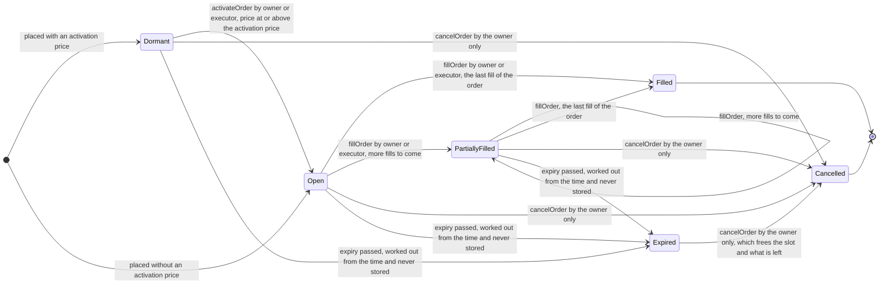

# Ledger Trigger contract specification

Ledger Trigger lets a user place orders that buy ETH with USDC once the price is right, while the money stays in the user's own wallet until then. There are four kinds of order: a plain limit order ("when ETH costs this much or less, spend this much USDC on it and send the ETH to this address"); a dormant limit order, which sleeps until the price first rises to an activation price and is then woken up; a `Dca` order (dollar-cost averaging), which buys a set amount once in every period for a number of periods; and a `Ladder` order, which buys tier by tier as the price falls. The orders live in one smart contract, `LedgerTrigger`. Placing an order moves no money. When the price feed reports a price at or below the price cap of the next fill, the owner of the order, or the executor the owner named in it, calls `fillOrder`; only then does the contract take that fill's USDC from the owner, swap it for ETH and send the ETH to the recipient. Each fill also gets the owner a receipt from a second contract, `FillReceipt`: an ERC-721 token that records the fill and can never be transferred. An off-chain program, the keeper, watches the price and makes the calls that wake up and fill orders; the contracts do not trust the keeper and check everything themselves.

This document describes what the two contracts guarantee and how. It follows six parts: roles and permissions, functions, data structures, security rules, state machine and test scenarios. Three appendices follow: the steps of a fill and of an activation, with the minimum ETH output; the parts around the contracts; and the design choices. Which test covers which scenario is listed in [test-matrix.md](test-matrix.md).

Names in `code font` are the names used in the contracts. Amounts are whole numbers in each token's smallest unit: USDC has 6 decimals (1 USDC is `1000000`), prices have the price feed's decimals (8 for an ETH / USD feed, so 1500 USD is `150000000000`), and ETH has 18 decimals (1 ETH is 10^18 wei). One USDC is taken to be worth one US dollar throughout. The periods of a `Dca` order and the tiers of a `Ladder` order are counted from 0.

## What the system guarantees

1. **Seven functions change state: four that place an order (`createOrder`, `createDormantOrder`, `createDcaOrder`, `createLadderOrder`), `activateOrder`, `fillOrder` and `cancelOrder`.** Placing and activating an order move no money. Only a fill takes USDC from the owner's wallet, swaps it for ETH and sends the ETH to the recipient, and each fill takes only its own share: all of a limit order, one period of a `Dca` order, the next tier of a `Ladder` order. The owner can cancel an order that is not finished at any time, whether it is dormant, open or partly filled, expired or not; what it has already bought is not given back.
2. **Three roles: owner, executor and recipient. There is no admin.** Only the owner and the executor named in an order can activate it or fill it; only the owner can cancel it. The receipt contract has no admin either. Nobody can pause either contract, upgrade it, change its settings or take money out of it.
3. **Every fill gives two hard guarantees: the price paid is never above this fill's price cap, and the ETH received is never less than the price feed's price gives, minus the allowed slippage.** This fill's price cap is the target price of a limit order, the price cap of every period of a `Dca` order, and the price of the tier being bought of a `Ladder` order. Both minimums are whole numbers rounded down, so each can fall short of the exact value by less than one wei, the smallest unit of ETH; that remainder is not counted (Appendix A).
4. **An order is stored in one of five states: `Dormant`, `Open`, `PartiallyFilled`, `Filled` or `Cancelled`. `Expired` is never stored; it is worked out from the time.** `Filled` and `Cancelled` are final.
5. **The contracts keep no money, and each receipt stands for one fill.** The USDC and ETH balances of both contracts are the same before and after every fill. That promise is about fills, not about what the balances hold: USDC that someone sends straight to a contract cannot be refused, because a token transfer does not ask the receiver, and it stays there for good, since nothing can take it out; the same goes for ETH forced in by a way that skips `receive`. Each receipt stands for exactly one fill, is issued to the owner of the order that was filled, and can never be transferred; nobody can be approved to transfer it either.

## 1. Roles and permissions

| Role                    | Who                                                                               | Can                                                                                                                                                                                                                                           | Cannot                                                                                                 |
| ----------------------- | --------------------------------------------------------------------------------- | --------------------------------------------------------------------------------------------------------------------------------------------------------------------------------------------------------------------------------------------- | ------------------------------------------------------------------------------------------------------ |
| Owner (`owner`)         | The account that places an order with one of the four functions that place orders | Place orders; activate, fill and cancel its own orders; receive one receipt for each fill of its orders                                                                                                                                       | Touch anyone else's orders; transfer a receipt, or approve anyone to                                   |
| Executor (`executor`)   | An address the owner names in each order, usually the keeper's account            | Activate and fill that one order                                                                                                                                                                                                              | Cancel it; touch orders that do not name it; change any setting                                        |
| Recipient (`recipient`) | An address the owner names in each order, usually a cold wallet                   | Receive the ETH of every fill of that order                                                                                                                                                                                                   | Call anything because it is the recipient: the role gives no rights                                    |
| Anyone                  | Any account                                                                       | Read: an order, its status, whether it can be filled or activated now, the schedule of a `Dca` order, the tiers of a `Ladder` order, an owner's open-order count and total, and the receipts. Place orders of its own, and so become an owner | Change anything about an order it does not own or execute; issue a receipt                             |
| Receipt issuer          | `LedgerTrigger`, the one address the receipt contract is bound to at deployment   | Issue receipts, one in every fill                                                                                                                                                                                                             | Move or take back a receipt once it is issued                                                          |
| Admin                   | **Does not exist**                                                                | -                                                                                                                                                                                                                                             | Neither contract has a pause, an upgrade, a function that changes a setting or a way to withdraw funds |

The executor is not an admin: each owner names it in each order, and it has rights over that order only. An owner may name itself as executor, and may name itself as recipient.

## 2. Functions

### `LedgerTrigger`

| Function                                                                                                                                                                                           | Who can call                           | What it does                                                                                                                                                                                                                                                                                                                                                                                                                                                                                                                                                                                                                  | Moves money |
| -------------------------------------------------------------------------------------------------------------------------------------------------------------------------------------------------- | -------------------------------------- | ----------------------------------------------------------------------------------------------------------------------------------------------------------------------------------------------------------------------------------------------------------------------------------------------------------------------------------------------------------------------------------------------------------------------------------------------------------------------------------------------------------------------------------------------------------------------------------------------------------------------------- | ----------- |
| `createOrder(usdcAmount, targetPrice, recipient, executor, expiry)`                                                                                                                                | Anyone; the caller becomes the owner   | Checks the input (security rules, 4) and stores an `Open` plain limit order: kind `Limit`, one fill for the whole amount. Returns its ID. Needs no USDC allowance yet                                                                                                                                                                                                                                                                                                                                                                                                                                                         | No          |
| `createDormantOrder(usdcAmount, targetPrice, activationPrice, recipient, executor, expiry)`                                                                                                        | Anyone; the caller becomes the owner   | Stores a `Dormant` limit order, whose `activationPrice` must be above its `targetPrice`. Once activated it is an `Open` order like one placed with `createOrder`. Returns its ID                                                                                                                                                                                                                                                                                                                                                                                                                                              | No          |
| `createDcaOrder(p)`, with `p` a `DcaOrderParams`                                                                                                                                                   | Anyone; the caller becomes the owner   | Stores a `Dca` order: from `p.startAt` on (0 stands for the block that places it), `p.usdcPerPeriod` can be spent once in each period of `p.periodLength` seconds, for `p.periodCount` periods, each time at no more than `p.targetPrice`. A period that passes without a fill is skipped for good. Its budget is the amount per period times the number of periods, and its expiry, worked out by the contract, is the last second of its last period. With `p.activationPrice` above zero it is placed `Dormant`; that price may be at, below or above the cap. Emits `OrderCreated`, then `OrderScheduled`. Returns its ID | No          |
| `createLadderOrder(p)`, with `p` a `LadderOrderParams`                                                                                                                                             | Anyone; the caller becomes the owner   | Stores a `Ladder` order: one tier or more, up to `maxTiersPerOrder`, each a price and an amount, the prices strictly falling. It is filled one tier at a time, in order. Its budget is the tiers' amounts added up, and its target price the price of tier 0. With `p.activationPrice` above zero, which must then be above the price of tier 0, it is placed `Dormant`. Emits `OrderCreated`, then `OrderTiered`. Returns its ID                                                                                                                                                                                             | No          |
| `activateOrder(orderId)`                                                                                                                                                                           | Only the order's owner or its executor | Turns a `Dormant` order into an `Open` one once the price feed reports a price at or above its activation price (Appendix A). Calls neither the USDC token nor the swap venue                                                                                                                                                                                                                                                                                                                                                                                                                                                 | No          |
| `fillOrder(orderId)`                                                                                                                                                                               | Only the order's owner or its executor | Runs the checks, then takes this fill's USDC from the owner, swaps it for ETH, sends all of that ETH to the recipient and has the receipt contract issue the owner one receipt (Appendix A). This fill's share is all of a limit order, the amount per period of a `Dca` order (at most once in each period) or the amount of the next tier of a `Ladder` order                                                                                                                                                                                                                                                               | Yes         |
| `cancelOrder(orderId)`                                                                                                                                                                             | Only the order's owner                 | Turns a `Dormant`, `Open` or `PartiallyFilled` order, expired or not, into `Cancelled`, frees its slot and takes what it had left to spend off the owner's open total. What it has already bought stays bought. Reads nothing outside the contract, so it works whatever the price feed, the swap venue or the keeper does                                                                                                                                                                                                                                                                                                    | No          |
| `getOrder(orderId)`                                                                                                                                                                                | Anyone, read only                      | Returns every field of the order. Its `status` is the stored one, so an expired order still shows `Dormant`, `Open` or `PartiallyFilled` here; `statusOf` gives the status worked out from the time                                                                                                                                                                                                                                                                                                                                                                                                                           | -           |
| `getSchedule(orderId)`                                                                                                                                                                             | Anyone, read only                      | Returns the schedule of a `Dca` order, whatever its status                                                                                                                                                                                                                                                                                                                                                                                                                                                                                                                                                                    | -           |
| `getTiers(orderId)`                                                                                                                                                                                | Anyone, read only                      | Returns all the tiers of a `Ladder` order as they were given, in the order they are filled, whatever its status. The order's `fillsDone` is the index of its next tier                                                                                                                                                                                                                                                                                                                                                                                                                                                        | -           |
| `statusOf(orderId)`                                                                                                                                                                                | Anyone, read only                      | Returns the status now, which is `Expired` for an order stored as `Dormant`, `Open` or `PartiallyFilled` whose expiry has passed                                                                                                                                                                                                                                                                                                                                                                                                                                                                                              | -           |
| `canFill(orderId)`, returns `fillable` and `reason`                                                                                                                                                | Anyone, read only                      | Returns whether the order can be filled now and, if not, the first reason why (a `FillBlocker`). It runs the same checks as `fillOrder`, apart from who the caller is, and does not try the swap or the receipt. The keeper asks it before it sends a fill                                                                                                                                                                                                                                                                                                                                                                    | -           |
| `canActivate(orderId)`, returns `activatable` and `reason`                                                                                                                                         | Anyone, read only                      | Returns whether the order can be activated now and, if not, the first reason why (an `ActivationBlocker`). It runs the same checks as `activateOrder`, apart from who the caller is. The keeper asks it before it sends an activation                                                                                                                                                                                                                                                                                                                                                                                         | -           |
| `openOrderCount(owner)`, `openOrderTotal(owner)`                                                                                                                                                   | Anyone, read only                      | How many orders of an address are `Dormant`, `Open` or `PartiallyFilled`, expired ones included, and the USDC those orders have left to spend (`usdcRemaining`), added up. The total is the USDC allowance the owner needs to give the contract to cover them                                                                                                                                                                                                                                                                                                                                                                 | -           |
| `receive()`                                                                                                                                                                                        | Only the swap venue gets through       | Accepts the ETH a swap pays during a fill. ETH from anyone else is rejected, so nobody can lose ETH by sending it here by mistake                                                                                                                                                                                                                                                                                                                                                                                                                                                                                             | -           |
| `usdc`, `priceFeed`, `swapVenue`, `maxOrderAmount`, `maxOpenOrdersPerOwner`, `maxPriceAge`, `maxSlippageBps`, `maxPeriodsPerOrder`, `maxTiersPerOrder`, `receipt`, `usdcDecimals`, `priceDecimals` | Anyone, read only; never reverts       | The ten deployment parameters, and the decimals of the token and of the price feed read at deployment                                                                                                                                                                                                                                                                                                                                                                                                                                                                                                                         | -           |
| `constructor(usdc, priceFeed, swapVenue, maxOrderAmount, maxOpenOrdersPerOwner, maxPriceAge, maxSlippageBps, maxPeriodsPerOrder, maxTiersPerOrder, receipt)`                                       | Whoever deploys the contract           | Checks and stores the ten parameters (security rules, 4), checks that the receipt contract is bound to this contract, and reads the two decimals. Nothing can change them later                                                                                                                                                                                                                                                                                                                                                                                                                                               | -           |

### `FillReceipt`

The receipt contract is built on OpenZeppelin's ERC-721 code (version 5), the standard for tokens of which each one is unique. Its receipts are named `Ledger Trigger Fill Receipt`, with the symbol `LTFR`. It implements `IFillReceipt`, the interface through which `LedgerTrigger` knows it.

| Function                                                                                                              | Who can call                                            | What it does                                                                                                                                                                                                                                                                                                           | Moves money |
| --------------------------------------------------------------------------------------------------------------------- | ------------------------------------------------------- | ---------------------------------------------------------------------------------------------------------------------------------------------------------------------------------------------------------------------------------------------------------------------------------------------------------------------- | ----------- |
| `constructor(trigger)`                                                                                                | Whoever deploys the contract                            | Stores the order contract that alone may issue receipts, as the immutable `trigger`. That contract does not have to exist yet: its own deployment checks the binding (Appendix B)                                                                                                                                      | -           |
| `mint(to, data)`                                                                                                      | Only `trigger`, that is `LedgerTrigger` (`onlyTrigger`) | Issues the next receipt to `to` and stores `data`, a `Receipt`. Receipt IDs start at 1 and go up by one across all orders. Emits OpenZeppelin's `Transfer` from the zero address, then `ReceiptIssued`. It does not call `to`, so issuing a receipt runs no code of the account that gets it. Returns the receipt's ID | No          |
| `receiptOf(tokenId)`                                                                                                  | Anyone, read only                                       | Returns what a receipt records                                                                                                                                                                                                                                                                                         | -           |
| `trigger()`                                                                                                           | Anyone, read only; never reverts                        | The order contract this receipt contract is bound to                                                                                                                                                                                                                                                                   | -           |
| `transferFrom(from, to, tokenId)`, `safeTransferFrom(from, to, tokenId)`, `safeTransferFrom(from, to, tokenId, data)` | Anyone may call; every call is refused                  | Nothing: a receipt never moves                                                                                                                                                                                                                                                                                         | -           |
| `approve(to, tokenId)`, `setApprovalForAll(operator, approved)`                                                       | Anyone may call; every call is refused                  | Nothing: nobody can be approved to move a receipt                                                                                                                                                                                                                                                                      | -           |
| `balanceOf`, `ownerOf`, `getApproved`, `isApprovedForAll`, `tokenURI`, `name`, `symbol`, `supportsInterface`          | Anyone, read only                                       | OpenZeppelin's own ERC-721 read functions. As no approval can be made, `getApproved` always returns the zero address and `isApprovedForAll` false; `tokenURI` returns an empty string for a receipt that exists                                                                                                        | -           |

### When each function rejects

Every check the contracts themselves make rejects with a named error, listed here in the order the function checks. An error raised by the price feed, the USDC token, the swap venue or the receipt contract is passed on as it is, so it may have another name or none (see "Errors" in part 3). A rejected call changes nothing.

| Function                                         | Rejects with, in this order                                                                                                                                                                                                                                                                                                                                                                                                                                                                                                                                                                                                                                                                                                                                                                                                                                                                                                                                                                                                                                                                                                                                                                                                                                                                                                                                                                                                                      |
| ------------------------------------------------ | ------------------------------------------------------------------------------------------------------------------------------------------------------------------------------------------------------------------------------------------------------------------------------------------------------------------------------------------------------------------------------------------------------------------------------------------------------------------------------------------------------------------------------------------------------------------------------------------------------------------------------------------------------------------------------------------------------------------------------------------------------------------------------------------------------------------------------------------------------------------------------------------------------------------------------------------------------------------------------------------------------------------------------------------------------------------------------------------------------------------------------------------------------------------------------------------------------------------------------------------------------------------------------------------------------------------------------------------------------------------------------------------------------------------------------------------------ |
| `createOrder`                                    | `ZeroAmount`; `AmountAboveMax(amount, max)`; `ZeroTargetPrice`; `ZeroRecipient`; `ZeroExecutor`; `ExpiryNotInFuture(expiry, currentTime)` when the expiry is not after the current block's time; `TooManyOpenOrders(owner, max)` when the caller already has `maxOpenOrdersPerOwner` orders that are `Dormant`, `Open` or `PartiallyFilled`, expired ones included                                                                                                                                                                                                                                                                                                                                                                                                                                                                                                                                                                                                                                                                                                                                                                                                                                                                                                                                                                                                                                                                               |
| `createDormantOrder`                             | `ZeroAmount`; `AmountAboveMax(amount, max)`; `ZeroTargetPrice`; `ActivationNotAboveTarget(activationPrice, targetPrice)` when the activation price is not above the target price; `ZeroRecipient`; `ZeroExecutor`; `ExpiryNotInFuture(expiry, currentTime)`; `TooManyOpenOrders(owner, max)`                                                                                                                                                                                                                                                                                                                                                                                                                                                                                                                                                                                                                                                                                                                                                                                                                                                                                                                                                                                                                                                                                                                                                     |
| `createDcaOrder`                                 | `ZeroAmount` and `AmountAboveMax(amount, max)` for the amount per period (the budget may be above `maxOrderAmount`); `ZeroTargetPrice` for the price cap; `ZeroPeriodLength`; `ZeroPeriodCount`; `TooManyPeriods(periodCount, maxPeriods)`; `StartInPast(startAt, currentTime)` when the start is not zero and is before the current block's time; `ZeroRecipient`; `ZeroExecutor`; `ExpiryNotInFuture(expiry, currentTime)` for the expiry worked out from the schedule, which only a single period of one second starting in the current block can cause; `TooManyOpenOrders(owner, max)`. Inputs whose product does not fit in 256 bits (the number of periods times their length, or times the amount per period) make the call revert with a panic                                                                                                                                                                                                                                                                                                                                                                                                                                                                                                                                                                                                                                                                                          |
| `createLadderOrder`                              | `NoTiers`; `TooManyTiers(tierCount, maxTiers)`; then tier by tier from tier 0, each tier checked in full before the next: `ZeroAmount`, `AmountAboveMax(amount, max)`, `ZeroTargetPrice` for a zero tier price and, from tier 1 on, `TiersNotDescending(tierIndex)` for a price not strictly below the tier before; then `ActivationNotAboveTarget(activationPrice, targetPrice)` when an activation price above zero is not above the price of tier 0; `ZeroRecipient`; `ZeroExecutor`; `ExpiryNotInFuture(expiry, currentTime)`; `TooManyOpenOrders(owner, max)`                                                                                                                                                                                                                                                                                                                                                                                                                                                                                                                                                                                                                                                                                                                                                                                                                                                                               |
| `activateOrder`                                  | `OrderNotFound(orderId)`; `NotOrderOwnerOrExecutor(orderId, caller)`; `OrderNotDormant(orderId, status)` when the stored status is not `Dormant`; `OrderExpired(orderId, expiry)`; `InvalidPrice(price)` when the feed's price is zero or below or its update time is after the current block's time; `StalePrice(updatedAt, maxPriceAge)`; `PriceBelowActivation(price, activationPrice)`. An error raised by the price feed itself rejects it too                                                                                                                                                                                                                                                                                                                                                                                                                                                                                                                                                                                                                                                                                                                                                                                                                                                                                                                                                                                              |
| `fillOrder`                                      | `ReentrancyGuardReentrantCall` for a call made while a fill is running; `OrderNotFound(orderId)`; `NotOrderOwnerOrExecutor(orderId, caller)`; `OrderNotOpen(orderId, status)` when the stored status is not `Open` or `PartiallyFilled`, which names `Dormant` for an order not activated yet; `OrderExpired(orderId, expiry)`; for a `Dca` order, `NotStarted(orderId, startAt)` before its period 0 begins and `PeriodAlreadyFilled(orderId, periodIndex)` when its current period has been bought; `InvalidPrice(price)`; `StalePrice(updatedAt, maxPriceAge)`; `PriceAboveTarget(price, targetPrice)`, where `targetPrice` is this fill's price cap; `InsufficientAllowance(allowance, needed)` and `InsufficientBalance(balance, needed)`, where `needed` is this fill's amount. Then, while the money moves: `SafeERC20FailedOperation(token)`, raised by OpenZeppelin's code in the contract, when a USDC transfer returns something other than true, such as false, instead of reverting, or an approval of the swap venue returns false when tried again (steps 7 to 9 of Appendix A; see "Errors" in part 3); `SwapUsdcMismatch(expectedBalance, actualBalance)` when the swap venue did not take exactly this fill's amount; `InsufficientEthOut(received, minEthOut)`; `EthTransferFailed(recipient, amount)`. An error raised by the price feed, the USDC token, the swap venue or the receipt contract itself rejects the fill too |
| `cancelOrder`                                    | `OrderNotFound(orderId)`; `NotOrderOwner(orderId, caller)`; `OrderNotOpen(orderId, status)` when the order is already `Filled` or `Cancelled`                                                                                                                                                                                                                                                                                                                                                                                                                                                                                                                                                                                                                                                                                                                                                                                                                                                                                                                                                                                                                                                                                                                                                                                                                                                                                                    |
| `getSchedule`                                    | `OrderNotFound(orderId)`, ID 0 included; `NotADcaOrder(orderId)` for an order of another kind                                                                                                                                                                                                                                                                                                                                                                                                                                                                                                                                                                                                                                                                                                                                                                                                                                                                                                                                                                                                                                                                                                                                                                                                                                                                                                                                                    |
| `getTiers`                                       | `OrderNotFound(orderId)`, ID 0 included; `NotALadderOrder(orderId)` for an order of another kind                                                                                                                                                                                                                                                                                                                                                                                                                                                                                                                                                                                                                                                                                                                                                                                                                                                                                                                                                                                                                                                                                                                                                                                                                                                                                                                                                 |
| `getOrder`, `statusOf`, `canFill`, `canActivate` | `OrderNotFound(orderId)` for an ID that no order has, ID 0 included. `canFill` also reverts when the price feed or the USDC token reverts as it reads them, and `canActivate` when the price feed does                                                                                                                                                                                                                                                                                                                                                                                                                                                                                                                                                                                                                                                                                                                                                                                                                                                                                                                                                                                                                                                                                                                                                                                                                                           |
| `openOrderCount`, `openOrderTotal`, getters      | Never; an address with no orders gets zero                                                                                                                                                                                                                                                                                                                                                                                                                                                                                                                                                                                                                                                                                                                                                                                                                                                                                                                                                                                                                                                                                                                                                                                                                                                                                                                                                                                                       |
| `receive`                                        | `UnexpectedEthSender(sender)` for ETH from anyone but the swap venue                                                                                                                                                                                                                                                                                                                                                                                                                                                                                                                                                                                                                                                                                                                                                                                                                                                                                                                                                                                                                                                                                                                                                                                                                                                                                                                                                                             |
| `constructor` of `LedgerTrigger`                 | `ZeroUsdc`; `ZeroPriceFeed`; `ZeroSwapVenue`; `ZeroMaxOrderAmount`; `ZeroMaxOpenOrdersPerOwner`; `ZeroMaxPriceAge`; `SlippageTooHigh(maxSlippageBps)` when the slippage is 100 % or more; `ZeroMaxPeriodsPerOrder`; `ZeroMaxTiersPerOrder`; `ZeroReceipt`; `ReceiptNotBound(receipt, boundTo)` when the receipt contract's `trigger` is not this contract. A receipt address with no code, or a contract with no `trigger` function, makes it revert with no error data. It also reverts when the token or the price feed does not report its decimals                                                                                                                                                                                                                                                                                                                                                                                                                                                                                                                                                                                                                                                                                                                                                                                                                                                                                           |
| `constructor` of `FillReceipt`                   | `ZeroTrigger` for the zero address                                                                                                                                                                                                                                                                                                                                                                                                                                                                                                                                                                                                                                                                                                                                                                                                                                                                                                                                                                                                                                                                                                                                                                                                                                                                                                                                                                                                               |
| `mint`                                           | `NotTrigger(caller)` for any caller but `trigger`                                                                                                                                                                                                                                                                                                                                                                                                                                                                                                                                                                                                                                                                                                                                                                                                                                                                                                                                                                                                                                                                                                                                                                                                                                                                                                                                                                                                |
| `receiptOf`                                      | `ERC721NonexistentToken(tokenId)`, from OpenZeppelin, for an ID that no receipt has, ID 0 included                                                                                                                                                                                                                                                                                                                                                                                                                                                                                                                                                                                                                                                                                                                                                                                                                                                                                                                                                                                                                                                                                                                                                                                                                                                                                                                                               |
| `transferFrom`, both `safeTransferFrom`          | `ERC721InvalidReceiver(receiver)`, from OpenZeppelin, for a transfer to the zero address; then `ReceiptNotTransferable(tokenId)` for any receipt that exists; `ERC721NonexistentToken(tokenId)`, from OpenZeppelin, for an ID that no receipt has                                                                                                                                                                                                                                                                                                                                                                                                                                                                                                                                                                                                                                                                                                                                                                                                                                                                                                                                                                                                                                                                                                                                                                                                |
| `approve`                                        | `ReceiptNotTransferable(tokenId)` for the receipt named, whatever the input, before any other check                                                                                                                                                                                                                                                                                                                                                                                                                                                                                                                                                                                                                                                                                                                                                                                                                                                                                                                                                                                                                                                                                                                                                                                                                                                                                                                                              |
| `setApprovalForAll`                              | `ReceiptNotTransferable(0)` whatever the input, before any other check: it names no single receipt, and 0 is never a receipt                                                                                                                                                                                                                                                                                                                                                                                                                                                                                                                                                                                                                                                                                                                                                                                                                                                                                                                                                                                                                                                                                                                                                                                                                                                                                                                     |
| The read functions of `FillReceipt`              | `balanceOf` rejects the zero address (`ERC721InvalidOwner`); `ownerOf`, `getApproved` and `tokenURI` reject an ID that no receipt has (`ERC721NonexistentToken`); `isApprovedForAll`, `name`, `symbol`, `supportsInterface` and `trigger` never revert                                                                                                                                                                                                                                                                                                                                                                                                                                                                                                                                                                                                                                                                                                                                                                                                                                                                                                                                                                                                                                                                                                                                                                                           |

The interface of `FillReceipt` also lists five more OpenZeppelin errors that no call to it can reach, because transfers and approvals are refused before OpenZeppelin's own checks run: `ERC721IncorrectOwner`, `ERC721InsufficientApproval`, `ERC721InvalidApprover`, `ERC721InvalidOperator` and `ERC721InvalidSender`.

A price exactly `maxPriceAge` seconds old still counts, a price equal to this fill's price cap can fill, a price equal to the activation price can activate, and an order can still be filled or activated in the very second of its expiry.

## 3. Data structures

`LedgerTrigger` stores the orders, which are never deleted; for each owner, the count and the USDC total of its unfinished orders; the schedule of each `Dca` order; the tiers of each `Ladder` order; a private counter of order IDs; and ten settings and two decimals that never change. OpenZeppelin's reentrancy guard keeps one flag besides. `FillReceipt` stores what each receipt records and a private counter of receipt IDs; OpenZeppelin's ERC-721 code keeps who holds each receipt, how many receipts each account holds, and the receipts' name and symbol. Its two tables of approvals always stay empty, since every approval is refused.

### Deployment parameters

Ten values are given to `LedgerTrigger` at deployment and stored as immutables: nothing can change them afterwards. The contract itself has no defaults: it accepts any values that pass its checks (security rules, 4), as long as the token and the price feed report their decimals; if either cannot, the deployment reverts (see the constructor under "When each function rejects" in part 2). The last column shows what the deployment scripts in this repository use (see the README). With those scripts, the six limits have defaults that an environment variable can change; on a test network, `usdc` and `priceFeed` are addresses that must be given; and `swapVenue` is always a new `MockSwapVenue`, and `receipt` a new `FillReceipt`, that the script deploys.

| Name                    | Meaning                                                                                                                                                                                                               | With the deployment scripts                                                                                                                                                                                |
| ----------------------- | --------------------------------------------------------------------------------------------------------------------------------------------------------------------------------------------------------------------- | ---------------------------------------------------------------------------------------------------------------------------------------------------------------------------------------------------------- |
| `usdc`                  | The USDC token that orders spend                                                                                                                                                                                      | Locally, a new `MockUSDC` that the script deploys; on the Sepolia test network, an address that must be given: Circle's official test USDC                                                                 |
| `priceFeed`             | The price feed for ETH in USD                                                                                                                                                                                         | Locally, a new `MockPriceFeed`; on Sepolia, an address that must be given: Chainlink's ETH / USD feed                                                                                                      |
| `swapVenue`             | The swap venue that turns USDC into ETH                                                                                                                                                                               | Always a new `MockSwapVenue` that the script deploys, on Sepolia as well: real swap venues on that test network quote ETH at prices more than ten times away from the market price, so they cannot be used |
| `maxOrderAmount`        | The largest amount of one fill: the whole amount of a limit order, the amount per period of a `Dca` order, the amount of each tier of a `Ladder` order. The whole budget of a `Dca` or `Ladder` order may be above it | 500 USDC by default                                                                                                                                                                                        |
| `maxOpenOrdersPerOwner` | How many unfinished orders, that is `Dormant`, `Open` or `PartiallyFilled` ones, expired or not, one owner may have at the same time                                                                                  | 5 by default                                                                                                                                                                                               |
| `maxPriceAge`           | How old, in seconds, a price may be and still count                                                                                                                                                                   | 4500 seconds (75 minutes) by default: the Sepolia ETH / USD feed updates at least once an hour, and the extra 15 minutes keep a price from being refused just before its hourly update                     |
| `maxSlippageBps`        | The allowed slippage, in basis points (100 basis points = 1 %)                                                                                                                                                        | 100, that is 1 %, by default                                                                                                                                                                               |
| `maxPeriodsPerOrder`    | The largest number of periods of one `Dca` order                                                                                                                                                                      | 52 by default                                                                                                                                                                                              |
| `maxTiersPerOrder`      | The largest number of tiers of one `Ladder` order                                                                                                                                                                     | 5 by default                                                                                                                                                                                               |
| `receipt`               | The receipt contract, which must be bound to this `LedgerTrigger`                                                                                                                                                     | Always a new `FillReceipt` that the script deploys right before `LedgerTrigger`, bound to the address `LedgerTrigger` is about to get (Appendix B)                                                         |

At deployment the contract also reads the decimals of the token and of the price feed and stores them as `usdcDecimals` and `priceDecimals`, so no decimals are written into the code.

### Structs

`Order`, one order, stored in `LedgerTrigger`:

| Field             | Meaning                                                                                                                                                                                                                                                                                                                                 |
| ----------------- | --------------------------------------------------------------------------------------------------------------------------------------------------------------------------------------------------------------------------------------------------------------------------------------------------------------------------------------- |
| `owner`           | The account that placed the order                                                                                                                                                                                                                                                                                                       |
| `executor`        | The one address besides the owner that may activate and fill it                                                                                                                                                                                                                                                                         |
| `recipient`       | Where the ETH of every fill goes                                                                                                                                                                                                                                                                                                        |
| `kind`            | The kind of order (an `OrderKind`): `Limit`, `Dca` or `Ladder`                                                                                                                                                                                                                                                                          |
| `status`          | The stored status (an `OrderStatus`); never `Expired`                                                                                                                                                                                                                                                                                   |
| `usdcAmount`      | The USDC budget of the whole order, in its smallest unit: the amount of a limit order; the amount per period times the number of periods of a `Dca` order; the amounts of the tiers added up of a `Ladder` order                                                                                                                        |
| `usdcRemaining`   | The part of the budget not spent yet: `usdcAmount` when the order is placed, less the amount of each fill. A cancel leaves it as it was                                                                                                                                                                                                 |
| `targetPrice`     | The highest ETH price in USD at which a fill may go ahead, written like the feed's price (8 decimals for 1500 USD: `150000000000`): the target price of a limit order; the price cap of every period of a `Dca` order; for a `Ladder` order, the price of tier 0, the highest, while each fill is held to the price of the tier it buys |
| `activationPrice` | Zero for an order placed `Open`; otherwise the order was placed `Dormant` and can be activated once the price is at or above it. It keeps its value after the activation                                                                                                                                                                |
| `fillsTotal`      | How many fills the order takes in all: 1 for a limit order, the number of periods of a `Dca` order, the number of tiers of a `Ladder` order                                                                                                                                                                                             |
| `fillsDone`       | How many fills it has had. For a `Ladder` order, it is also the index of the next tier                                                                                                                                                                                                                                                  |
| `createdAt`       | The time of the block that placed the order                                                                                                                                                                                                                                                                                             |
| `expiry`          | The last second, in Unix time, at which the order is valid; one second later it has expired. For a `Dca` order the contract works it out: the last second of its last period                                                                                                                                                            |

After an order is placed, only its `status`, `usdcRemaining` and `fillsDone` ever change; its owner, executor and recipient, like every other field, stay as they were.

The other structs:

- `OpenOrders`, for one owner: `count`, the number of its unfinished orders, and `total`, the `usdcRemaining` of those orders added up.
- `DcaSchedule`, the schedule of a `Dca` order: `startAt`, the time at which period 0 begins; `periodLength`, in seconds; `usdcPerPeriod`, what one fill spends; and `filledThrough`, the first period that may still be bought: 0 at first, and p + 1 once period p has been bought, so a period that was skipped can never be bought later. Period p runs from `startAt + p * periodLength` to `startAt + (p + 1) * periodLength - 1`, and the current period is `(now - startAt) / periodLength`, rounded down. The number of periods is the order's `fillsTotal`.
- `Tier`, one tier of a `Ladder` order: `price`, the most this tier's fill may pay, and `usdcAmount`, what it spends.
- `DcaOrderParams`, the inputs of `createDcaOrder`: `usdcPerPeriod`, `targetPrice` (the price cap of every period), `periodLength` (seconds), `periodCount`, `startAt` (a Unix time, or 0 for the time of the block that places the order), `activationPrice` (0 for none), `recipient` and `executor`.
- `LadderOrderParams`, the inputs of `createLadderOrder`: `tiers` (in the order they are filled, tier 0 first, at strictly falling prices), `activationPrice` (0 for none; otherwise above the price of tier 0), `recipient`, `executor` and `expiry`. Both kinds of input are passed as structs because so many separate inputs would run into Solidity's limit on local variables.
- `FillCheck` and `ActivationCheck`, used inside the contract only: what the fill checks, or the activation checks, found for one order (the first reason it cannot go ahead, and the values read on the way, such as this fill's amount and price cap), so that `canFill` and `fillOrder` run one and the same set of checks, and so do `canActivate` and `activateOrder`.
- `Receipt`, declared in the interface `IFillReceipt` and stored in `FillReceipt`, what one receipt records: `orderId`, the order that was filled; `fillNumber`, which fill of that order it was, counted from 1; `usdcIn`, the USDC the fill spent; `ethOut`, the ETH it bought, in wei, all of it sent to the order's recipient; `price`, the feed's price the fill used; and `filledAt`, the time of the block in which it happened.

### Mappings and counters

In `LedgerTrigger`, all private, each read through the functions named:

- `orders`: order ID to `Order`. IDs start at 1 and go up by one across all kinds of order; an ID is never used twice, and an order is never deleted. Read it with `getOrder`.
- `openOrdersOf`: owner address to `OpenOrders`. An order counts there while its stored status is `Dormant`, `Open` or `PartiallyFilled`, expired or not. Read it with `openOrderCount` and `openOrderTotal`.
- `schedules`: order ID to `DcaSchedule`, for `Dca` orders only. Read it with `getSchedule`.
- `tiersOf`: order ID to its array of `Tier`, for `Ladder` orders only, stored as given and never changed. Read it with `getTiers`.
- `lastOrderId`, a counter: the ID of the newest order, or 0 before the first. Each new order gets the next number.

Three private constants complete the contract's own values: `BPS` (10000 basis points in 100 %), `MAX_SLIPPAGE_BPS` (9999, the largest slippage accepted at deployment) and `ETH_DECIMALS` (18).

In `FillReceipt`:

- `receipts` (private): receipt ID to `Receipt`. Read it with `receiptOf`.
- `lastTokenId` (private), a counter: the ID of the last receipt issued, or 0 before the first.
- OpenZeppelin's ERC-721 code keeps its own tables: who holds each receipt (read with `ownerOf`) and how many receipts each account holds (read with `balanceOf`). Its tables of approvals stay empty.

### Enums

The members of each enum, and their order, are fixed. In the contracts' interface each member is a number (`uint8`), counted from 0 in the order listed here.

`OrderKind`, what kind of order it is:

| Value    | Meaning                                                                                                                 |
| -------- | ----------------------------------------------------------------------------------------------------------------------- |
| `Limit`  | One fill for the whole amount, at no more than the target price. `createOrder` and `createDormantOrder` place this kind |
| `Dca`    | A set amount bought once in each period, over a number of periods. `createDcaOrder` places it                           |
| `Ladder` | Amounts bought one tier at a time, at falling prices. `createLadderOrder` places it                                     |

`OrderStatus`, where an order stands:

| Value             | Meaning                                                                                                                   |
| ----------------- | ------------------------------------------------------------------------------------------------------------------------- |
| `None`            | No order has this ID. Never returned: the read functions reject such an ID instead                                        |
| `Dormant`         | Placed with an activation price and not activated yet. It cannot be filled                                                |
| `Open`            | Can be filled, and has had no fill yet                                                                                    |
| `PartiallyFilled` | Has had some of its fills, not all of them. It can be filled again                                                        |
| `Filled`          | Has had all its fills. Final                                                                                              |
| `Cancelled`       | Cancelled by its owner. Final                                                                                             |
| `Expired`         | Never stored. `statusOf` returns it for an order stored as `Dormant`, `Open` or `PartiallyFilled` whose expiry has passed |

`FillBlocker`, why an order cannot be filled right now, as `canFill` reports it. When several apply, the first in this list is reported.

| Value                   | Meaning                                                                                                        |
| ----------------------- | -------------------------------------------------------------------------------------------------------------- |
| `None`                  | Nothing stops the fill                                                                                         |
| `NotOpen`               | The order is `Filled` or `Cancelled`                                                                           |
| `Dormant`               | The order has not been activated                                                                               |
| `Expired`               | Its expiry has passed                                                                                          |
| `NotStarted`            | A `Dca` order whose period 0 has not begun                                                                     |
| `PeriodAlreadyFilled`   | A `Dca` order whose current period has been bought already                                                     |
| `InvalidPrice`          | The feed's price is zero or below, or its update time is after the current block's time                        |
| `StalePrice`            | The price is older than `maxPriceAge`                                                                          |
| `PriceAboveTarget`      | The price is above this fill's price cap: the target price, or for a `Ladder` order the price of its next tier |
| `InsufficientAllowance` | The owner's USDC allowance to the contract is below the amount of this fill                                    |
| `InsufficientBalance`   | The owner's USDC balance is below the amount of this fill                                                      |

`ActivationBlocker`, why an order cannot be activated right now, as `canActivate` reports it. When several apply, the first in this list is reported.

| Value                  | Meaning                                                                                 |
| ---------------------- | --------------------------------------------------------------------------------------- |
| `None`                 | Nothing stops the activation                                                            |
| `NotDormant`           | The order's stored status is not `Dormant`                                              |
| `Expired`              | Its expiry has passed                                                                   |
| `InvalidPrice`         | The feed's price is zero or below, or its update time is after the current block's time |
| `StalePrice`           | The price is older than `maxPriceAge`                                                   |
| `PriceBelowActivation` | The price is below the order's activation price                                         |

### Events

One event for each change of state, kept on the chain for good. `LedgerTrigger` emits these:

| Event            | Fields                                                                                                                                                                                                                                                               | Indexed                                                                                                             | When                                                               |
| ---------------- | -------------------------------------------------------------------------------------------------------------------------------------------------------------------------------------------------------------------------------------------------------------------- | ------------------------------------------------------------------------------------------------------------------- | ------------------------------------------------------------------ |
| `OrderCreated`   | `orderId`, `owner`, `executor`, `recipient`, `usdcAmount` (the whole budget), `targetPrice`, `expiry`, `kind`, `activationPrice`                                                                                                                                     | `orderId`, `owner`, `executor`                                                                                      | An order is placed, by any of the four functions that place orders |
| `OrderScheduled` | `orderId`, `startAt` (as stored: the block's time when 0 was given), `periodLength`, `periodCount`, `usdcPerPeriod`                                                                                                                                                  | `orderId`, `startAt`, `periodLength`                                                                                | Right after the `OrderCreated` of a `Dca` order                    |
| `OrderTiered`    | `orderId`, `tiers` (all of them, as given)                                                                                                                                                                                                                           | `orderId` only: an indexed array of structs would be logged as its hash alone, and the tiers could not be read back | Right after the `OrderCreated` of a `Ladder` order                 |
| `OrderActivated` | `orderId`, `activatedBy` (the owner or the executor), `price` (the feed's price at the activation)                                                                                                                                                                   | all three                                                                                                           | A dormant order is activated                                       |
| `OrderFilled`    | `orderId`, `owner`, `filledBy` (the owner or the executor), `recipient`, `usdcAmount` (what this fill spent), `ethReceived` (the ETH the recipient got, in wei), `price` (the feed price used), `fillNumber` (which fill of the order this is, from 1), `fillsTotal` | `orderId`, `owner`, `filledBy`                                                                                      | Each fill                                                          |
| `OrderCancelled` | `orderId`, `owner`, `afterExpiry` (whether the order had already expired)                                                                                                                                                                                            | all three                                                                                                           | An order is cancelled                                              |

`FillReceipt` emits `ReceiptIssued(tokenId, orderId, owner)`, all three indexed, once for each receipt, right after OpenZeppelin's `Transfer(from, to, tokenId)` from the zero address, which marks the receipt's issue; no other `Transfer` can happen. `Approval` and `ApprovalForAll` are in its interface from OpenZeppelin but are never emitted, since every approval is refused.

The contract keeps no list of the orders that name an executor: the keeper finds its orders by searching `OrderCreated` for its own address as executor.

### Modifiers

| Modifier                        | Lets through                                                           | Rejects with                                                                     | Used by                                                                                                                  |
| ------------------------------- | ---------------------------------------------------------------------- | -------------------------------------------------------------------------------- | ------------------------------------------------------------------------------------------------------------------------ |
| `orderExists`                   | An ID that an order has                                                | `OrderNotFound`                                                                  | `activateOrder`, `fillOrder`, `cancelOrder`, `getOrder`, `getSchedule`, `getTiers`, `statusOf`, `canFill`, `canActivate` |
| `onlyOrderOwner`                | The order's owner                                                      | `NotOrderOwner`                                                                  | `cancelOrder`                                                                                                            |
| `onlyOrderOwnerOrExecutor`      | The order's owner and its executor                                     | `NotOrderOwnerOrExecutor`                                                        | `activateOrder`, `fillOrder`                                                                                             |
| `onlyOpen`                      | An order whose stored status is `Open` or `PartiallyFilled`            | `OrderNotOpen`, with the stored status: `Dormant` for an order not activated yet | `fillOrder`                                                                                                              |
| `onlyUnfinished`                | An order whose stored status is `Dormant`, `Open` or `PartiallyFilled` | `OrderNotOpen`, with the stored status                                           | `cancelOrder`                                                                                                            |
| `onlyDormant`                   | An order whose stored status is `Dormant`                              | `OrderNotDormant`, with the stored status                                        | `activateOrder`                                                                                                          |
| `onlyTrigger`, in `FillReceipt` | The order contract the receipt contract is bound to                    | `NotTrigger`                                                                     | `mint`                                                                                                                   |

An expired order keeps its stored status, so it gets past `onlyOpen`, `onlyUnfinished` and `onlyDormant`; a fill and an activation check the expiry right after. `fillOrder` also carries OpenZeppelin's reentrancy guard (`nonReentrant`), placed first, before these modifiers.

### Errors

Every reason the contracts themselves have to reject a call has its own named error, never a sentence in a string, so the tests, the keeper, the scripts and the web page can tell the reasons apart. Many errors carry the values that caused them: `PriceAboveTarget` the price and this fill's price cap, `InsufficientAllowance` the allowance there is and the allowance needed. The table under "When each function rejects" says which function raises which.

| Group                                   | Errors, with the values they carry                                                                                                                                                                                                                                                                                                                    |
| --------------------------------------- | ----------------------------------------------------------------------------------------------------------------------------------------------------------------------------------------------------------------------------------------------------------------------------------------------------------------------------------------------------- |
| Placing an order                        | `ZeroAmount()`, `AmountAboveMax(amount, max)`, `ZeroTargetPrice()`, `ActivationNotAboveTarget(activationPrice, targetPrice)`, `ZeroRecipient()`, `ZeroExecutor()`, `ExpiryNotInFuture(expiry, currentTime)`, `TooManyOpenOrders(owner, max)`                                                                                                          |
| Placing a `Dca` order                   | `ZeroPeriodLength()`, `ZeroPeriodCount()`, `TooManyPeriods(periodCount, maxPeriods)`, `StartInPast(startAt, currentTime)`                                                                                                                                                                                                                             |
| Placing a `Ladder` order                | `NoTiers()`, `TooManyTiers(tierCount, maxTiers)`, `TiersNotDescending(tierIndex)`                                                                                                                                                                                                                                                                     |
| Which order, which caller, which status | `OrderNotFound(orderId)`, `NotOrderOwner(orderId, caller)`, `NotOrderOwnerOrExecutor(orderId, caller)`, `OrderNotOpen(orderId, status)`, `OrderNotDormant(orderId, status)`                                                                                                                                                                           |
| The fill and activation checks          | `OrderExpired(orderId, expiry)`, `NotStarted(orderId, startAt)`, `PeriodAlreadyFilled(orderId, periodIndex)`, `InvalidPrice(price)`, `StalePrice(updatedAt, maxPriceAge)`, `PriceAboveTarget(price, targetPrice)`, `PriceBelowActivation(price, activationPrice)`, `InsufficientAllowance(allowance, needed)`, `InsufficientBalance(balance, needed)` |
| While the money moves                   | `SwapUsdcMismatch(expectedBalance, actualBalance)`, `InsufficientEthOut(received, minEthOut)`, `EthTransferFailed(recipient, amount)`                                                                                                                                                                                                                 |
| Reading a schedule or tiers             | `NotADcaOrder(orderId)`, `NotALadderOrder(orderId)`                                                                                                                                                                                                                                                                                                   |
| ETH sent to the contract                | `UnexpectedEthSender(sender)`                                                                                                                                                                                                                                                                                                                         |
| Deployment of `LedgerTrigger`           | `ZeroUsdc()`, `ZeroPriceFeed()`, `ZeroSwapVenue()`, `ZeroMaxOrderAmount()`, `ZeroMaxOpenOrdersPerOwner()`, `ZeroMaxPriceAge()`, `SlippageTooHigh(maxSlippageBps)`, `ZeroMaxPeriodsPerOrder()`, `ZeroMaxTiersPerOrder()`, `ZeroReceipt()`, `ReceiptNotBound(receipt, boundTo)`                                                                         |
| From OpenZeppelin, in `LedgerTrigger`   | `ReentrancyGuardReentrantCall()`, for a call to `fillOrder` made while a fill is running; `SafeERC20FailedOperation(token)`, when a USDC transfer returns something other than true, such as false, instead of reverting, or an approval of the swap venue returns false when tried again                                                             |
| `FillReceipt`                           | `ZeroTrigger()`, `NotTrigger(caller)`, `ReceiptNotTransferable(tokenId)`                                                                                                                                                                                                                                                                              |
| From OpenZeppelin, in `FillReceipt`     | `ERC721NonexistentToken(tokenId)`, `ERC721InvalidReceiver(receiver)`, `ERC721InvalidOwner(owner)`; and five that no call can reach (see "When each function rejects")                                                                                                                                                                                 |

A USDC call that reverts is not turned into `SafeERC20FailedOperation`: the fill reverts with that call's own revert data, unchanged even when it is empty. (The approvals of the swap venue are the one difference: if one reverts or returns false, OpenZeppelin's `forceApprove` tries again, setting the allowance to zero and then to the wanted amount, and a revert in those two calls is passed on.)

## 4. Security rules

The rules fall into six groups.

**1. Access control**

- Only the owner can cancel an order. The executor cannot either.
- Only the owner or the order's executor can activate it or fill it.
- Only `LedgerTrigger`, the order contract the receipt contract is bound to, can issue receipts. Nobody can transfer a receipt, or approve anyone to.
- Neither contract has an admin, a pause, an upgrade or a function that changes a parameter. All deployment parameters are immutable.

**2. State transitions**

- Only a `Dormant` order can become `Open`, and only through `activateOrder`. An order that has had a fill can never be activated, and no order becomes dormant again.
- An `Open` or `PartiallyFilled` order leaves its state only through a fill or a cancel. Only the fill that brings `fillsDone` up to `fillsTotal` makes it `Filled`; an earlier fill makes it `PartiallyFilled`.
- `Filled` and `Cancelled` are final: an order never leaves them, and never goes from one to the other.
- An order whose expiry has passed, whether dormant, open or partly filled, can no longer be activated or filled. The only thing still possible is for its owner to cancel it.
- Order IDs are never reused, and a cancelled order never comes back.

**3. Payment safety**

- A fill always runs in this order: check; then record the fill (the fill count, what the order has left, its status, the owner's open-order count and total, and for a `Dca` order the next period it may buy); and only then move money: take the USDC, swap it, send the ETH and issue the receipt. A reentrancy guard comes on top.
- A fill takes USDC only from the order's owner, and only this fill's share, never more than the order has left: all of a limit order, once; the amount per period of a `Dca` order, never twice in one period; the amount of the next tier of a `Ladder` order, one tier at a time and in order.
- The swap venue's and the receipt contract's addresses are fixed at deployment. `fillOrder` takes no address and no instruction from its caller.
- If the swap brings in less ETH than the minimum output, the whole fill is rejected (Appendix A).
- After the swap, the swap venue's allowance is set back to zero.
- If the swap venue does not take exactly this fill's amount, the ETH cannot be sent to the recipient, or the receipt cannot be issued, the whole fill is rejected: the order keeps the status it had and the owner's USDC does not move.
- Placing, activating and cancelling an order move no money. Activating calls neither the USDC token nor the swap venue, and cancelling calls no other contract at all.

**4. Input validation**

When an order is placed, any of these checks that fails rejects it:

- The amount is above zero and not above `maxOrderAmount`: the amount of a limit order, the amount per period of a `Dca` order, the amount of each tier of a `Ladder` order. The budget of a `Dca` or `Ladder` order may be above it.
- The target price, the price cap of a `Dca` order and the price of each tier are above zero.
- The activation price of a dormant limit order is above its target price, and that of a dormant `Ladder` order above the price of tier 0. The activation price of a `Dca` order may be at, below or above its price cap.
- A `Dca` order has a period length above zero, at least one period and no more than `maxPeriodsPerOrder`, and a start time that is zero (the block that places the order) or not before the current block's time.
- A `Ladder` order has at least one tier and no more than `maxTiersPerOrder`, and each tier's price is strictly below the price of the tier before it.
- Neither the recipient nor the executor is the zero address. The executor may be the owner.
- The expiry is in the future. For a `Dca` order this is the expiry worked out from its schedule.
- The caller has fewer unfinished orders than `maxOpenOrdersPerOwner`.

At deployment: none of the three addresses of the parts is the zero address; `maxOrderAmount`, `maxOpenOrdersPerOwner`, `maxPriceAge`, `maxPeriodsPerOrder` and `maxTiersPerOrder` are above zero; `maxSlippageBps` is below 100 % (10000 basis points), and may be zero; and the receipt contract is not the zero address and is bound to this `LedgerTrigger`. `FillReceipt` itself refuses to be bound to the zero address.

**5. Auditability**

- Orders are never deleted. At any time, any order can be looked up by its ID, with all its fields and how it ended; the schedule of a `Dca` order and the tiers of a `Ladder` order stay readable too, whatever the order's status.
- Placing, activating, filling and cancelling each emit an event. Each fill emits its own `OrderFilled`, with which fill of the order it is, the feed price used and the ETH actually received, so anyone can check afterwards that the price paid was not above that fill's price cap. An activation records who pressed it and the price at that moment.
- The cancel event records whether the order had already expired.
- Each fill issues one receipt, which records the same order, fill number, USDC, ETH and price as that fill's `OrderFilled`, and the fill's block time.

**6. Consistent ownership**

- The contract always knows each order's owner, executor and recipient, and none of the three can change after the order is placed.
- For every address, the open-order count always equals the number of its orders whose stored status is `Dormant`, `Open` or `PartiallyFilled`, and the open total the `usdcRemaining` of those orders added up. For every order, `usdcRemaining` plus what its fills have spent equals `usdcAmount`, and `fillsDone` is never above `fillsTotal`.
- Each receipt is held by the owner of the order whose fill it records, and each fill issues exactly one receipt.
- The contracts keep no money: the USDC and ETH balances of both contracts are the same before and after every fill. USDC sent straight to a contract cannot be refused, and stays there for good, untouched by any fill.

## 5. State machine

- Each fill needs everything listed under `fillOrder` in part 2 and in Appendix A: the caller is the owner or the executor; the order is stored as `Open` or `PartiallyFilled` and has not expired; for a `Dca` order, its period 0 has begun and its current period has not been bought; the price feed reports a valid, recent price at or below this fill's price cap; and the owner's USDC balance and allowance both cover this fill's amount. These are needed but not enough on their own: the USDC token must also let the transfer from the owner and the approvals of the swap venue go through; the swap must go through, taking exactly this fill's amount and bringing in at least the minimum ETH output; the ETH must reach the recipient; and the receipt must be issued. If any of these fails, the fill is rejected and the order keeps the status it had.
- Final states: `Filled` and `Cancelled`. An order can never be both filled and cancelled, and never leaves either.
- `Expired` is not a stored state: `statusOf` works it out from the expiry and the current block's time. In storage an expired order keeps the status it had, so **it still takes one of its owner's open-order slots, and what it has left still counts in the open total, until the owner cancels it**. It can no longer be activated or filled.
- A plain limit order, and a dormant one once it is activated, takes one fill: that fill takes it straight from `Open` to `Filled`, never through `PartiallyFilled`.
- A `Dca` order whose schedule has run out with periods still unbought is `Expired`; cancelling it frees what it has left.
- When a fill and a cancel of the same order are sent at the same time, whichever the chain includes first takes effect. If the cancel comes first, the fill is rejected. If the fill comes first and was the order's last, the cancel is rejected; otherwise the cancel still goes through and frees what is left.

## 6. Test scenarios

Expected results are written in four forms: a status change (`Open -> Filled`), "transaction must revert", "second call must revert", and "explicit error". Each scenario has an ID, S01 to S60; [test-matrix.md](test-matrix.md) lists the tests for each.

| ID  | Scenario                                                       | How                                                                                                                                                                                       | Expected result                                                                                                                                                                                                               |
| --- | -------------------------------------------------------------- | ----------------------------------------------------------------------------------------------------------------------------------------------------------------------------------------- | ----------------------------------------------------------------------------------------------------------------------------------------------------------------------------------------------------------------------------- |
| S01 | Normal fill                                                    | Place an order; the price falls to the target; the executor fills it                                                                                                                      | `Open -> Filled`; the ETH goes to the recipient, not to the caller                                                                                                                                                            |
| S02 | The owner fills                                                | As S01, but the owner fills it                                                                                                                                                            | `Open -> Filled`                                                                                                                                                                                                              |
| S03 | Cancel                                                         | Place an order; the owner cancels it                                                                                                                                                      | `Open -> Cancelled`                                                                                                                                                                                                           |
| S04 | A stranger fills                                               | An account that is neither the owner nor the executor fills                                                                                                                               | Transaction must revert                                                                                                                                                                                                       |
| S05 | Someone else cancels                                           | A stranger cancels; the executor cancels                                                                                                                                                  | Transaction must revert                                                                                                                                                                                                       |
| S06 | Price not reached                                              | Fill while the price is above the target                                                                                                                                                  | Transaction must revert; the order stays `Open`                                                                                                                                                                               |
| S07 | Filled twice                                                   | Fill the same order twice                                                                                                                                                                 | Second call must revert                                                                                                                                                                                                       |
| S08 | Fill after cancel                                              | Cancel an order, then fill it                                                                                                                                                             | Transaction must revert                                                                                                                                                                                                       |
| S09 | Cancel after fill                                              | Fill an order, then cancel it                                                                                                                                                             | Transaction must revert                                                                                                                                                                                                       |
| S10 | Fill after expiry                                              | Move the time past the expiry, then fill                                                                                                                                                  | Transaction must revert; `statusOf` returns `Expired`                                                                                                                                                                         |
| S11 | Expiry boundary                                                | Fill in the very second of the expiry; fill one second later                                                                                                                              | The first fills; the second must revert                                                                                                                                                                                       |
| S12 | Cancel after expiry                                            | The owner cancels an expired order                                                                                                                                                        | It becomes `Cancelled`; one open-order slot is freed                                                                                                                                                                          |
| S13 | Price too old                                                  | The feed's last update is older than `maxPriceAge`                                                                                                                                        | Transaction must revert                                                                                                                                                                                                       |
| S14 | Bad price                                                      | The feed reports zero or a negative price                                                                                                                                                 | Transaction must revert                                                                                                                                                                                                       |
| S15 | Allowance too small                                            | The owner's allowance is below the order amount                                                                                                                                           | Transaction must revert; the order stays `Open`; once the allowance is topped up, the order fills                                                                                                                             |
| S16 | Balance too small                                              | The owner holds less USDC than the order amount                                                                                                                                           | Transaction must revert; the order stays `Open`                                                                                                                                                                               |
| S17 | Balance larger than the order                                  | The owner holds more USDC than the order amount, and the order fills                                                                                                                      | Only the order amount is taken; the rest does not move                                                                                                                                                                        |
| S18 | A sixth order                                                  | Five orders are open; place one more                                                                                                                                                      | Transaction must revert; once one is cancelled, a new one can be placed                                                                                                                                                       |
| S19 | Two orders, allowance for one                                  | Two orders, and an allowance that covers one of them                                                                                                                                      | The first fills; the second is rejected (allowance too small); once topped up, it fills                                                                                                                                       |
| S20 | Bad input when placing                                         | Amount zero; amount above the single-order limit; target price zero; recipient the zero address; executor the zero address; expiry in the past                                            | Each one must revert                                                                                                                                                                                                          |
| S21 | Too little ETH from the swap                                   | The swap venue gives less than the minimum output                                                                                                                                         | Transaction must revert; the owner's USDC does not move                                                                                                                                                                       |
| S22 | Reentrancy                                                     | The recipient is a hostile contract that calls `fillOrder` again when it receives the ETH                                                                                                 | The same order is never filled twice                                                                                                                                                                                          |
| S23 | Recipient cannot take ETH                                      | The recipient is a contract that refuses ETH                                                                                                                                              | Transaction must revert; the order stays `Open`; the USDC does not move                                                                                                                                                       |
| S24 | Unknown order                                                  | Look up an ID that no order has                                                                                                                                                           | Explicit error (`OrderNotFound`)                                                                                                                                                                                              |
| S25 | The contract keeps no money                                    | Any fill                                                                                                                                                                                  | The contract's USDC and ETH balances after the fill equal those before it                                                                                                                                                     |
| S26 | ETH sent straight to the contract                              | Someone other than the swap venue sends ETH to the contract                                                                                                                               | Transaction must revert                                                                                                                                                                                                       |
| S27 | A dormant order is activated, then filled                      | Place a dormant order; the price rises to the activation price; the executor activates it; the price falls to the target; the executor fills it                                           | `Dormant -> Open -> Filled`; `OrderActivated` records the executor and the price; while dormant the order already takes an open-order slot and counts in the open total                                                       |
| S28 | The owner activates                                            | As S27, but the owner activates it                                                                                                                                                        | `Dormant -> Open`                                                                                                                                                                                                             |
| S29 | Fill while dormant                                             | The price is at the target, but the order has not been activated; fill it                                                                                                                 | Transaction must revert (`OrderNotOpen` with `Dormant`); `canFill` reports `Dormant`                                                                                                                                          |
| S30 | Activation price not reached                                   | Activate while the price is below the activation price; then at exactly the activation price                                                                                              | The first must revert (`PriceBelowActivation`), and `canActivate` reports the same reason; the second activates                                                                                                               |
| S31 | Activate an order that is not dormant                          | Activate an open, a filled and a cancelled order; activate the same order twice                                                                                                           | Each one must revert (`OrderNotDormant`); second call must revert                                                                                                                                                             |
| S32 | A stranger activates                                           | An account that is neither the owner nor the executor activates                                                                                                                           | Transaction must revert (`NotOrderOwnerOrExecutor`)                                                                                                                                                                           |
| S33 | A dormant order expires                                        | Move the time past the expiry of a dormant order; activate it, fill it, then the owner cancels it                                                                                         | Activation must revert (`OrderExpired`); the fill must revert (`OrderNotOpen` with `Dormant`); `canFill` reports `Dormant`; `statusOf` returns `Expired`; the cancel frees the slot and the amount                            |
| S34 | Cancel a dormant order                                         | The executor cancels a dormant order; the owner cancels it                                                                                                                                | The executor's cancel must revert; `Dormant -> Cancelled`                                                                                                                                                                     |
| S35 | Activation price not above the target                          | Place a dormant order with an activation price equal to the target price; below it                                                                                                        | Each one must revert (`ActivationNotAboveTarget`)                                                                                                                                                                             |
| S36 | Bad or old price at activation                                 | The feed reports zero; its last update is older than `maxPriceAge`                                                                                                                        | Each one must revert (`InvalidPrice`, `StalePrice`)                                                                                                                                                                           |
| S37 | First period of a Dca order                                    | The start has come and the price is not above the cap; the executor fills                                                                                                                 | `Open -> PartiallyFilled`; only one period's USDC is taken; `OrderFilled` records fill 1 of N; `usdcRemaining` and the open total each drop by one period; the ETH goes to the recipient                                      |
| S38 | Same period bought twice                                       | Fill the first period, then fill again without moving the time                                                                                                                            | Second call must revert (`PeriodAlreadyFilled`)                                                                                                                                                                               |
| S39 | Fill before the start                                          | The start time is in the future; fill                                                                                                                                                     | Transaction must revert (`NotStarted`)                                                                                                                                                                                        |
| S40 | Every period bought                                            | Move the time period by period and fill each one                                                                                                                                          | The last fill is `PartiallyFilled -> Filled`; the slot is freed; another fill must revert (`OrderNotOpen`)                                                                                                                    |
| S41 | A skipped period                                               | Buy period 0, then move the time straight to period 2 and fill                                                                                                                            | Period 2 fills; period 1 can never be bought; `filledThrough` matches                                                                                                                                                         |
| S42 | The schedule ends with periods unbought                        | Buy some of the periods, then move the time past the last period                                                                                                                          | `statusOf` returns `Expired`; the fill must revert (`OrderExpired`); cancelling frees what is left                                                                                                                            |
| S43 | Cancel a Dca order midway                                      | After two periods, the owner cancels                                                                                                                                                      | `PartiallyFilled -> Cancelled`; the open total drops by what is left; what was bought is not given back                                                                                                                       |
| S44 | Price cap of each period                                       | Fill while the price is above the cap                                                                                                                                                     | Transaction must revert (`PriceAboveTarget`); once the price is at the cap, the period fills                                                                                                                                  |
| S45 | Allowance for one period                                       | The allowance covers one period only                                                                                                                                                      | The first period fills; the second must revert (`InsufficientAllowance`); once topped up, it fills                                                                                                                            |
| S46 | Bad input for a Dca order                                      | Amount per period zero or above the single-fill limit; cap zero; period length zero; number of periods zero or above the limit; start in the past; recipient or executor the zero address | Each one must revert; a start equal to the current block's time is accepted                                                                                                                                                   |
| S47 | A dormant Dca order; a partly filled order cannot be activated | Dormant, then activated, then the current period is filled; activate the order again                                                                                                      | `Dormant -> Open -> PartiallyFilled`; the second activation must revert (`OrderNotDormant` with `PartiallyFilled`), and `canActivate` reports `NotDormant`                                                                    |
| S48 | The contract keeps no money over several fills                 | Each fill of a Dca order                                                                                                                                                                  | The contract's USDC and ETH balances are the same before and after; `usdcRemaining` plus what has been spent equals `usdcAmount`                                                                                              |
| S49 | Read the schedule                                              | Ask for the schedule of a Dca order, and of a plain order                                                                                                                                 | The first returns every field; the second is an explicit error (`NotADcaOrder`)                                                                                                                                               |
| S50 | Tiers filled one at a time                                     | Three tiers at 2000, 1900 and 1800; fill at 1950; move the price to 1850 and fill; fill again; move it to 1800 and fill                                                                   | The first fill is `Open -> PartiallyFilled` and takes the amount of tier 0; the second takes tier 1; the third must revert (`PriceAboveTarget`, with the price of tier 2); at 1800 the order goes `PartiallyFilled -> Filled` |
| S51 | A price that falls through several tiers                       | The price drops straight to 1700; fill three times                                                                                                                                        | Three fills, one tier each, in three transactions; each takes the amount of the next tier: no tier is skipped or joined with another                                                                                          |
| S52 | Bad input for a Ladder order                                   | No tiers; more tiers than the limit; prices equal or rising; a tier amount zero or above the single-fill limit; a tier price zero                                                         | Each one must revert                                                                                                                                                                                                          |
| S53 | Cancel a Ladder order midway                                   | After one tier, the owner cancels                                                                                                                                                         | `PartiallyFilled -> Cancelled`; the amounts of the tiers left leave the open total                                                                                                                                            |
| S54 | A dormant Ladder order                                         | Place one with an activation price not above the price of tier 0; place one with it above: dormant, then activated, then filled                                                           | The first must revert (`ActivationNotAboveTarget`); the second is `Dormant -> Open -> PartiallyFilled`                                                                                                                        |
| S55 | Read the tiers                                                 | Ask for the tiers of a Ladder order, and of a plain order                                                                                                                                 | The first returns every tier; the second is an explicit error (`NotALadderOrder`)                                                                                                                                             |
| S56 | One receipt for each fill                                      | Fill a plain order once; fill a Dca order for three periods                                                                                                                               | The owner gets 1 and then 3 more receipts; each records the order, which fill it was, the USDC, the ETH, the price and the time, as its `OrderFilled` does; one `ReceiptIssued` for each receipt                              |
| S57 | A receipt cannot be transferred                                | The owner tries `transferFrom` and `safeTransferFrom` to someone else, `approve` and `setApprovalForAll`                                                                                  | Each one must revert (`ReceiptNotTransferable`)                                                                                                                                                                               |
| S58 | No one else can issue receipts                                 | A stranger and the owner call the receipt contract's `mint` directly                                                                                                                      | Transaction must revert (`NotTrigger`)                                                                                                                                                                                        |
| S59 | Binding at deployment                                          | Deploy LedgerTrigger with a receipt contract bound to another address, and with a zero receipt address                                                                                    | The deployment must revert (`ReceiptNotBound`, `ZeroReceipt`)                                                                                                                                                                 |
| S60 | A fill that is undone leaves no receipt                        | The swap venue gives too little ETH, so the fill is undone at the swap                                                                                                                    | The number of receipts does not change; the owner gets no new receipt                                                                                                                                                         |

The demo (`npm run demo`) plays thirteen of these on a fresh local chain: S01, S03, S27, S37, S50 and S56, which must succeed, and S04, S06, S07, S15, S29, S38 and S57, in which a call must be rejected. It shows the correct flows and that incorrect ones are refused.

## Appendix A. The steps of a fill and of an activation, and the minimum output

### The steps of a fill

`fillOrder` runs these steps in this order, and no step ever moves. Before step 0, OpenZeppelin's reentrancy guard rejects a call made while a fill is already running (`ReentrancyGuardReentrantCall`), before any other check.

0. **Does the order exist?** An unknown ID is rejected with an explicit error.
1. **Who is calling?** The caller must be the owner or the executor.
2. **Status and time.** The order must be stored as `Open` or `PartiallyFilled` (a dormant one is rejected with `OrderNotOpen`, naming `Dormant`), and its expiry must not have passed.
3. **This fill's share and price cap**, by kind of order:
   - A limit order: the share is all the order has left (`usdcRemaining`, its whole amount), and the price cap is its target price.
   - A `Dca` order: the current time must be at or after `startAt` (otherwise `NotStarted`); the current period p is worked out, and it must be at or after `filledThrough` (otherwise `PeriodAlreadyFilled`); the share is `usdcPerPeriod`, and the price cap the order's target price.
   - A `Ladder` order: the next tier is tier `fillsDone`; the share is that tier's amount, and the price cap that tier's price.
4. **Price.** Read the price feed. The price must be above zero, it must not be too old, and it must not be above this fill's price cap (`PriceAboveTarget` names the price and the cap). A price exactly `maxPriceAge` seconds old still counts; an update time later than the current block's time is rejected as an invalid price.
5. **Money.** The owner's USDC allowance to the contract and the owner's USDC balance must each cover the share. If not, the fill is rejected and the order stays as it was.
6. **Record the fill.** Add one to `fillsDone`; take the share off `usdcRemaining` and off the owner's open total; for a `Dca` order, set `filledThrough` to p + 1. If `fillsDone` now equals `fillsTotal`, mark the order `Filled` and take it off the owner's open-order count; otherwise mark it `PartiallyFilled`, and it keeps its slot.
7. **Take the USDC.** Take the share from the owner's wallet.
8. **Swap.** Approve the swap venue for the share and ask it to swap, with the minimum ETH output. The swap venue sends the ETH back to the contract. The contract counts the result by its own balances, not by what the venue reports: its USDC balance must be back where it was before step 7, and its ETH balance must have gone up by at least the minimum.
9. **Clear the allowance.** Set the swap venue's allowance back to zero.
10. **Send the ETH.** Send all the ETH that this swap brought in to the recipient.
11. **Issue the receipt.** Have the receipt contract issue the owner one receipt for this fill, recording the order, which fill this is, the share, the ETH, the price and the block's time.
12. **Record it.** Emit `OrderFilled`.

If any of steps 7 to 11 fails, the whole transaction is undone, step 6 included, and the order keeps the status it had. `canFill` runs step 0, leaves out step 1, then runs steps 2 to 5 in the same order and with the same code as `fillOrder`, and stops there: it tries neither the swap nor the receipt.

### The steps of an activation

`activateOrder` runs these steps in this order:

0. **Does the order exist?** An unknown ID is rejected with an explicit error.
1. **Who is calling?** The caller must be the owner or the executor.
2. **Status.** The order must be stored as `Dormant` (otherwise `OrderNotDormant`, naming the stored status).
3. **Time.** Its expiry must not have passed (otherwise `OrderExpired`).
4. **Price.** Read the price feed. The price must be above zero and not updated after the current block's time (otherwise `InvalidPrice`), and not older than `maxPriceAge` (otherwise `StalePrice`).
5. **Activation price.** The price must be at or above the order's activation price (otherwise `PriceBelowActivation`).
6. **Change the state.** Mark the order `Open`. Its activation price stays in the order.
7. **Record it.** Emit `OrderActivated`, with the caller and the price.

An activation moves no money, calls neither the USDC token nor the swap venue, and leaves the owner's open-order count and total as they were. `canActivate` runs step 0, leaves out step 1, then runs steps 2 to 5 in the same order and with the same code as `activateOrder`.

### The minimum output

The minimum ETH output of a fill is the larger of two numbers, worked out with this fill's share as the amount:

- **Not above the price cap**: the amount divided by this fill's price cap. This makes sure the price paid is never above the cap.
- **Within slippage**: the amount divided by the feed price, times (1 minus the allowed slippage). This makes sure the swap venue gives not much less than the feed price says.

Both are worked out in whole numbers, each in full and rounded down once at the end, with fixed formulas, where `k = 18 + feed decimals - USDC decimals`:

- not above the price cap = `amount * 10^k / priceCap`
- within slippage = `amount * 10^k * (10000 - maxSlippageBps) / (price * 10000)`

Rounding down makes each minimum smaller than its exact value by less than one wei. Rounding up instead would make a fill that is exactly at its price cap, with an amount that does not divide evenly, impossible.

Example: a limit order of 100 USDC with a target price of 2000 USD and an allowed slippage of 1 %.

| Feed price                 | Not above the price cap | Within slippage  | Minimum output   |
| -------------------------- | ----------------------- | ---------------- | ---------------- |
| 2000 USD (exactly the cap) | 0.05 ETH                | 0.0495 ETH       | 0.05 ETH         |
| 1900 USD (below the cap)   | 0.05 ETH                | about 0.0521 ETH | about 0.0521 ETH |

A `Dca` order works the same way with its amount per period and its cap; a `Ladder` order with the amount and the price of the tier being bought.

Three sets of decimals have to line up: USDC has 6, the price feed 8, and ETH 18. The contract reads the first two from the token and the feed at deployment, so they are not written into the code. One USDC is taken to be worth one US dollar.

## Appendix B. The parts around the contracts

| Part                                       | What it is                                                                                                                                                                                                                                                                                                                                                                                                                                                                                                                                                                                                                               | Used where                                                           |
| ------------------------------------------ | ---------------------------------------------------------------------------------------------------------------------------------------------------------------------------------------------------------------------------------------------------------------------------------------------------------------------------------------------------------------------------------------------------------------------------------------------------------------------------------------------------------------------------------------------------------------------------------------------------------------------------------------- | -------------------------------------------------------------------- |
| `MockUSDC`                                 | A test token with 6 decimals; anyone can mint any amount to themselves                                                                                                                                                                                                                                                                                                                                                                                                                                                                                                                                                                   | Local tests and the local demo                                       |
| `MockPriceFeed`                            | The same interface as a Chainlink price feed; anyone can set the price and the update time                                                                                                                                                                                                                                                                                                                                                                                                                                                                                                                                               | Local tests; the demo moves the price with it                        |
| `MockSwapVenue`                            | Swaps USDC for ETH at the feed price, minus a fee given at deployment that can never change: the mock has no admin either. It pays out of ETH sent to it beforehand. A test that needs another fee deploys another one, for example to show a swap that gives too little ETH being rejected                                                                                                                                                                                                                                                                                                                                              | Locally and on the test network                                      |
| `IPriceFeed`, `ISwapVenue`                 | The interfaces through which the order contract uses the price feed and the swap venue. It knows only these, not which contract is behind them, so a real swap venue can take the mock's place later without any change to the order contract                                                                                                                                                                                                                                                                                                                                                                                            | The order contract                                                   |
| `IFillReceipt`                             | The receipt contract as `LedgerTrigger` sees it: the `Receipt` struct, `trigger()` and `mint(to, data)`                                                                                                                                                                                                                                                                                                                                                                                                                                                                                                                                  | The order contract; `FillReceipt` implements it                      |
| Hostile contracts, in `contracts/hostile/` | `ReentrantRecipient`, a recipient that calls `fillOrder` again when it is paid; `CancellingRecipient`, an owner and recipient that calls `cancelOrder` when it is paid; `EthRejectingRecipient`, a recipient that refuses ETH; `ShortChangingSwapVenue`, a swap venue that breaks its promises in a way the test picks (it pays a set amount whatever the minimum, pays one wei less than the minimum while reporting the full minimum, or takes one unit less USDC); `RefusingFillReceipt`, a receipt contract that names the order contract it is given but refuses to issue any receipt                                               | Tests only                                                           |
| The keeper, in `keeper/`                   | A program that runs on a computer. Every so often it looks at the orders that name its account as executor. First it goes through the dormant ones: it asks `canActivate`, and when an order can be activated it simulates the activation, checks that the fee is not above a cap it is given, and only then sends `activateOrder`. Then it goes through the open and partly filled ones: it asks `canFill`, simulates the fill, checks the fee against the cap and sends `fillOrder`, and fills the same order again in the same round until `canFill` says no or a limit of fills per order per round is reached. It keeps no database | What makes orders activate and fill without anyone pressing a button |

**How the two contracts are bound.** The deployment scripts and the test helpers first work out the address `LedgerTrigger` is about to get, from the deploying account and its transaction count. They deploy `FillReceipt` bound to that address, then deploy `LedgerTrigger`, whose constructor checks that `receipt.trigger()` is itself. So the binding is fixed in both contracts for good, neither has an admin, and there is no function that binds them later and that someone else could call first. Nothing else may be sent from the deploying account in between, or `LedgerTrigger` gets another address and refuses to deploy.

The price feed interface is written by hand after Chainlink's function signatures, instead of installing Chainlink's contracts package (Appendix C, item 8).

The mock swap venue is open to everyone: anyone can send it ETH, and anyone with test USDC can swap the ETH in it at the feed price. This does not weaken any guarantee of the order contract, which counts the ETH it receives itself. On a public test network, stock it with only as much ETH as a demonstration needs, and only just before the demonstration.

## Appendix C. Design choices

Each of these could have gone another way. The table says what was chosen, why, and how to change it for anyone who disagrees.

| #   | Chosen                                                                                                                                                                                                                                                                                                      | Why                                                                                                                                                                                                                                                                                                                                                                                                                                                                                                                                                               | To change it                                                                                                      |
| --- | ----------------------------------------------------------------------------------------------------------------------------------------------------------------------------------------------------------------------------------------------------------------------------------------------------------- | ----------------------------------------------------------------------------------------------------------------------------------------------------------------------------------------------------------------------------------------------------------------------------------------------------------------------------------------------------------------------------------------------------------------------------------------------------------------------------------------------------------------------------------------------------------------- | ----------------------------------------------------------------------------------------------------------------- |
| 1   | The minimum output has a second bound, "not above the price cap"                                                                                                                                                                                                                                            | An order means "no more than this price". With the slippage bound alone, a fill exactly at its price cap could pay about 1 % more than the cap                                                                                                                                                                                                                                                                                                                                                                                                                    | Remove that bound and keep only the slippage bound                                                                |
| 2   | An expired order keeps its open-order slot, and what it has left stays in the open total, until its owner cancels it                                                                                                                                                                                        | The contract has no clock and cannot free a slot by itself when an order expires; freeing slots automatically would need an extra loop                                                                                                                                                                                                                                                                                                                                                                                                                            | Clear the owner's expired orders whenever the owner places a new one                                              |
| 3   | The owner can activate and fill its own orders too                                                                                                                                                                                                                                                          | If the keeper's account is lost or replaced, older orders are not stuck                                                                                                                                                                                                                                                                                                                                                                                                                                                                                           | Allow only the executor                                                                                           |
| 4   | The deployment scripts default `maxPriceAge` to 75 minutes and `maxSlippageBps` to 1 %                                                                                                                                                                                                                      | See "Deployment parameters" in part 3                                                                                                                                                                                                                                                                                                                                                                                                                                                                                                                             | Give other values at deployment, with `TRIGGER_MAX_PRICE_AGE_SECONDS` and `TRIGGER_MAX_SLIPPAGE_BPS`              |
| 5   | The contract accepts ETH from the swap venue only                                                                                                                                                                                                                                                           | To catch mistakes: the contract has no admin, so ETH sent to it could never be taken out again                                                                                                                                                                                                                                                                                                                                                                                                                                                                    | Remove the check in `receive`                                                                                     |
| 6   | Extra read functions, `canFill` and `canActivate`                                                                                                                                                                                                                                                           | Both the keeper and the demo need to answer "why can this order not be filled, or activated, now?"                                                                                                                                                                                                                                                                                                                                                                                                                                                                | Remove them, and let the keeper simulate the fill or the activation directly                                      |
| 7   | The cancel event records whether the order had already expired                                                                                                                                                                                                                                              | The record of a cancellation then says why it happened: an owner who gave up on a live order, or one who cleared an order that had run out of time                                                                                                                                                                                                                                                                                                                                                                                                                | Remove that field                                                                                                 |
| 8   | The price feed interface is written by hand; Chainlink's contracts package is not installed                                                                                                                                                                                                                 | One dependency fewer, and a clear license situation: that package as a whole comes under a license that restricts commercial use                                                                                                                                                                                                                                                                                                                                                                                                                                  | Install the package and import only the two MIT-licensed files needed                                             |
| 9   | Five edge cases are fixed: `getOrder` returns the stored status; `canFill` rejects an unknown ID too; a price exactly `maxPriceAge` old counts, while an update time in the future counts as an invalid price; the minimum output is rounded down; the mock swap venue's fee cannot change after deployment | Left open, different parts of the code and the tests could treat them differently                                                                                                                                                                                                                                                                                                                                                                                                                                                                                 | Each is a one-line change in the code                                                                             |
| 10  | A plain limit order is placed with `createOrder`, a dormant one with `createDormantOrder`; a `Dca` or `Ladder` order carries its activation price in its input struct                                                                                                                                       | Each of the four functions places one kind of order and takes only the inputs that kind needs, so a plain limit order has no activation price to leave at zero                                                                                                                                                                                                                                                                                                                                                                                                    | Add the activation price to the inputs of `createOrder`, with zero for none                                       |
| 11  | `usdcAmount` is the budget of the whole order, and `usdcRemaining` the part not spent yet                                                                                                                                                                                                                   | For a plain limit order the two are the same number. The open total adds up what each order has left, so `openOrderTotal` gives the allowance an owner needs at any moment, after fills and cancellations too                                                                                                                                                                                                                                                                                                                                                     | Store only the amount of each fill, and work the total out                                                        |
| 12  | The members of the four enums, and their order, are fixed                                                                                                                                                                                                                                                   | In the contracts' interface each member is a number; the keeper, the scripts and the web page turn those numbers into names with fixed lists, and a test (`test/LedgerTriggerEnums.ts`) checks that each enum keeps its members in their order                                                                                                                                                                                                                                                                                                                    | Add a member only at the end of an enum, and update those lists in the same change                                |
| 13  | A fill or a cancel of an order that is already filled or cancelled is rejected with the same error, `OrderNotOpen`                                                                                                                                                                                          | One error says "this order is finished" whichever of the two is tried, and it names the stored status, which tells a filled order from a cancelled one                                                                                                                                                                                                                                                                                                                                                                                                            | Give finished orders an error of their own, such as `OrderFinished`                                               |
| 14  | A `Dca` order skips a period that passes without a fill, for good; the owner approves its whole budget at once; every period has a price cap; and its start time may be the current block's time, with 0 standing for the block that places it                                                              | A fill never buys more than one period's amount, so a keeper that was stopped for a while does not catch up by buying several periods at once at that day's price. The whole budget is what `openOrderTotal` asks the owner to approve, while the USDC itself stays in the owner's wallet until each fill. The cap gives every period the same hard guarantee as a limit order (guarantee 3). A local node makes a block only when something is sent, so the time of the next block cannot be known in advance; 0 lets an order start at once without guessing it | Let missed periods be bought later; or require the start time to be in the future                                 |
| 15  | The contract works out a `Dca` order's expiry and takes no expiry input for it                                                                                                                                                                                                                              | The schedule already fixes the last second; a second input could only disagree with it                                                                                                                                                                                                                                                                                                                                                                                                                                                                            | Take an expiry input and check that it matches                                                                    |
| 16  | The tiers of a `Ladder` order must have strictly falling prices, and are filled in order, one tier per fill                                                                                                                                                                                                 | When the price falls through several tiers, each tier is its own transaction, with its own `OrderFilled` and receipt, which keeps the record easy to check; two tiers at the same price would mean nothing                                                                                                                                                                                                                                                                                                                                                        | Allow equal prices; or let one transaction fill several tiers                                                     |
| 17  | `maxPeriodsPerOrder` (52 by default) and `maxTiersPerOrder` (5 by default) are immutable deployment parameters                                                                                                                                                                                              | As immutables they are part of the rules a user can read, and nobody can change them later. A limit on tiers also bounds the loop that checks and stores them when an order is placed. 52 periods is one period a week for a year                                                                                                                                                                                                                                                                                                                                 | Give other values at deployment, with `TRIGGER_MAX_PERIODS_PER_ORDER` and `TRIGGER_MAX_TIERS_PER_ORDER`           |
| 18  | Receipts refuse approvals as well as transfers                                                                                                                                                                                                                                                              | An approval of a receipt that can never be moved would mean nothing, and could be read as if the receipt could be moved                                                                                                                                                                                                                                                                                                                                                                                                                                           | Refuse only transfers, and let approvals through                                                                  |
| 19  | The two contracts are bound by working out `LedgerTrigger`'s address before deploying `FillReceipt`, and `LedgerTrigger`'s constructor checks the binding                                                                                                                                                   | Both stay immutable, and there is no one-time binding function that someone could call first                                                                                                                                                                                                                                                                                                                                                                                                                                                                      | Have `LedgerTrigger`'s constructor deploy its own `FillReceipt` (its deployed size would then need checking)      |
| 20  | The receipt is issued after the ETH reaches the recipient, and before `OrderFilled`                                                                                                                                                                                                                         | Every change of state is done by then; if the receipt cannot be issued, the whole fill is undone, so there is never a fill without a receipt or a receipt without a fill                                                                                                                                                                                                                                                                                                                                                                                          | Issue it before the ETH is sent                                                                                   |
| 21  | `OrderFilled` records which fill of the order it is (`fillNumber`) and how many it takes (`fillsTotal`); `OrderCancelled` has no field for what was left                                                                                                                                                    | The events show how far an order has got. What an order had left when it was cancelled can be read from the order itself, as a cancel leaves `usdcRemaining` as it was                                                                                                                                                                                                                                                                                                                                                                                            | Add `usdcRemaining` to `OrderCancelled`                                                                           |
| 22  | The contracts are compiled with the Solidity optimizer on, at its standard setting (200 runs)                                                                                                                                                                                                               | It keeps the deployed code of `LedgerTrigger`, 13,496 bytes, well below Ethereum's limit of 24,576 bytes for one contract                                                                                                                                                                                                                                                                                                                                                                                                                                         | Turn it off in `hardhat.config.ts`, and split the contract if its deployed code then comes too close to the limit |
