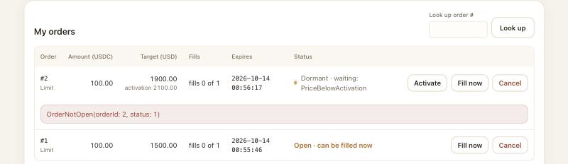
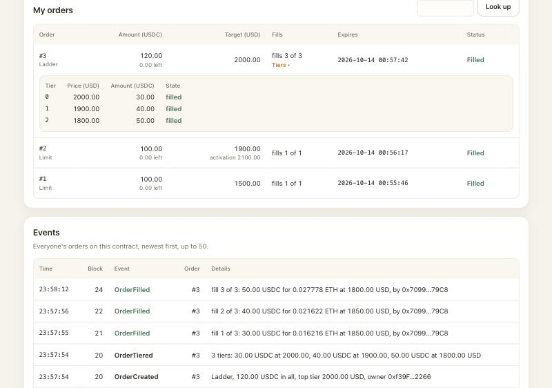
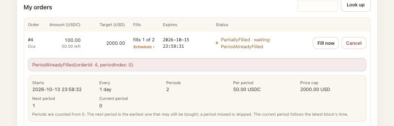

# Demo script

A live demonstration of Ledger Trigger, planned for ten minutes, on a local Hardhat chain, with the web page and a terminal. It shows the four kinds of order, the keeper waking up and filling orders, and the contract refusing calls it must refuse:

| Scene        | Scenario                                                                                   | Correct or refused | Who decides                              |
| ------------ | ------------------------------------------------------------------------------------------ | ------------------ | ---------------------------------------- |
| 2, 6         | S01 Normal fill: place a limit order, then the keeper fills it                             | correct            | the contract lets it through             |
| 3            | S06 Fill while the price is above the target                                               | refused            | `PriceAboveTarget`                       |
| 4            | S04 A stranger fills                                                                       | refused            | `NotOrderOwnerOrExecutor`                |
| 5, 6         | S29 Fill a dormant order before it is woken up                                             | refused            | `OrderNotOpen`, with status 1, `Dormant` |
| 7            | S27 The keeper wakes the dormant order up, then fills it                                   | correct            | the contract lets it through             |
| 8            | S50 A `Ladder` order bought tier by tier, two tiers in one keeper round                    | correct            | the contract lets it through             |
| 9            | S37 The first period of a `Dca` order                                                      | correct            | the contract lets it through             |
| 9            | S38 The same period of the `Dca` order bought twice                                        | refused            | `PeriodAlreadyFilled`                    |
| 10           | S03 Cancel                                                                                 | correct            | the contract lets it through             |
| Closing      | S56 Each fill issues a receipt; S57 a receipt cannot be transferred                        | correct; refused   | `ReceiptNotTransferable`                 |
| Backup plans | S09 Cancel an order that is already filled; S20 Place an order above the limit of one fill | refused            | `OrderNotOpen`; `AmountAboveMax`         |

The scenario IDs are those of [contract-spec.md](contract-spec.md), part 6. Every refusal on the page is the contract's own error: the page simulates each call on the node first and shows the error the contract would reject it with, without asking the wallet. S09 and S20 are in "Backup plans" at the end: with a real wallet the scenes above already fill the ten minutes, so those two are shown from the terminal only if there is time left, or when asked.

Use the real page only, the one `npm run web` serves at `http://localhost:5173/`. Do not open `dev.html`: it is a development page with a stand-in wallet, not for a demonstration.

Every action in MetaMask, including those under "If it goes wrong", is marked _(not checked with a real wallet)_. This script was walked through with the development page's stand-in wallet, which signs without asking, so those steps were read but not tried. Rehearse them before the day.

## The values used

All values are made up for the demonstration. The four accounts are Hardhat's public test accounts, the same on every computer: never send real money to them.

| What                                  | Value                                                                                                                                                                                                                                           |
| ------------------------------------- | ----------------------------------------------------------------------------------------------------------------------------------------------------------------------------------------------------------------------------------------------- |
| Owner (places the orders)             | test account #0, `0xf39fd6e51aad88f6f4ce6ab8827279cfffb92266`, shown as `0xf39F…2266`                                                                                                                                                           |
| Keeper's account (executor)           | test account #1, `0x70997970c51812dc3a010c7d01b50e0d17dc79c8`, shown as `0x7099…79C8`                                                                                                                                                           |
| Recipient (receives the ETH)          | test account #2, `0x3c44cdddb6a900fa2b585dd299e03d12fa4293bc`, shown as `0x3C44…93BC`                                                                                                                                                           |
| Stranger (no role)                    | test account #3, `0x90f79bf6eb2c4f870365e785982e1f101e93b906`, shown as `0x90F7…b906`                                                                                                                                                           |
| Contract address                      | the `LedgerTrigger` address that the deployment prints; on a fresh node it is usually `0xDc64a140Aa3E981100a9becA4E685f962f0cF6C9` (the address before it, `0xCf7Ed3AccA5a467e9e704C703E8D87F634fB0Fc9`, is the receipt contract `FillReceipt`) |
| Starting price                        | 2000 USD                                                                                                                                                                                                                                        |
| Order 1, a limit order (page)         | 100 USDC, target price 1500 USD, valid for 60 minutes                                                                                                                                                                                           |
| Order 2, a dormant limit order (page) | 100 USDC, target price 1900 USD, activation price 2100 USD, valid for 60 minutes                                                                                                                                                                |
| Order 3, a `Ladder` order (terminal)  | tier 0: 30 USDC at no more than 2000 USD; tier 1: 40 USDC at no more than 1900 USD; tier 2: 50 USDC at no more than 1800 USD; valid for 60 minutes                                                                                              |
| Order 4, a `Dca` order (terminal)     | 50 USDC per period, at no more than 2000 USD, 2 periods of one day (86400 seconds), starting in the block that places it                                                                                                                        |
| Order 5, a limit order (page)         | 50 USDC, target price 1200 USD, valid for 60 minutes                                                                                                                                                                                            |
| The price, scene by scene             | 2000 USD; 1400 in scene 6; 2100, then 1850 in scene 7; 1850, then 1800 in scene 8; 1800 in scene 9                                                                                                                                              |
| Too-large order (backup plans)        | 600 USDC, target price 1500 USD; the limit of one fill is 500 USDC                                                                                                                                                                              |

## Before the day

Do these once, a day or more before. Steps B1 to B4 happen in MetaMask and are all _(not checked with a real wallet)_.

**B1. A browser profile for the demo.** _(not checked with a real wallet)_

- **Do.** Create a new browser profile that holds no real wallet, and install MetaMask there, only for this.
- **You should see** MetaMask in that profile only, with a new wallet of its own.
- **If it goes wrong.** If the profile already has a wallet with real money in it, stop and make another profile: the test keys below must never go near real money.

**B2. Add the local network.** _(not checked with a real wallet)_

- **Do.** With the node running (P1 below), add a network to MetaMask by hand: RPC URL `http://127.0.0.1:8545`, chain ID `31337`, currency symbol `ETH`. Any network name will do, such as `Hardhat local`.
- **You should see** MetaMask accept the network and switch to it.
- **If it goes wrong.** If MetaMask cannot reach the RPC URL, the node is not running: start it (P1) and try again.

**B3. Import three test accounts.** _(not checked with a real wallet)_

- **Do.** Import into MetaMask, with the private keys that `npx hardhat node` prints, test accounts #0 (the owner), #2 (the recipient, to show its ETH go up in the wallet too) and #3 (the stranger). The keeper's account #1 is not needed in MetaMask: its key goes into a terminal. These keys are public: never import them into a wallet that holds real money.
- **You should see** the three accounts on the local network with about 10000 ETH each; account #0 has about 9990 ETH after a deployment, which stocks the swap venue with 10 ETH and pays a little gas.
- **If it goes wrong.** An address that does not match the table above means a wrong key was pasted: remove that account and import it again.

**B4. Clear the nonce after every node restart.** _(not checked with a real wallet)_

- **Do.** For each imported account, open MetaMask's settings, go to the advanced settings, and clear the account's activity and nonce data.
- **You should see** the account's list of past transactions empty.
- **If it goes wrong.** Why this matters: each restart starts a new, empty chain, but MetaMask still counts the old chain's transactions and sends the next one with a wrong number (nonce), which the node refuses. A transaction that the page sends but that never reaches `Confirmed` is the usual sign: clear the nonce and try again.

**B5. Rehearse twice.**

- **Do.** Go from "Setting up" to "Closing" twice, with a clock. Keep the terminal commands of scenes 6 to 9 in a text file, ready to paste.
- **You should see** each scene end as written here. In a walk-through with the development page's stand-in wallet, which signs at once, the commands and clicks from scene 1 to the closing took about three minutes. A real wallet adds seven confirmations (two in scene 2, two in scene 5, three in scene 10) and two account switches (scene 4), and each scene needs its few sentences: keep them short to stay near ten minutes.
- **If it goes wrong.** Note where it went wrong, and use that scene's "If it goes wrong" or the backup plans at the end. If the rehearsal runs over ten minutes, say less in each scene rather than leaving one out.

## Setting up (before the clock starts)

You need three terminals, each opened in the repository folder: terminal 1 runs the node, terminal 2 runs the page, terminal 3 is for every command after that. Terminals 1 and 2 keep running until the end.

**P1. Start the node.**

- **Do.** In terminal 1:

  ```sh
  export HARDHAT_DISABLE_TELEMETRY=true
  npx hardhat node
  ```

- **You should see** `Started HTTP and WebSocket JSON-RPC server at http://127.0.0.1:8545/`, then twenty test accounts, each with its address and private key. Leave it running.
- **If it goes wrong.** `EADDRINUSE` means a node is already running: stop it with Ctrl+C in its own terminal, or use that one.

**P2. Deploy.**

- **Do.** In terminal 2:

  ```sh
  export HARDHAT_DISABLE_TELEMETRY=true
  npx hardhat build
  npm run deploy:mocks -- --network localhost
  ```

- **You should see**, among other lines (the receipt contract is deployed first, then `LedgerTrigger`):

  ```text
  Deployed on chain 31337 from account 0xf39fd6e51aad88f6f4ce6ab8827279cfffb92266.
    FillReceipt     0xCf7Ed3AccA5a467e9e704C703E8D87F634fB0Fc9  (deployed now; issues a receipt for each fill)
    LedgerTrigger   0xDc64a140Aa3E981100a9becA4E685f962f0cF6C9  (deployed now, in block 5)
    maxOrderAmount          500000000 (smallest USDC units; 500 USDC, as USDC has 6 decimals)
    maxOpenOrdersPerOwner   5 (orders)
    maxPeriodsPerOrder      52 (periods per time-scheduled order)
    maxTiersPerOrder        5 (tiers per tiered order)
  FillReceipt, read back from the chain, is bound to 0xDc64a140Aa3E981100a9becA4E685f962f0cF6C9: this LedgerTrigger, the only address that can issue its receipts.
  Price feed: 8 decimals, latest price 2000 USD.
  The deploying account holds 1000 USDC.
  LedgerTrigger was deployed in block 5: use it as KEEPER_FROM_BLOCK.
  ```

  Note the `LedgerTrigger` address and the block number in the last line. On a fresh node they are usually the ones above; they can be different.

- **If it goes wrong.** If it stops with an error, check that the node in terminal 1 is still running, then run the last command again.

**P3. Start the page.**

- **Do.** In terminal 2, once the deployment has finished:

  ```sh
  npm run web
  ```

  In the demo browser profile, open `http://localhost:5173/?contract=<address>`, with the `LedgerTrigger` address from P2 in place of `<address>`.

- **You should see** `Local: http://localhost:5173/` in terminal 2. The page shows `Ledger Trigger`, the contract address in "Contract address", the line `Limits of this contract: up to 500.00 USDC per fill · up to 5 unfinished orders per owner · Dca up to 52 periods · Ladder up to 5 tiers`, ETH / USD `2000.00`, and under "Events" `No events yet.`
- **If it goes wrong.** If the port is taken, Vite picks the next one and prints it: open that address instead. If the page says the contract at the address is not a `LedgerTrigger`, the `FillReceipt` address was pasted: use the `LedgerTrigger` one. If it says there is no contract at the address, deploy again (P2) and press Load.

**P4. Connect the wallet.**

- **Do.** Switch MetaMask to the local network and to account #0 _(not checked with a real wallet)_. Press "Connect wallet" on the page and accept in MetaMask; allow both account #0 and account #3 to connect, so that switching between them in scene 4 changes the page _(not checked with a real wallet)_. Then type the recipient (account #2) and the executor (account #1) into the order form; the page remembers them.
- **You should see** `0xf39F…2266 · chain 31337` next to the button; "My USDC" `1000.00` with `allowance to the contract 0.00`; "Recipient's ETH" `10000.000000`; under "My orders" `You have placed no orders on this contract yet.`
- **If it goes wrong.** `Your wallet is on chain …, but the local node is chain 31337` means MetaMask is on another network: switch it to the local network _(not checked with a real wallet)_. If the node was restarted since the last rehearsal, clear the nonce first (B4) _(not checked with a real wallet)_.

**P5. Get the terminal ready, but do not run the keeper yet.**

- **Do.** In terminal 3, with the address and block number from P2 and account #1's private key from terminal 1:

  ```sh
  export HARDHAT_DISABLE_TELEMETRY=true
  export TRIGGER_CONTRACT_ADDRESS=<LedgerTrigger address printed in P2>
  export TRIGGER_RECIPIENT_ADDRESS=0x3c44cdddb6a900fa2b585dd299e03d12fa4293bc
  export TRIGGER_EXECUTOR_ADDRESS=0x70997970c51812dc3a010c7d01b50e0d17dc79c8
  export KEEPER_RPC_URL=http://127.0.0.1:8545
  export KEEPER_PRIVATE_KEY=<private key of account 1>
  export KEEPER_CONTRACT_ADDRESS=$TRIGGER_CONTRACT_ADDRESS
  export KEEPER_FROM_BLOCK=<block number printed in P2>
  export KEEPER_MAX_FEE_WEI=5000000000000000
  ```

- **You should see** nothing: `export` prints nothing.
- **If it goes wrong.** Nothing to go wrong yet; a wrong value shows up in scene 6.

**P6. Refresh the price, just before you begin.**

- **Do.** In terminal 3:

  ```sh
  TRIGGER_PRICE_USD=2000 npm run set-price -- --network localhost
  ```

- **You should see** `The feed now reports 2000 USD (200000000000).` The page shows ETH / USD `2000.00`, `updated … s ago`.
- **If it goes wrong.** `TRIGGER_CONTRACT_ADDRESS is required and not set.`: set it as in P5, in this terminal.
- **Why this step.** The local chain makes a block only when something is sent. This gives the chain a fresh block, so an order placed now gets its full 60 minutes (the expiry counts from the latest block's time), and a fresh price, which counts for 75 minutes (`maxPriceAge`).

Start the clock.

## Scene 1. A look at the page (nothing sent)

- **Do.** Point at the line of limits, the four kinds of order in the form, the three cards, the empty order list and the empty event list. Say: "Placing or waking up an order moves no money. Only a fill takes USDC, only this fill's share, and only the owner or the executor named in the order can wake it up or fill it, at a price at or below its cap. Every fill gets the owner a receipt that cannot be transferred. There is no admin."
- **You should see** `Limits of this contract: up to 500.00 USDC per fill · up to 5 unfinished orders per owner · Dca up to 52 periods · Ladder up to 5 tiers`; Kind `Limit` `Dormant limit` `Dca` `Ladder`, with `Limit` chosen; ETH / USD `2000.00`; My USDC `1000.00`; Recipient's ETH `10000.000000`; `You have placed no orders on this contract yet.`; `No events yet.`

  

- **If it goes wrong.** If a card shows `—`, press Load next to the contract address.

## Scene 2. Place a limit order (correct: S01, first half)

- **Do.** With Kind `Limit`, type Amount `100`, Target price `1500`, Valid for `60`; Recipient and Executor are already filled in (P4). Press "Place order". MetaMask asks twice: first to approve the USDC, then to place the order; accept both _(not checked with a real wallet)_.
- **You should see** each step go from `Confirm in your wallet…` to `Sent, waiting for the block…` with a small spinner, to a tick: `Approve USDC: Confirmed in block 9` and `Place order: Confirmed in block 10` (these lines fade after a few seconds). Under "My orders", order `#1`, kind `Limit`, with `100.00`, `1500.00`, `fills 0 of 1`, its expiry time and `Open · waiting: PriceAboveTarget`, with a pulsing dot, and the buttons Fill now and Cancel. My USDC still shows `1000.00`, now with `allowance to the contract 100.00`: placing moved no money. Under "Events", `OrderCreated` for order `#1`: `100.00 USDC, target 1500.00 USD, owner 0xf39F…2266`.
- **If it goes wrong.** `You rejected it in the wallet`: press "Place order" again and accept in MetaMask _(not checked with a real wallet)_. MetaMask refuses to send, or the node reports a wrong nonce: clear the nonce (B4) and try again _(not checked with a real wallet)_. The block numbers can be different if more was sent before; that does not matter.

## Scene 3. Fill before the price is reached (refused: S06)

- **Do.** Press "Fill now" on order #1.
- **You should see** red text under the row: `PriceAboveTarget(price: 2000.00, targetPrice: 1500.00)`. MetaMask is not asked. The order stays `Open · waiting: PriceAboveTarget`.
- **If it goes wrong.** If the red text or the waiting reason says `StalePrice` instead, the price is older than 75 minutes: run `TRIGGER_PRICE_USD=2000 npm run set-price -- --network localhost` in terminal 3 again (the same price, above the target), which refreshes its time, and press Fill now again.

## Scene 4. A stranger tries to fill (refused: S04)

- **Do.** In MetaMask, switch to account #3 _(not checked with a real wallet)_. On the page, type `1` into "Look up order #" and press Look up. Press "Fill now" on that row. Then switch MetaMask back to account #0 _(not checked with a real wallet)_.
- **You should see**, after the switch, `0x90F7…b906 · chain 31337` next to the button, My USDC `0.00`, and `You have placed no orders on this contract yet.` The looked-up row shows order #1 marked `not yours`. After Fill now, red text under it: `NotOrderOwnerOrExecutor(orderId: 1, caller: 0x90F7…b906)`. MetaMask is not asked, and the order stays `Open`. After switching back, the page shows `0xf39F…2266` and order #1 again.
- **If it goes wrong.** If the page still shows `0xf39F…2266` after the switch, account #3 is not connected to the page: press "Connect wallet" and allow account #3 _(not checked with a real wallet)_, or reload the page and connect again _(not checked with a real wallet)_. `StalePrice` instead of the expected error: as in scene 3.

## Scene 5. Place a dormant order (correct, the start of S27 and S29)

- **Do.** Choose Kind `Dormant limit`. Type Amount `100`, Target price `1900`, Activation price `2100`, Valid for `60`, and press "Place order". MetaMask asks twice again, because the allowance only covers order 1: accept both _(not checked with a real wallet)_. Say: "This order sleeps until the price first rises to 2100; only then can it be woken up, and after that it waits for the price to fall to 1900."
- **You should see** `Approve USDC: Confirmed in block 11` and `Place order: Confirmed in block 12`. Order `#2`, kind `Limit`, with `100.00`, `1900.00` and under it `activation 2100.00`, `fills 0 of 1`, and `Dormant · waiting: PriceBelowActivation` with a pulsing dot; it has three buttons: Activate, Fill now and Cancel. Under "Events", `OrderCreated` for order `#2`: `100.00 USDC, target 1900.00 USD, activation 2100.00 USD, owner 0xf39F…2266`.
- **If it goes wrong.** The red text `ActivationNotAboveTarget(…)` under the form means the two prices were swapped: the activation price must be above the target price. Otherwise as in scene 2.

## Scene 6. The price falls; a dormant order cannot be filled; the keeper fills order 1 (refused: S29; correct: S01, second half)

- **Do.** In terminal 3, move the mock price below both targets:

  ```sh
  TRIGGER_PRICE_USD=1400 npm run set-price -- --network localhost
  ```

  On the page, press "Fill now" on order #2. Say: "The price is below this order's target, but it has never been woken up, so the contract refuses the fill." Then, in terminal 3, run one round of the keeper:

  ```sh
  npm run keeper -- --once
  ```

- **You should see**, after `set-price`, `The feed now reports 1400 USD (140000000000).`; on the page ETH / USD `1400.00`, order #1 as `Open · can be filled now` (the red text of scene 3 disappears: it showed the price at the moment of the refusal), and order #2 still `Dormant · waiting: PriceBelowActivation`. After Fill now, red text under order #2: `OrderNotOpen(orderId: 2, status: 1)`. Status 1 is `Dormant`. MetaMask is not asked.

  

  Then the keeper logs, among other lines:

  ```text
  … order=- action=round-start reason=orders-found from-block=5 to-block=13 orders=2
  … order=2 action=skip reason=PriceBelowActivation check=canActivate
  … order=1 action=filled reason=transaction-succeeded tx=0xed1e…abb1
  … order=- action=round-end reason=done activated=0 filled=1 skipped=1 errors=0
  ```

  Each keeper line starts with the time, shown here as `…`; the transaction hashes can be different. The keeper first asks about the dormant order and leaves it: the price is below its activation price. Then it fills order 1. Without reloading, the row of order #1 flashes and turns to `Filled` in green, with `0.00 left` and `fills 1 of 1`; Recipient's ETH goes from `10000.000000` to `10000.071429`; My USDC goes from `1000.00` to `900.00`; at the top of "Events", `OrderFilled` for order `#1`: `100.00 USDC for 0.071429 ETH at 1400.00 USD, by 0x7099…79C8`. The keeper's account called, and the ETH went to the recipient, not to the keeper.

- **If it goes wrong.** The keeper logs `action=skip reason=PriceAboveTarget` for order 1: the price did not move; run the `set-price` line again. It stops before its round: check the `KEEPER_` variables of P5, in this same terminal. The page has not changed after a few seconds: press Load.

## Scene 7. The keeper wakes the dormant order up, then fills it (correct: S27)

- **Do.** In terminal 3, move the price up to the activation price and run a keeper round; then move it down below the target and run another:

  ```sh
  TRIGGER_PRICE_USD=2100 npm run set-price -- --network localhost
  npm run keeper -- --once
  TRIGGER_PRICE_USD=1850 npm run set-price -- --network localhost
  npm run keeper -- --once
  ```

- **You should see**, in the first round:

  ```text
  … order=2 action=activated reason=transaction-succeeded tx=0x1c4b…551e
  … order=1 action=skip reason=Filled check=statusOf
  … order=2 action=skip reason=PriceAboveTarget check=canFill
  … order=- action=round-end reason=done activated=1 filled=0 skipped=2 errors=0
  ```

  On the page order #2 turns to `Open · waiting: PriceAboveTarget` (2100 is above its target of 1900), keeps `activation 2100.00` under its target, and has Fill now and Cancel only; the red text of scene 6 is gone; "Events" shows `OrderActivated` for order `#2`: `at 2100.00 USD, by 0x7099…79C8`. In the second round:

  ```text
  … order=1 action=skip reason=Filled check=statusOf
  … order=2 action=filled reason=transaction-succeeded tx=0x5449…c1bd
  … order=- action=round-end reason=done activated=0 filled=1 skipped=1 errors=0
  ```

  Order #2 turns to `Filled`; "Events" shows `OrderFilled` for order `#2`: `100.00 USDC for 0.054054 ETH at 1850.00 USD, by 0x7099…79C8`.

- **If it goes wrong.** The first round logs `action=skip reason=PriceBelowActivation` for order 2: the price did not reach 2100; run that `set-price` line again. `reason=StalePrice`: the price is older than 75 minutes; run the `set-price` line again.

## Scene 8. A `Ladder` order, tier by tier (correct: S50)

- **Do.** In terminal 3, place a `Ladder` order of three tiers, then run a keeper round. The price stays at 1850 from scene 7: below the prices of tiers 0 and 1, above the price of tier 2.

  ```sh
  TRIGGER_TIERS=2000:30,1900:40,1800:50 TRIGGER_EXPIRY_MINUTES=60 npm run place-ladder-order -- --network localhost
  npm run keeper -- --once
  ```

  Say: "Two tiers can be bought at this price. The contract sells them one at a time, in order, one transaction each; tier 2 waits for its own price." Then move the price to tier 2 and run another round:

  ```sh
  TRIGGER_PRICE_USD=1800 npm run set-price -- --network localhost
  npm run keeper -- --once
  ```

- **You should see**, from `place-ladder-order`:

  ```text
  Placed Ladder order 3 from account 0xf39fd6e51aad88f6f4ce6ab8827279cfffb92266, now Open.
    tiers             3, filled one at a time from tier 0
    tier 0            30 USDC (30000000) at no more than 2000 USD (200000000000)
    tier 1            40 USDC (40000000) at no more than 1900 USD (190000000000)
    tier 2            50 USDC (50000000) at no more than 1800 USD (180000000000)
    budget            120 USDC (120000000)
    activation price  none: the order is open once placed
    expiry            … (Unix …), … seconds after the block that placed the order
    allowance         120 USDC (120000000), equal to the open-order total 120 USDC (120000000)
    USDC balance      800 USDC (800000000)
  ```

  In the first round, two fills of order 3, one transaction each, and nothing else for it:

  ```text
  … order=3 action=filled reason=transaction-succeeded tx=0xf139…aa07
  … order=3 action=filled reason=transaction-succeeded tx=0xc2a7…7a9d
  … order=- action=round-end reason=done activated=0 filled=2 skipped=2 errors=0
  ```

  On the page order #3, kind `Ladder`, `120.00` with `50.00 left`, target `2000.00`, `fills 2 of 3`, `PartiallyFilled · waiting: PriceAboveTarget`. After the second round:

  ```text
  … order=3 action=filled reason=transaction-succeeded tx=0x8736…2741
  … order=- action=round-end reason=done activated=0 filled=1 skipped=2 errors=0
  ```

  Order #3 turns to `Filled` with `0.00 left` and `fills 3 of 3`. Press Tiers, under its fills, to see the three tiers, each `filled`. At the top of "Events", three `OrderFilled` lines for order `#3`: `fill 1 of 3: 30.00 USDC for 0.016216 ETH at 1850.00 USD`, `fill 2 of 3: 40.00 USDC for 0.021622 ETH at 1850.00 USD` and `fill 3 of 3: 50.00 USDC for 0.027778 ETH at 1800.00 USD`, each `by 0x7099…79C8`, below them `OrderTiered` and `OrderCreated` for order `#3`.

  

- **If it goes wrong.** `place-ladder-order` stops with `The contract rejected the call with …`: the error names what is wrong, such as `TiersNotDescending(…)` for prices that do not fall; nothing was sent. If the first round fills only one tier, the price is above 1900: run `TRIGGER_PRICE_USD=1850 npm run set-price -- --network localhost` and another round.

## Scene 9. A `Dca` order: one period, the same period again, the next period (correct: S37; refused: S38)

- **Do.** In terminal 3, place a `Dca` order of two daily periods, then run a keeper round:

  ```sh
  TRIGGER_USDC_PER_PERIOD=50 TRIGGER_TARGET_PRICE_USD=2000 TRIGGER_PERIOD_SECONDS=86400 TRIGGER_PERIOD_COUNT=2 npm run place-dca-order -- --network localhost
  npm run keeper -- --once
  ```

  On the page, press "Fill now" on order #4, and press Schedule, under its fills. Say: "Period 0 is bought; the same period cannot be bought twice." Then move the chain's clock forward by one period and run another round. Set the price before the clock moves, so the clock moves on from a fresh block, and again after, because a day later the old price is long stale:

  ```sh
  TRIGGER_PRICE_USD=1800 npm run set-price -- --network localhost
  TRIGGER_ADVANCE_SECONDS=86400 npm run advance-time -- --network localhost
  TRIGGER_PRICE_USD=1800 npm run set-price -- --network localhost
  npm run keeper -- --once
  ```

- **You should see**, from `place-dca-order`:

  ```text
  Placed time-scheduled order 4 from account 0xf39fd6e51aad88f6f4ce6ab8827279cfffb92266, now Open.
    per period        50 USDC (50000000)
    price cap         2000 USD (200000000000)
    periods           2 of 86400 seconds each
    budget            100 USDC (100000000)
    activation price  none: the order is open once placed
    period 0 begins   … (Unix …), 0 seconds after the block that placed the order
    last second       … (Unix …), the end of the last period
    allowance         100 USDC (100000000), equal to the open-order total 100 USDC (100000000)
    USDC balance      680 USDC (680000000)
  ```

  The keeper buys period 0:

  ```text
  … order=4 action=filled reason=transaction-succeeded tx=0xa535…4478
  … order=- action=round-end reason=done activated=0 filled=1 skipped=3 errors=0
  ```

  On the page order #4, kind `Dca`, `100.00` with `50.00 left`, cap `2000.00`, `fills 1 of 2`, `PartiallyFilled · waiting: PeriodAlreadyFilled`. After Fill now, red text under it: `PeriodAlreadyFilled(orderId: 4, periodIndex: 0)`. The schedule shows when it starts, `Every 1 day`, `Periods 2`, `Per period 50.00 USDC`, `Price cap 2000.00 USD`, `Next period 1` and `Current period 0`.

  

  `advance-time` prints:

  ```text
  Moved the local chain's clock forward by 86400 seconds.
    before  block 28 at … (Unix …)
    after   block 29 at … (Unix …)
    the new block's time is 86400 seconds after the block before it
  ```

  and the last round buys period 1:

  ```text
  … order=4 action=filled reason=transaction-succeeded tx=0x8a23…f325
  … order=- action=round-end reason=done activated=0 filled=1 skipped=3 errors=0
  ```

  The block numbers and times can be different. Order #4 turns to `Filled`, `fills 2 of 2`, and its schedule shows `Next period none`; "Events" shows `OrderFilled` for order `#4`: `fill 2 of 2: 50.00 USDC for 0.027778 ETH at 1800.00 USD, by 0x7099…79C8`. The price card says `updated 0 s ago`: the chain's clock is now a day ahead of the computer's.

- **If it goes wrong.** The last round logs `reason=StalePrice`: the second `set-price` was left out; run it and another round. It logs `reason=PeriodAlreadyFilled`: the clock did not move; run `advance-time` again. `advance-time` refuses with `runs on Hardhat's local chain only`: `--network localhost` is missing or points elsewhere.

## Scene 10. Place and cancel an order (correct: S03)

- **Do.** Make sure MetaMask is on account #0 _(not checked with a real wallet)_. Choose Kind `Limit`, type Amount `50`, Target price `1200`, Valid for `60`, and press "Place order". MetaMask asks twice again, because the fills used up the allowance: accept both _(not checked with a real wallet)_. Then press "Cancel" on order #5 and accept in MetaMask _(not checked with a real wallet)_.
- **You should see** `Approve USDC: Confirmed in block 32` and `Place order: Confirmed in block 33`, and order `#5` with `50.00`, `1200.00` and `Open · waiting: PriceAboveTarget` (the price, 1800, is above this order's target). After Cancel: `Cancel: Confirmed in block 34`, the order turns to `Cancelled` in grey, its buttons are gone, and "Events" shows `OrderCancelled` for order `#5`, `by 0xf39F…2266`.
- **If it goes wrong.** Red `NotOrderOwner(…)` under the row: MetaMask is still on account #3; switch it back to #0 _(not checked with a real wallet)_.

## Closing

- **Do.** In terminal 3 (without `--network`):

  ```sh
  npm run demo
  ```

  Say: "The same contracts, on a fresh chain inside this process: thirteen scenarios, each checked against the chain. The receipts are shown here: the web page does not read them, and no command prints one." Point at S56, where a fill's receipt records the same order, fill, USDC, ETH and price as its `OrderFilled`, and at S57, where the owner tries to hand that receipt to someone else and the receipt contract refuses.

- **You should see** thirteen scenarios, S01, S03, S04, S06, S07, S15, S27, S29, S37, S38, S50, S56 and S57, each ending with `Result:   PASS`; in S56 a line like `receipt #10: order 11, fill 1, 100 USDC in, 0.055555555555555555 ETH out, price 1800 USD, filled at Unix …` and the matching `OrderFilled: order 11, fill 1, …` line; in S57 `ReceiptNotTransferable(10)`; then a summary table and `13 of 13 scenarios PASS.`
- **If it goes wrong.** The demo does not use the node or the page, so a problem there does not affect it. Do not add `--network localhost`: the demo would then deploy another set of contracts on the node and move its clock forward a day, which changes what the page shows. If it fails, run it again.

Stop the clock. Keep the node and the page running while the backup plans below may still be needed; then stop them with Ctrl+C in terminals 2 and 1.

## Backup plans

**S09 and S20 from the terminal**, if there is time left after the closing, or when asked. Both send nothing: each script simulates the call first and stops with the contract's error.

**S09. Cancel an order that is already filled (refused).**

- **Do.** In terminal 3, cancel order 1, which the keeper filled in scene 6:

  ```sh
  TRIGGER_ORDER_ID=1 npm run cancel-order -- --network localhost
  ```

- **You should see** `The contract rejected the call with OrderNotOpen(1, 4).` The 4 is the stored status, `Filled`: a filled order can never become `Cancelled`. The script sends nothing and ends with an error code, as it should. As an aside, `npm run keeper -- --once` skips order 1 without sending anything: `order=1 action=skip reason=Filled check=statusOf`.
- **If it goes wrong.** `OrderNotFound(…)`: the order ID is wrong. `TRIGGER_CONTRACT_ADDRESS is required and not set.`: set it again as in P5.

**S20. An order above the limit of one fill (refused).**

- **Do.** In terminal 3:

  ```sh
  TRIGGER_ORDER_USDC=600 TRIGGER_TARGET_PRICE_USD=1500 TRIGGER_EXPIRY_MINUTES=60 npm run place-order -- --network localhost
  ```

  On the page the same refusal shows without the terminal: Kind `Limit`, Amount `600`, Target price `1500`, then "Place order". The limit is the first one in the page's line of limits, `up to 500.00 USDC per fill`.

- **You should see** `The contract rejected the call with AmountAboveMax(600000000, 500000000).` from the script, with nothing sent; on the page, red text under the form: `AmountAboveMax(amount: 600.00, max: 500.00)`, and MetaMask is not asked at all, not even for the approval.
- **If it goes wrong.** If MetaMask asks anyway, reject it _(not checked with a real wallet)_ and show the refusal from the terminal instead.

**If the page will not open**, terminal 3 can still show most scenes, with the variables of P5 set:

| Scenario | Commands                                                                                                                                                                                                                                                                                                                    |
| -------- | --------------------------------------------------------------------------------------------------------------------------------------------------------------------------------------------------------------------------------------------------------------------------------------------------------------------------- |
| S01      | `place-order` with the values of order 1 (as in the README, "Deploy and operate on a local chain", step 3), then `set-price` to 1400 and `npm run keeper -- --once`                                                                                                                                                         |
| S03      | `place-order` with the values of order 5, then `TRIGGER_ORDER_ID=<its number> npm run cancel-order -- --network localhost`                                                                                                                                                                                                  |
| S09, S20 | as above                                                                                                                                                                                                                                                                                                                    |
| S27      | `place-ladder-order` with one tier, an activation price and an expiry, such as `TRIGGER_TIERS=1900:100 TRIGGER_ACTIVATION_PRICE_USD=2100 TRIGGER_EXPIRY_MINUTES=60`: the order is placed dormant. Then `set-price` to 2100 and a keeper round (`action=activated`), `set-price` to 1850 and another round (`action=filled`) |
| S50      | scene 8 as written                                                                                                                                                                                                                                                                                                          |
| S37      | scene 9 without the page: `place-dca-order` and a keeper round                                                                                                                                                                                                                                                              |

`npm run order-status -- --network localhost`, with `TRIGGER_ORDER_ID` set, prints an order's kind, owner, executor and recipient, its amount, what is left and its target price, its activation price, `fills done … of …`, when it was placed and when it expires, its stored status and `status now`, `can fill now` with the reason, for a dormant order `can activate` with the reason, and the feed price; then the schedule of a `Dca` order (amount per period, period length, when period 0 begins and the next period it can buy) or one line per tier of a `Ladder` order, each `filled` or `not filled`. It sends nothing.

S04 (a stranger fills), S06 (fill before the price), S29 (fill a dormant order) and S38 (the same period twice) cannot be shown from the scripts: they all send from account #0, and none of them fills an order; the keeper asks `canFill` first and never sends such a fill. `npm run demo` in the closing scene shows all four, and S56 and S57.

**Remix as a last resort** _(not checked with a real wallet)_. The repository is public, so Remix can load the contracts from their GitHub address and compile them. With MetaMask on the local network, choose Remix's injected provider environment, point it at the deployed `LedgerTrigger` address, and call the functions from there.
