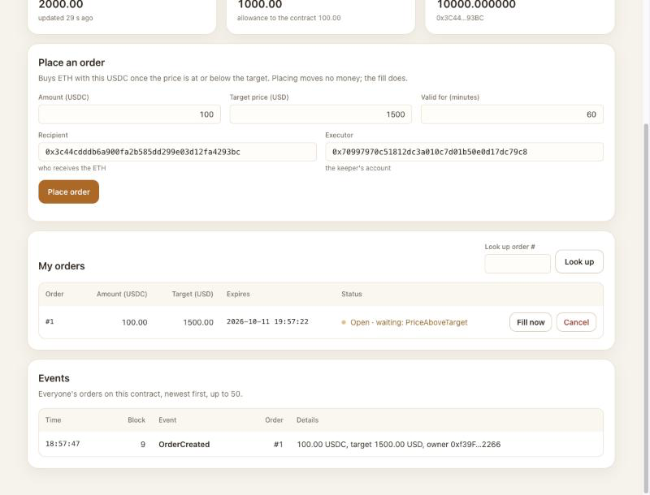
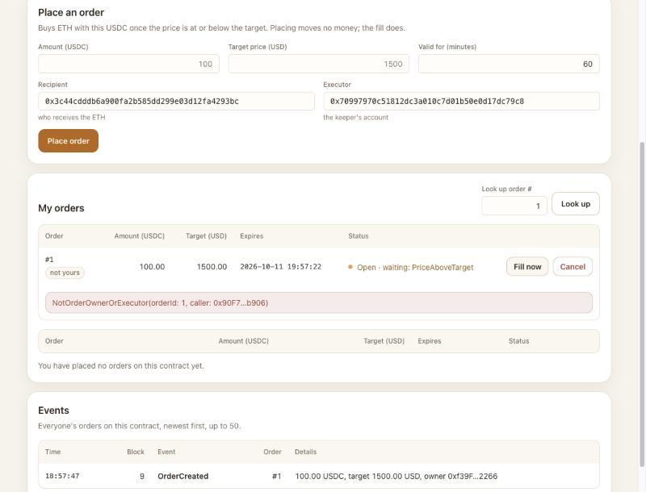
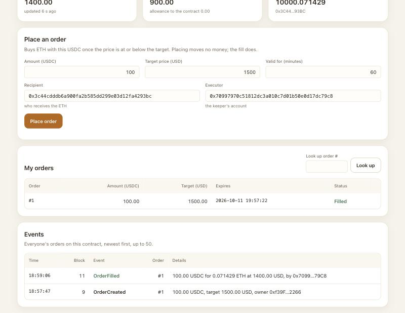

# Demo script

A live demonstration of Ledger Trigger in under ten minutes, on a local Hardhat chain, with the web page and a terminal. It shows two correct flows and four incorrect ones that the contract refuses:

| Scene | Scenario                                        | Correct or refused | Who decides                  |
| ----- | ----------------------------------------------- | ------------------ | ---------------------------- |
| 2, 5  | S01 Normal fill: place, then the keeper fills   | correct            | the contract lets it through |
| 3     | S06 Fill while the price is above the target    | refused            | `PriceAboveTarget`           |
| 4     | S04 A stranger fills                            | refused            | `NotOrderOwnerOrExecutor`    |
| 6     | S09 Cancel an order that is already filled      | refused            | `OrderNotOpen`               |
| 7     | S03 Cancel                                      | correct            | the contract lets it through |
| 8     | S20 Place an order above the single-order limit | refused            | `AmountAboveMax`             |

The scenario IDs are those of [contract-spec.md](contract-spec.md), part 6. Every refusal on the page is the contract's own error: the page simulates each call on the node first and shows the error the contract would reject it with, without asking the wallet.

Use the real page only, the one `npm run web` serves at `http://localhost:5173/`. Do not open `dev.html`: it is a development page with a stand-in wallet, not for a demonstration.

Steps marked _(not checked with a real wallet)_ happen in MetaMask. This script was walked through with the development page's stand-in wallet, which signs without asking, so those steps were read but not tried. Rehearse them before the day.

## The values used

All values are made up for the demonstration. The four accounts are Hardhat's public test accounts, the same on every computer: never send real money to them.

| What                         | Value                                                                                                                              |
| ---------------------------- | ---------------------------------------------------------------------------------------------------------------------------------- |
| Owner (places the orders)    | test account #0, `0xf39fd6e51aad88f6f4ce6ab8827279cfffb92266`, shown as `0xf39F…2266`                                              |
| Keeper's account (executor)  | test account #1, `0x70997970c51812dc3a010c7d01b50e0d17dc79c8`, shown as `0x7099…79C8`                                              |
| Recipient (receives the ETH) | test account #2, `0x3c44cdddb6a900fa2b585dd299e03d12fa4293bc`, shown as `0x3C44…93BC`                                              |
| Stranger (no role)           | test account #3, `0x90f79bf6eb2c4f870365e785982e1f101e93b906`, shown as `0x90F7…b906`                                              |
| Contract address             | the `LedgerTrigger` address that the deployment prints; on a fresh node it is usually `0xCf7Ed3AccA5a467e9e704C703E8D87F634fB0Fc9` |
| Starting price               | 2000 USD                                                                                                                           |
| Order 1                      | 100 USDC, target price 1500 USD, valid for 60 minutes                                                                              |
| Price after the move         | 1400 USD                                                                                                                           |
| Order 2                      | 50 USDC, target price 1200 USD, valid for 60 minutes                                                                               |
| Too-large order              | 600 USDC, target price 1500 USD; the single-order limit is 500 USDC                                                                |

## Before the day

Do these once, a day or more before. Steps B1 to B4 happen in MetaMask and are all _(not checked with a real wallet)_.

**B1. A browser profile for the demo.** _(not checked with a real wallet)_

- **Do.** Create a new browser profile that holds no real wallet, and install MetaMask there, only for this.
- **You should see** MetaMask in that profile only, with a new wallet of its own.
- **If it goes wrong.** If the profile already has a wallet with real money in it, stop and make another profile: the test keys below must never go near real money.

**B2. Add the local network.** _(not checked with a real wallet)_

- **Do.** With the node running (P1 below), add a network to MetaMask by hand: RPC URL `http://127.0.0.1:8545`, chain ID `31337`, currency symbol `ETH`. Any network name will do, such as `Hardhat local`.
- **You should see** MetaMask accept the network and switch to it.
- **If it goes wrong.** If MetaMask cannot reach the RPC URL, the node is not running: start it (P1) and try again.

**B3. Import three test accounts.** _(not checked with a real wallet)_

- **Do.** Import into MetaMask, with the private keys that `npx hardhat node` prints, test accounts #0 (the owner), #2 (the recipient, to show its ETH go up in the wallet too) and #3 (the stranger). The keeper's account #1 is not needed in MetaMask: its key goes into a terminal. These keys are public: never import them into a wallet that holds real money.
- **You should see** the three accounts on the local network with about 10000 ETH each; account #0 has about 9990 ETH after a deployment, which stocks the swap venue with 10 ETH and pays a little gas.
- **If it goes wrong.** An address that does not match the table above means a wrong key was pasted: remove that account and import it again.

**B4. Clear the nonce after every node restart.** _(not checked with a real wallet)_

- **Do.** For each imported account, open MetaMask's settings, go to the advanced settings, and clear the account's activity and nonce data.
- **You should see** the account's list of past transactions empty.
- **If it goes wrong.** Why this matters: each restart starts a new, empty chain, but MetaMask still counts the old chain's transactions and sends the next one with a wrong number (nonce), which the node refuses. A transaction that the page sends but that never reaches `Confirmed` is the usual sign: clear the nonce and try again.

**B5. Rehearse twice.**

- **Do.** Go from "Setting up" to "Closing" twice, with a clock.
- **You should see** each scene end as written here, in under ten minutes from scene 1 to the closing.
- **If it goes wrong.** Note where it went wrong, and use that scene's "If it goes wrong" or the backup plans at the end.

## Setting up (before the clock starts)

You need three terminals, each opened in the repository folder: terminal 1 runs the node, terminal 2 runs the page, terminal 3 is for every command after that. Terminals 1 and 2 keep running until the end.

**P1. Start the node.**

- **Do.** In terminal 1:

  ```sh
  export HARDHAT_DISABLE_TELEMETRY=true
  npx hardhat node
  ```

- **You should see** `Started HTTP and WebSocket JSON-RPC server at http://127.0.0.1:8545/`, then twenty test accounts, each with its address and private key. Leave it running.
- **If it goes wrong.** `EADDRINUSE` means a node is already running: stop it with Ctrl+C in its own terminal, or use that one.

**P2. Deploy.**

- **Do.** In terminal 2:

  ```sh
  export HARDHAT_DISABLE_TELEMETRY=true
  npx hardhat build
  npm run deploy:mocks -- --network localhost
  ```

- **You should see**, among other lines:

  ```text
  Deployed on chain 31337 from account 0xf39fd6e51aad88f6f4ce6ab8827279cfffb92266.
    LedgerTrigger   0xCf7Ed3AccA5a467e9e704C703E8D87F634fB0Fc9  (deployed now, in block 4)
    maxOrderAmount          500000000 (smallest USDC units; 500 USDC, as USDC has 6 decimals)
    maxOpenOrdersPerOwner   5 (orders)
  Price feed: 8 decimals, latest price 2000 USD.
  The deploying account holds 1000 USDC.
  LedgerTrigger was deployed in block 4: use it as KEEPER_FROM_BLOCK.
  ```

  Note the `LedgerTrigger` address and the block number.

- **If it goes wrong.** If it stops with an error, check that the node in terminal 1 is still running, then run the last command again.

**P3. Start the page.**

- **Do.** In terminal 2, once the deployment has finished:

  ```sh
  npm run web
  ```

  In the demo browser profile, open `http://localhost:5173/?contract=<address>`, with the `LedgerTrigger` address from P2 in place of `<address>`.

- **You should see** `Local: http://localhost:5173/` in terminal 2. The page shows `Ledger Trigger`, the contract address in "Contract address", ETH / USD `2000.00`, and under "Events" `No events yet.`
- **If it goes wrong.** If the port is taken, Vite picks the next one and prints it: open that address instead. If the page says there is no contract at the address, deploy again (P2) and press Load.

**P4. Connect the wallet.**

- **Do.** Switch MetaMask to the local network and to account #0. Press "Connect wallet" on the page and accept in MetaMask; allow both account #0 and account #3 to connect, so that switching between them in scene 4 changes the page _(not checked with a real wallet)_. Then type the recipient (account #2) and the executor (account #1) into the order form; the page remembers them.
- **You should see** `0xf39F…2266 · chain 31337` next to the button; "My USDC" `1000.00` with `allowance to the contract 0.00`; "Recipient's ETH" `10000.000000`; under "My orders" `You have placed no orders on this contract yet.`
- **If it goes wrong.** `Your wallet is on chain …, but the local node is chain 31337` means MetaMask is on another network: switch it to the local network. If the node was restarted since the last rehearsal, clear the nonce first (B4).

**P5. Get the keeper's settings ready, but do not run it.**

- **Do.** In terminal 3, with the address and block number from P2 and account #1's private key from terminal 1:

  ```sh
  export HARDHAT_DISABLE_TELEMETRY=true
  export TRIGGER_CONTRACT_ADDRESS=<LedgerTrigger address printed in P2>
  export KEEPER_RPC_URL=http://127.0.0.1:8545
  export KEEPER_PRIVATE_KEY=<private key of account 1>
  export KEEPER_CONTRACT_ADDRESS=$TRIGGER_CONTRACT_ADDRESS
  export KEEPER_FROM_BLOCK=4
  export KEEPER_MAX_FEE_WEI=5000000000000000
  ```

- **You should see** nothing: `export` prints nothing.
- **If it goes wrong.** Nothing to go wrong yet; a wrong value shows up in scene 5.

**P6. Refresh the price, just before you begin.**

- **Do.** In terminal 3:

  ```sh
  TRIGGER_PRICE_USD=2000 npm run set-price -- --network localhost
  ```

- **You should see** `The feed now reports 2000 USD (200000000000).` The page shows ETH / USD `2000.00`, `updated … s ago`.
- **If it goes wrong.** `TRIGGER_CONTRACT_ADDRESS is required and not set.`: set it as in P5, in this terminal.
- **Why this step.** The local chain makes a block only when something is sent. This gives the chain a fresh block, so an order placed now gets its full 60 minutes (the expiry counts from the latest block's time), and a fresh price, which counts for 75 minutes (`maxPriceAge`).

Start the clock.

## Scene 1. A look at the page (correct state, nothing sent)

- **Do.** Point at the three cards, the empty order list and the empty event list. Say: "Placing an order moves no money. Only a fill takes the USDC, and only the owner or the executor named in the order can fill it, at a price at or below the target. There is no admin."
- **You should see** ETH / USD `2000.00`; My USDC `1000.00`; Recipient's ETH `10000.000000`; `You have placed no orders on this contract yet.`; `No events yet.`
- **If it goes wrong.** If a card shows `—`, press Load next to the contract address.

## Scene 2. Place an order (correct: S01, first half)

- **Do.** Type Amount `100`, Target price `1500`, Valid for `60`; Recipient and Executor are already filled in (P4). Press "Place order". MetaMask asks twice: first to approve the USDC, then to place the order; accept both _(not checked with a real wallet)_.
- **You should see** each step go from `Confirm in your wallet…` to `Sent, waiting for the block…` with a small spinner, to a tick: `Approve USDC: Confirmed in block 8` and `Place order: Confirmed in block 9` (these lines fade after a few seconds). Under "My orders", order `#1` with `100.00`, `1500.00`, its expiry time and `Open · waiting: PriceAboveTarget`, with a pulsing dot. My USDC still shows `1000.00`, now with `allowance to the contract 100.00`: placing moved no money. Under "Events", `OrderCreated` for order `#1`: `100.00 USDC, target 1500.00 USD, owner 0xf39F…2266`.

  

- **If it goes wrong.** `You rejected it in the wallet`: press "Place order" again and accept. MetaMask refuses to send, or the node reports a wrong nonce: clear the nonce (B4) and try again. The block numbers can be different if more was sent before; that does not matter.

## Scene 3. Fill before the price is reached (refused: S06)

- **Do.** Press "Fill now" on order #1.
- **You should see** red text under the row: `PriceAboveTarget(price: 2000.00, targetPrice: 1500.00)`. MetaMask is not asked. The order stays `Open · waiting: PriceAboveTarget`.
- **If it goes wrong.** If the red text or the waiting reason says `StalePrice` instead, the price is older than 75 minutes: run `TRIGGER_PRICE_USD=2000 npm run set-price -- --network localhost` in terminal 3 again (the same price, above the target), which refreshes its time, and press Fill now again.

## Scene 4. A stranger tries to fill (refused: S04)

- **Do.** In MetaMask, switch to account #3 _(not checked with a real wallet)_. On the page, type `1` into "Look up order #" and press Look up. Press "Fill now" on that row. Then switch MetaMask back to account #0 _(not checked with a real wallet)_.
- **You should see**, after the switch, `0x90F7…b906 · chain 31337` next to the button, My USDC `0.00`, and `You have placed no orders on this contract yet.` The looked-up row shows order #1 marked `not yours`. After Fill now, red text under it: `NotOrderOwnerOrExecutor(orderId: 1, caller: 0x90F7…b906)`. MetaMask is not asked, and the order stays `Open`. After switching back, the page shows `0xf39F…2266` and order #1 again.

  

- **If it goes wrong.** If the page still shows `0xf39F…2266` after the switch, account #3 is not connected to the page: press "Connect wallet" and allow account #3 _(not checked with a real wallet)_, or reload the page and connect again. `StalePrice` instead of the expected error: as in scene 3.

## Scene 5. Move the price; the keeper fills (correct: S01, second half)

- **Do.** In terminal 3, move the mock price below the target:

  ```sh
  TRIGGER_PRICE_USD=1400 npm run set-price -- --network localhost
  ```

  Then run one round of the keeper:

  ```sh
  npm run keeper -- --once
  ```

- **You should see**, after `set-price`, `The feed now reports 1400 USD (140000000000).`; on the page ETH / USD `1400.00` and order #1 as `Open · can be filled now`. The red text from scene 3 disappears: it showed the price at the moment of the refusal. Then the keeper logs, among other lines:

  ```text
  … order=- action=round-start reason=orders-found from-block=4 to-block=10 orders=1
  … order=1 action=filled reason=transaction-succeeded tx=0x4799…f12e
  … order=- action=round-end reason=done filled=1 skipped=0 errors=0
  ```

  Without reloading, the row of order #1 flashes and turns to `Filled` in green; Recipient's ETH goes from `10000.000000` to `10000.071429`; My USDC goes from `1000.00` to `900.00`, with `allowance to the contract 0.00`; at the top of "Events", `OrderFilled` for order `#1`: `100.00 USDC for 0.071429 ETH at 1400.00 USD, by 0x7099…79C8`. The keeper's account called, and the ETH went to the recipient, not to the keeper.

  

- **If it goes wrong.** The keeper logs `action=skip reason=PriceAboveTarget`: the price did not move; run the `set-price` line again. It stops before its round: check the `KEEPER_` variables of P5, in this same terminal. The page has not changed after a few seconds: press Load.

## Scene 6. Cancel the filled order (refused: S09)

- **Do.** In terminal 3:

  ```sh
  TRIGGER_ORDER_ID=1 npm run cancel-order -- --network localhost
  ```

  As an aside, run the keeper once more: `npm run keeper -- --once`.

- **You should see** `The contract rejected the call with OrderNotOpen(1, 2).` The 2 is the stored status, `Filled`: a filled order can never become `Cancelled`. The script sends nothing and ends with an error code, as it should. This is the one refused state change in the demo. The keeper skips order 1 without sending anything: `order=1 action=skip reason=Filled check=statusOf`, then `filled=0 skipped=1 errors=0`.
- **If it goes wrong.** `OrderNotFound(…)`: the order ID is wrong. `TRIGGER_CONTRACT_ADDRESS is required and not set.`: set it again as in P5.

## Scene 7. Place and cancel another order (correct: S03)

- **Do.** Make sure MetaMask is on account #0. Type Amount `50`, Target price `1200`, Valid for `60`, and press "Place order". MetaMask asks twice again, because the fill used up the allowance: accept both _(not checked with a real wallet)_. Then press "Cancel" on order #2 and accept in MetaMask _(not checked with a real wallet)_.
- **You should see** `Approve USDC: Confirmed in block 12` and `Place order: Confirmed in block 13`, and order `#2` with `50.00`, `1200.00` and `Open · waiting: PriceAboveTarget` (the price, 1400, is above this order's target). After Cancel: `Cancel: Confirmed in block 14`, the order turns to `Cancelled` in grey, its buttons are gone, and "Events" shows `OrderCancelled` for order `#2`, `by 0xf39F…2266`.
- **If it goes wrong.** Red `NotOrderOwner(…)` under the row: MetaMask is still on account #3; switch back to #0.

## Scene 8. An order above the limit (refused: S20)

- **Do.** Type Amount `600` (above the 500 USDC limit that the deployment printed in P2), Target price `1500`, and press "Place order".
- **You should see** red text under the form: `AmountAboveMax(amount: 600.00, max: 500.00)`. MetaMask is not asked at all, not even for the approval, and no order is added.
- **If it goes wrong.** If MetaMask asks anyway, reject it, and show the same refusal from terminal 3 instead:

  ```sh
  TRIGGER_ORDER_USDC=600 TRIGGER_TARGET_PRICE_USD=1500 TRIGGER_EXPIRY_MINUTES=60 \
  TRIGGER_RECIPIENT_ADDRESS=0x3c44cdddb6a900fa2b585dd299e03d12fa4293bc \
  TRIGGER_EXECUTOR_ADDRESS=0x70997970c51812dc3a010c7d01b50e0d17dc79c8 \
  npm run place-order -- --network localhost
  ```

  It simulates the order first and prints `The contract rejected the call with AmountAboveMax(600000000, 500000000).`, sending nothing.

## Closing

- **Do.** In terminal 3:

  ```sh
  npm run demo
  ```

  Say: "The same contract, on a fresh chain inside this process: two correct flows and four refused ones, each checked against the chain."

- **You should see** six scenarios, S01, S03, S04, S06, S07 and S15, each ending with `Result:   PASS`, then a summary table and `6 of 6 scenarios PASS.`
- **If it goes wrong.** The demo does not use the node or the page, so a problem there does not affect it. If it fails, run it again.

Stop the clock. Stop the page and the node with Ctrl+C in terminals 2 and 1.

## Backup plans

**If the page will not open**, terminal 3 can still show four of the six scenes, with the variables of P5 set:

| Scene         | Commands                                                                                                                                                            |
| ------------- | ------------------------------------------------------------------------------------------------------------------------------------------------------------------- |
| S01 (2 and 5) | `place-order` with the values of order 1 (as in the README, "Deploy and operate on a local chain", step 3), then `set-price` to 1400 and `npm run keeper -- --once` |
| S09 (6)       | `TRIGGER_ORDER_ID=1 npm run cancel-order -- --network localhost` after the fill                                                                                     |
| S03 (7)       | `place-order` with the values of order 2, then `TRIGGER_ORDER_ID=2 npm run cancel-order -- --network localhost`                                                     |
| S20 (8)       | `place-order` with `TRIGGER_ORDER_USDC=600`, as in scene 8                                                                                                          |

`npm run order-status -- --network localhost`, with `TRIGGER_ORDER_ID` set, prints an order's status and why it cannot be filled yet.

S04 (a stranger fills) and S06 (fill before the price) cannot be shown from the scripts: they all send from account #0, and none of them fills. `npm run demo` in the closing scene shows both.

**Remix as a last resort** _(not checked with a real wallet)_. The repository is public, so Remix can load the contract from its GitHub address and compile it. With MetaMask on the local network, choose Remix's injected provider environment, point it at the deployed `LedgerTrigger` address, and call the functions from there.
