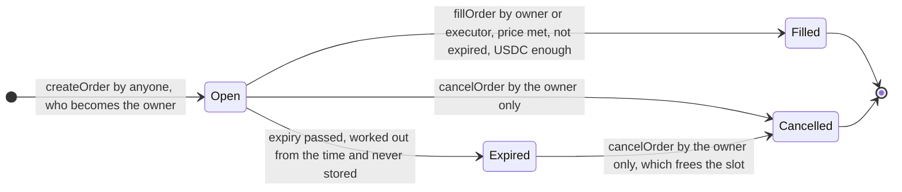

# Ledger Trigger: project specification

**Ledger Trigger: on-chain limit orders to buy ETH with USDC.** A course project: a Solidity contract, a small program that watches the price, and a web page, all running on a local Hardhat chain.

- Repository: `<repository URL>`
- Author: Zhen Zhu

This document is for someone who meets the project for the first time. Each part first says why, then what. The full technical description is [contract-spec.md](contract-spec.md); which test covers which scenario is in [test-matrix.md](test-matrix.md); the live demonstration is [demo-script.md](demo-script.md).

## 0. Problem and design

**The problem.** A user wants to buy ETH automatically once its price falls to a level they choose, and have the ETH sent straight to a cold wallet. Until the purchase happens, the money should stay in the user's own wallet.

**The idea.** A limit order: "when ETH costs this much or less, spend this much USDC on it and send the ETH to this address". Placing the order moves no money. When the price feed reports a price at or below the target, the owner of the order, or the executor the owner named in it, calls `fillOrder`; only then does the contract take the USDC from the owner, swap it for ETH and send the ETH to the recipient.

**The design.** Three parts work together:

- **One contract, `LedgerTrigger`, with no admin.** It holds the orders and has three functions that change state: place, fill and cancel an order.
- **The keeper**, an off-chain program on the user's computer, that only presses the button. Each round it looks at the open orders that name its account as executor, asks the contract whether each can be filled, and only then sends `fillOrder`. The contract does not trust the keeper and checks everything itself.
- **A price feed and a swap venue.** The contract reads the ETH / USD price from a price feed with the same interface as a Chainlink price feed, and swaps USDC for ETH at a swap venue. Both are fixed when the contract is deployed. On the local chain, `MockPriceFeed`, `MockSwapVenue` and the test token `MockUSDC` stand in for them.

**What the system guarantees.**

1. Three functions change state: place, fill and cancel an order. Placing moves no money; only a fill takes USDC from the owner's wallet, swaps it for ETH and sends the ETH to the recipient. The owner can cancel an open order at any time, expired or not.
2. Three roles: owner, executor and recipient. There is no admin. Only the owner can cancel an order; only the owner and the executor named in that order can fill it.
3. Every fill gives two hard guarantees: the price paid is never above the target price, and the ETH received is never less than the price feed's price gives, minus the allowed slippage. Both minimums are whole numbers rounded down, so each can fall short of the exact value by less than one wei.
4. An order is stored as `Open`, `Filled` or `Cancelled`. `Expired` is never stored; it is worked out from the time. `Filled` and `Cancelled` are final.
5. The contract keeps no money: its USDC and ETH balances are the same before and after every fill. This is a promise about fills only; part 4, group 6, says what happens to USDC sent straight to the contract.

**Why it is built this way.**

1. _Why the contract never holds funds between orders._ Placing an order moves nothing; the USDC leaves the owner's wallet only inside the fill itself, so a compromised contract or keeper finds nothing to take beyond what the current fill moves.
2. _Why there is no admin._ No owner, pause or upgrade exists, so nobody, the author included, can change the rules, freeze an order or redirect funds; the rules a user reads are the rules that run.
3. _Why the keeper cannot cheat._ The keeper only chooses when to call `fillOrder`; the contract itself checks the caller, the feed price, the expiry and the USDC, and sends the ETH to the recipient named when the order was placed, never to the caller, so a hostile keeper can at most do nothing.

The web page in `web/` shows the contract at work on a local chain: the price, the balances, the order form, the orders and the events.


## 1. Roles and permissions

Who may do what is decided order by order: the owner names an executor and a recipient in each order, and there is no admin.

| Role                    | Who                                                                    | Can                                                                                                                                                 | Cannot                                                                                                                         |
| ----------------------- | ---------------------------------------------------------------------- | --------------------------------------------------------------------------------------------------------------------------------------------------- | ------------------------------------------------------------------------------------------------------------------------------ |
| Owner (`owner`)         | The account that calls `createOrder`                                   | Place orders; cancel its own orders, expired or not; fill its own orders                                                                            | Touch anyone else's orders                                                                                                     |
| Executor (`executor`)   | An address the owner names in each order, usually the keeper's account | Fill that one order                                                                                                                                 | Cancel it; touch orders that do not name it; change any setting                                                                |
| Recipient (`recipient`) | An address the owner names in each order, usually a cold wallet        | Receive the ETH of that order                                                                                                                       | Call anything because it is the recipient: the role gives no rights                                                            |
| Anyone                  | Any account                                                            | Read an order, its status, whether it can be filled now, and an owner's open-order count and total; place orders of its own, and so become an owner | Change anything about an order it does not own or execute; send ETH to the contract (only the swap venue can)                  |
| Deployer                | Whoever deploys the contract                                           | Choose the seven deployment parameters, once                                                                                                        | Change them later, pause the contract, upgrade it or take money out of it: there is no admin, so nobody can, deployer included |

The executor is not an admin: each owner names it in each order, and it has rights over that order only. An owner may name itself as executor, and may name itself as recipient. In the code, `onlyOrderOwner` guards `cancelOrder` and `onlyOrderOwnerOrExecutor` guards `fillOrder` (part 3, "Modifiers").

## 2. Functions

The contract has three functions that change an order, five read functions, a `receive` function for the ETH a swap pays, and nine values that anyone can read.

| Function                                                                                                                                      | Who can call                           | What it does                                                                                                                                                                                                         | Event            |
| --------------------------------------------------------------------------------------------------------------------------------------------- | -------------------------------------- | -------------------------------------------------------------------------------------------------------------------------------------------------------------------------------------------------------------------- | ---------------- |
| `createOrder(usdcAmount, targetPrice, recipient, executor, expiry)`, returns `orderId`                                                        | Anyone; the caller becomes the owner   | Checks the input and stores an `Open` order. Moves no money and needs no USDC allowance yet. IDs start at 1 and go up by one                                                                                         | `OrderCreated`   |
| `fillOrder(orderId)`                                                                                                                          | Only the order's owner or its executor | Runs the checks, marks the order `Filled`, then takes the USDC from the owner, swaps it for ETH and sends all of that ETH to the recipient. It takes no address and no instruction from the caller                   | `OrderFilled`    |
| `cancelOrder(orderId)`                                                                                                                        | Only the order's owner                 | Turns an `Open` order, expired or not, into `Cancelled` and frees its slot. Reads nothing outside the contract, so it works whatever the price feed, the swap venue or the keeper does                               | `OrderCancelled` |
| `getOrder(orderId)`                                                                                                                           | Anyone, read only                      | Returns every field of the order, with the stored status: an expired order still shows `Open` here                                                                                                                   | -                |
| `statusOf(orderId)`                                                                                                                           | Anyone, read only                      | Returns the status now: `Expired` for an order stored as `Open` whose expiry has passed                                                                                                                              | -                |
| `canFill(orderId)`, returns `fillable` and `reason`                                                                                           | Anyone, read only                      | Says whether the order can be filled now and, if not, the first reason why (a `FillBlocker`). Runs the same checks as `fillOrder`, apart from who the caller is, and does not try the swap. The keeper asks it first | -                |
| `openOrderCount(owner)`, `openOrderTotal(owner)`                                                                                              | Anyone, read only                      | How many open orders an address has, expired ones included, and their USDC amounts added up. The total is the allowance the owner needs to give the contract                                                         | -                |
| `receive()`                                                                                                                                   | Only the swap venue gets through       | Accepts the ETH a swap pays during a fill. ETH from anyone else is rejected, so nobody can lose ETH by sending it here by mistake                                                                                    | -                |
| `usdc`, `priceFeed`, `swapVenue`, `maxOrderAmount`, `maxOpenOrdersPerOwner`, `maxPriceAge`, `maxSlippageBps`, `usdcDecimals`, `priceDecimals` | Anyone, read only; never reverts       | The seven deployment parameters, and the decimals of the token and of the price feed read at deployment                                                                                                              | -                |
| `constructor(usdc, priceFeed, swapVenue, maxOrderAmount, maxOpenOrdersPerOwner, maxPriceAge, maxSlippageBps)`                                 | Whoever deploys the contract           | Checks and stores the seven parameters and reads the two decimals. Nothing can change them later                                                                                                                     | -                |

The parameters of `createOrder`: `usdcAmount` is the USDC to spend, in its smallest unit (6 decimals, so 100 USDC is `100000000`); `targetPrice` is the highest ETH price in USD the owner accepts, with the price feed's decimals (8 for an ETH / USD feed, so 1500 USD is `150000000000`); `recipient` receives the ETH; `executor` may fill the order besides the owner; `expiry` is the last second, in Unix time, at which the order can be filled. `orderId` is the order's number.

### When each function rejects

Every check the contract itself makes rejects with a named error, listed here in the order the function checks. An error raised by the price feed, the USDC token or the swap venue is passed on as it is. A rejected call changes nothing.

| Function                                    | Rejects with, in this order                                                                                                                                                                                                                                                                                                                                                                                                                                                                                             |
| ------------------------------------------- | ----------------------------------------------------------------------------------------------------------------------------------------------------------------------------------------------------------------------------------------------------------------------------------------------------------------------------------------------------------------------------------------------------------------------------------------------------------------------------------------------------------------------- |
| `createOrder`                               | `ZeroAmount`; `AmountAboveMax`; `ZeroTargetPrice`; `ZeroRecipient`; `ZeroExecutor`; `ExpiryNotInFuture` when the expiry is not after the current block's time; `TooManyOpenOrders` when the caller already has `maxOpenOrdersPerOwner` open orders, expired ones included                                                                                                                                                                                                                                               |
| `fillOrder`                                 | `ReentrancyGuardReentrantCall` for a call made while a fill is running; `OrderNotFound`; `NotOrderOwnerOrExecutor`; `OrderNotOpen` when the order is `Filled` or `Cancelled`; `OrderExpired`; `InvalidPrice`; `StalePrice`; `PriceAboveTarget`; `InsufficientAllowance`; `InsufficientBalance`. Then, while the money moves: `SafeERC20FailedOperation`, `SwapUsdcMismatch`, `InsufficientEthOut`, `EthTransferFailed`. An error raised by the price feed, the USDC token or the swap venue itself rejects the fill too |
| `cancelOrder`                               | `OrderNotFound`; `NotOrderOwner`; `OrderNotOpen` when the order is already `Filled` or `Cancelled`                                                                                                                                                                                                                                                                                                                                                                                                                      |
| `getOrder`, `statusOf`, `canFill`           | `OrderNotFound` for an ID that no order has, ID 0 included. `canFill` also reverts when the price feed or the USDC token reverts as it reads them                                                                                                                                                                                                                                                                                                                                                                       |
| `openOrderCount`, `openOrderTotal`, getters | Never; an address with no orders gets zero                                                                                                                                                                                                                                                                                                                                                                                                                                                                              |
| `receive`                                   | `UnexpectedEthSender` for ETH from anyone but the swap venue                                                                                                                                                                                                                                                                                                                                                                                                                                                            |
| `constructor`                               | `ZeroUsdc`; `ZeroPriceFeed`; `ZeroSwapVenue`; `ZeroMaxOrderAmount`; `ZeroMaxOpenOrdersPerOwner`; `ZeroMaxPriceAge`; `SlippageTooHigh` when the slippage is 100 % or more. It also reverts when the token or the price feed does not report its decimals                                                                                                                                                                                                                                                                 |

Three boundaries are fixed: a price exactly `maxPriceAge` seconds old still counts, a price equal to the target price can fill, and an order can still be filled in the very second of its expiry.

## 3. Data structures

The contract stores three things: the orders, which are never deleted; for each owner, the count and USDC total of its open orders; and seven settings and two decimals that never change.

### Deployment parameters

Seven values are given at deployment and stored as immutables: nothing can change them afterwards. The contract has no defaults of its own; the last column shows what the deployment scripts in this repository use, and an environment variable can change each of the four limits.

| Name                    | Meaning                                                        | With the deployment scripts                                                |
| ----------------------- | -------------------------------------------------------------- | -------------------------------------------------------------------------- |
| `usdc`                  | The USDC token that orders spend                               | Locally, a new `MockUSDC`; on the Sepolia test network, Circle's test USDC |
| `priceFeed`             | The price feed for ETH in USD                                  | Locally, a new `MockPriceFeed`; on Sepolia, Chainlink's ETH / USD feed     |
| `swapVenue`             | The swap venue that turns USDC into ETH                        | Always a new `MockSwapVenue`                                               |
| `maxOrderAmount`        | The largest amount of one order                                | 500 USDC                                                                   |
| `maxOpenOrdersPerOwner` | How many open orders one owner may have at the same time       | 5                                                                          |
| `maxPriceAge`           | How old, in seconds, a price may be and still count            | 4500 seconds (75 minutes)                                                  |
| `maxSlippageBps`        | The allowed slippage, in basis points (100 basis points = 1 %) | 100, that is 1 %                                                           |

At deployment the contract also reads the decimals of the token and of the price feed and stores them as `usdcDecimals` and `priceDecimals`, so no decimals are written into the code. One USDC is taken to be worth one US dollar.

### Structs

`Order`, one order:

| Field         | Meaning                                                                                          |
| ------------- | ------------------------------------------------------------------------------------------------ |
| `owner`       | The account that placed the order                                                                |
| `executor`    | The one address besides the owner that may fill it                                               |
| `recipient`   | Where the ETH goes                                                                               |
| `usdcAmount`  | How much USDC to spend, in its smallest unit (6 decimals)                                        |
| `targetPrice` | The highest ETH price in USD the owner accepts, written like the feed's price (8 decimals)       |
| `createdAt`   | The time of the block that placed the order                                                      |
| `expiry`      | The last second, in Unix time, at which the order can be filled; one second later it has expired |
| `status`      | The stored status: `Open`, `Filled` or `Cancelled`, never `Expired`                              |

After an order is placed, its owner, executor and recipient never change.

`OpenOrders`, for one owner: the number of open orders (`count`) and their USDC amounts added up (`total`). `FillCheck` (private): what the fill checks found for one order, so that `canFill` and `fillOrder` run one and the same set of checks.

### Mappings

- `orders`: order ID to `Order`. IDs start at 1 and go up by one; an ID is never used twice, and an order is never deleted. Read it with `getOrder`.
- `openOrdersOf`: owner address to `OpenOrders`. An order counts there while its stored status is `Open`, expired or not. Read it with `openOrderCount` and `openOrderTotal`.

### Enums

`OrderStatus`, where an order stands:

| Value       | Meaning                                                                                   |
| ----------- | ----------------------------------------------------------------------------------------- |
| `None`      | No order has this ID. Never returned: the read functions reject such an ID instead        |
| `Open`      | Placed, and not yet filled or cancelled                                                   |
| `Filled`    | Filled. Final                                                                             |
| `Cancelled` | Cancelled by its owner. Final                                                             |
| `Expired`   | Never stored. `statusOf` returns it for an order stored as `Open` whose expiry has passed |

`FillBlocker`, why an order cannot be filled right now, as `canFill` reports it. When several apply, the first in this list is reported.

| Value                   | Meaning                                                                                 |
| ----------------------- | --------------------------------------------------------------------------------------- |
| `None`                  | Nothing stops the fill                                                                  |
| `NotOpen`               | The order is `Filled` or `Cancelled`                                                    |
| `Expired`               | Its expiry has passed                                                                   |
| `InvalidPrice`          | The feed's price is zero or below, or its update time is after the current block's time |
| `StalePrice`            | The price is older than `maxPriceAge`                                                   |
| `PriceAboveTarget`      | The price is above the order's target price                                             |
| `InsufficientAllowance` | The owner's USDC allowance to the contract is below the order amount                    |
| `InsufficientBalance`   | The owner's USDC balance is below the order amount                                      |

### Events

One event for each change of state, kept on the chain for good.

| Event            | Fields                                                                                                                                                                  | Indexed                           |
| ---------------- | ----------------------------------------------------------------------------------------------------------------------------------------------------------------------- | --------------------------------- |
| `OrderCreated`   | `orderId`, `owner`, `executor`, `recipient`, `usdcAmount`, `targetPrice`, `expiry`                                                                                      | `orderId`, `owner`, `executor`    |
| `OrderFilled`    | `orderId`, `owner`, `filledBy` (the owner or the executor), `recipient`, `usdcAmount`, `ethReceived` (the ETH the recipient got, in wei), `price` (the feed price used) | `orderId`, `owner`, `filledBy`    |
| `OrderCancelled` | `orderId`, `owner`, `afterExpiry` (whether the order had already expired)                                                                                               | `orderId`, `owner`, `afterExpiry` |

The contract keeps no list of the orders that name an executor: the keeper finds its orders by searching `OrderCreated` for its own address as executor.

### Modifiers

| Modifier                   | Rejects                                                                                                            | Used by                                                       |
| -------------------------- | ------------------------------------------------------------------------------------------------------------------ | ------------------------------------------------------------- |
| `orderExists`              | An ID that no order has (`OrderNotFound`)                                                                          | `fillOrder`, `cancelOrder`, `getOrder`, `statusOf`, `canFill` |
| `onlyOrderOwner`           | Any caller but the order's owner (`NotOrderOwner`)                                                                 | `cancelOrder`                                                 |
| `onlyOrderOwnerOrExecutor` | Any caller but the order's owner and its executor (`NotOrderOwnerOrExecutor`)                                      | `fillOrder`                                                   |
| `onlyOpen`                 | An order whose stored status is not `Open` (`OrderNotOpen`); an expired order is still stored as `Open` and passes | `cancelOrder`                                                 |

`fillOrder` also carries OpenZeppelin's reentrancy guard (`nonReentrant`), placed first. It checks the order's status as part of the fill checks it shares with `canFill`, rather than with `onlyOpen`.

### Errors

Every reason the contract itself has to reject a call has its own named error, never a sentence in a string, so the tests and the keeper can tell the reasons apart. Many errors carry the values that caused them.

| Group                     | Errors, with the values they carry                                                                                                                                                                                                                                                        |
| ------------------------- | ----------------------------------------------------------------------------------------------------------------------------------------------------------------------------------------------------------------------------------------------------------------------------------------- |
| Placing an order          | `ZeroAmount()`, `AmountAboveMax(amount, max)`, `ZeroTargetPrice()`, `ZeroRecipient()`, `ZeroExecutor()`, `ExpiryNotInFuture(expiry, currentTime)`, `TooManyOpenOrders(owner, max)`                                                                                                        |
| Which order, which caller | `OrderNotFound(orderId)`, `NotOrderOwner(orderId, caller)`, `NotOrderOwnerOrExecutor(orderId, caller)`, `OrderNotOpen(orderId, status)`                                                                                                                                                   |
| The fill checks           | `OrderExpired(orderId, expiry)`, `InvalidPrice(price)`, `StalePrice(updatedAt, maxPriceAge)`, `PriceAboveTarget(price, targetPrice)`, `InsufficientAllowance(allowance, needed)`, `InsufficientBalance(balance, needed)`                                                                  |
| While the money moves     | `SwapUsdcMismatch(expectedBalance, actualBalance)`, `InsufficientEthOut(received, minEthOut)`, `EthTransferFailed(recipient, amount)`                                                                                                                                                     |
| ETH sent to the contract  | `UnexpectedEthSender(sender)`                                                                                                                                                                                                                                                             |
| Deployment                | `ZeroUsdc()`, `ZeroPriceFeed()`, `ZeroSwapVenue()`, `ZeroMaxOrderAmount()`, `ZeroMaxOpenOrdersPerOwner()`, `ZeroMaxPriceAge()`, `SlippageTooHigh(maxSlippageBps)`                                                                                                                         |
| From OpenZeppelin         | `ReentrancyGuardReentrantCall()`, for a call to `fillOrder` made while a fill is running; `SafeERC20FailedOperation(token)`, when a USDC transfer returns something other than true, such as false, instead of reverting, or an approval of the swap venue returns false when tried again |

## 4. Security rules

The rules fall into six groups, the same as in [contract-spec.md](contract-spec.md), part 4.

**1. Access control**

- Only the owner can cancel an order. The executor cannot either.
- Only the owner or the order's executor can fill it.
- There is no admin, no pause, no upgrade and no function that changes a parameter. All deployment parameters are immutable.

**2. State transitions**

- Only an `Open` order can become `Filled` or `Cancelled`. Both are final: an order never leaves them, and never goes from one to the other.
- An order whose expiry has passed cannot be filled. The only thing still possible is for its owner to cancel it.
- Order IDs are never reused, and a cancelled order never comes back.

**3. Payment safety**

- A fill always runs in this order: check, then mark the order `Filled`, and only then move money: take the USDC, swap it, send the ETH. A reentrancy guard comes on top.
- USDC is taken only from the order's owner, only the order amount, and only once per order.
- The swap venue's address is fixed at deployment. `fillOrder` takes no address and no instruction from its caller.
- If the swap brings in less ETH than the minimum output, the whole fill is rejected. The minimum is the larger of "not above the target" and "within the allowed slippage of the feed price".
- After the swap, the swap venue's allowance is set back to zero.
- If the swap venue does not take exactly the order amount, or the ETH cannot be sent to the recipient, the whole fill is rejected: the order stays `Open` and the owner's USDC does not move.

**4. Input validation**

- When an order is placed: the amount is above zero and not above `maxOrderAmount`; the target price is above zero; neither the recipient nor the executor is the zero address; the expiry is in the future; the caller has fewer open orders than `maxOpenOrdersPerOwner`. Any check that fails rejects the order.
- At deployment: none of the three addresses is the zero address; `maxOrderAmount`, `maxOpenOrdersPerOwner` and `maxPriceAge` are above zero; `maxSlippageBps` is below 100 %, and may be zero.

**5. Auditability**

- Orders are never deleted. At any time, any order can be looked up by its ID, with all its fields and how it ended.
- Placing, filling and cancelling each emit an event. The fill event records the feed price used and the ETH actually received, so anyone can check afterwards that the price paid was not above the target.
- The cancel event records whether the order had already expired.

**6. Consistent ownership**

- The contract always knows each order's owner, executor and recipient, and none of the three can change after the order is placed.
- For every address, the open-order count and total always equal the number and the USDC sum of its orders whose stored status is `Open`.
- The contract keeps no money: its USDC and ETH balances are the same before and after every fill. USDC sent straight to the contract cannot be refused, and stays there for good, untouched by any fill.

## 5. State machine

An order is placed as `Open` and can end only as `Filled` or `Cancelled`. The diagram is the same as in [contract-spec.md](contract-spec.md), part 5.



`Filled` and `Cancelled` are the final states: an order can never be both filled and cancelled, and never leaves either. `Expired` is never stored: `statusOf` works the status out each time it is asked, from the expiry and the current block's time. In storage an expired order is still `Open`, and the contract has no clock and cannot free a slot by itself when an order expires, so the order keeps one of its owner's open-order slots until the owner cancels it; it can no longer be filled. When a fill and a cancel of the same order are sent at the same time, whichever the chain includes first takes effect, and the other is rejected.

## 6. Test scenarios

Each of the 26 scenarios below has at least one test. Expected results are written in four forms: a status change (`Open -> Filled`), "transaction must revert", "second call must revert", and "explicit error". [test-matrix.md](test-matrix.md) names the tests for each scenario, and `npm run check` fails if a scenario has no test.

| ID  | Scenario                          | How                                                                                                                                            | Expected result                                                                                   |
| --- | --------------------------------- | ---------------------------------------------------------------------------------------------------------------------------------------------- | ------------------------------------------------------------------------------------------------- |
| S01 | Normal fill                       | Place an order; the price falls to the target; the executor fills it                                                                           | `Open -> Filled`; the ETH goes to the recipient, not to the caller                                |
| S02 | The owner fills                   | As S01, but the owner fills it                                                                                                                 | `Open -> Filled`                                                                                  |
| S03 | Cancel                            | Place an order; the owner cancels it                                                                                                           | `Open -> Cancelled`                                                                               |
| S04 | A stranger fills                  | An account that is neither the owner nor the executor fills                                                                                    | Transaction must revert                                                                           |
| S05 | Someone else cancels              | A stranger cancels; the executor cancels                                                                                                       | Transaction must revert                                                                           |
| S06 | Price not reached                 | Fill while the price is above the target                                                                                                       | Transaction must revert; the order stays `Open`                                                   |
| S07 | Filled twice                      | Fill the same order twice                                                                                                                      | Second call must revert                                                                           |
| S08 | Fill after cancel                 | Cancel an order, then fill it                                                                                                                  | Transaction must revert                                                                           |
| S09 | Cancel after fill                 | Fill an order, then cancel it                                                                                                                  | Transaction must revert                                                                           |
| S10 | Fill after expiry                 | Move the time past the expiry, then fill                                                                                                       | Transaction must revert; `statusOf` returns `Expired`                                             |
| S11 | Expiry boundary                   | Fill in the very second of the expiry; fill one second later                                                                                   | The first fills; the second must revert                                                           |
| S12 | Cancel after expiry               | The owner cancels an expired order                                                                                                             | It becomes `Cancelled`; one open-order slot is freed                                              |
| S13 | Price too old                     | The feed's last update is older than `maxPriceAge`                                                                                             | Transaction must revert                                                                           |
| S14 | Bad price                         | The feed reports zero or a negative price                                                                                                      | Transaction must revert                                                                           |
| S15 | Allowance too small               | The owner's allowance is below the order amount                                                                                                | Transaction must revert; the order stays `Open`; once the allowance is topped up, the order fills |
| S16 | Balance too small                 | The owner holds less USDC than the order amount                                                                                                | Transaction must revert; the order stays `Open`                                                   |
| S17 | Balance larger than the order     | The owner holds more USDC than the order amount, and the order fills                                                                           | Only the order amount is taken; the rest does not move                                            |
| S18 | A sixth order                     | Five orders are open; place one more                                                                                                           | Transaction must revert; once one is cancelled, a new one can be placed                           |
| S19 | Two orders, allowance for one     | Two orders, and an allowance that covers one of them                                                                                           | The first fills; the second is rejected (allowance too small); once topped up, it fills           |
| S20 | Bad input when placing            | Amount zero; amount above the single-order limit; target price zero; recipient the zero address; executor the zero address; expiry in the past | Each one must revert                                                                              |
| S21 | Too little ETH from the swap      | The swap venue gives less than the minimum output                                                                                              | Transaction must revert; the owner's USDC does not move                                           |
| S22 | Reentrancy                        | The recipient is a hostile contract that calls `fillOrder` again when it receives the ETH                                                      | The same order is never filled twice                                                              |
| S23 | Recipient cannot take ETH         | The recipient is a contract that refuses ETH                                                                                                   | Transaction must revert; the order stays `Open`; the USDC does not move                           |
| S24 | Unknown order                     | Look up an ID that no order has                                                                                                                | Explicit error (`OrderNotFound`)                                                                  |
| S25 | The contract keeps no money       | Any fill                                                                                                                                       | The contract's USDC and ETH balances after the fill equal those before it                         |
| S26 | ETH sent straight to the contract | Someone other than the swap venue sends ETH to the contract                                                                                    | Transaction must revert                                                                           |

`npm run demo` plays six of these on a fresh local chain: S01 and S03, which must succeed, and S04, S06, S07 and S15, which must be rejected. The live demonstration ([demo-script.md](demo-script.md)) shows S01, S03, S04, S06, S09 and S20 on the web page and in a terminal.

## 7. Where to look

Each point the course grades on, and where in the repository to find it. Test titles are written as in [test-matrix.md](test-matrix.md); scenes are those of [demo-script.md](demo-script.md).

| Grading point                                                          | Files                                                                                                                                                                                                   | Tests                                                                                                                                                                                                                                                                                                                                                 | Demo                                                    |
| ---------------------------------------------------------------------- | ------------------------------------------------------------------------------------------------------------------------------------------------------------------------------------------------------- | ----------------------------------------------------------------------------------------------------------------------------------------------------------------------------------------------------------------------------------------------------------------------------------------------------------------------------------------------------- | ------------------------------------------------------- |
| Correctness of the contract logic                                      | `contracts/LedgerTrigger.sol`; [contract-spec.md](contract-spec.md), Appendix A (the steps of a fill and the minimum output)                                                                            | S01, S02, S03, S17, S19, S25 in `test/LedgerTriggerFill.ts` and `test/LedgerTriggerOrders.ts`; in `test/LedgerTriggerCanFill.ts`, the tests that show `canFill` and `fillOrder` agree, such as `None: canFill reports the order fillable and the owner's fill goes through`                                                                           | Scenes 2 and 5 (S01), scene 7 (S03)                     |
| Use of Solidity concepts (structs, mappings, enums, modifiers, events) | `contracts/LedgerTrigger.sol`: structs `Order`, `OpenOrders`, `FillCheck`; mappings `orders`, `openOrdersOf`; enums `OrderStatus`, `FillBlocker`; four modifiers; three events. Part 3 of this document | `S01 OrderFilled names the order, its owner, ${label} as the one who filled it, the recipient, the USDC, the ETH the recipient got and the feed price`; `S03 emits OrderCancelled with the order, its owner and not-after-expiry, and nothing else`; `indexes orderId, owner and executor in OrderCreated, so one executor's orders can be looked up` | The event list in scenes 2, 5 and 7                     |
| Security and access control                                            | `contracts/LedgerTrigger.sol` (the modifiers and `receive`); `contracts/hostile/`; part 4 of this document                                                                                              | S04, S05, S21, S22, S23, S26 in `test/LedgerTriggerFill.ts`, `test/LedgerTriggerOrders.ts`, `test/LedgerTriggerFillGuards.ts` and `test/LedgerTriggerHostile.ts`                                                                                                                                                                                      | Scene 4 (S04)                                           |
| Edge cases and invalid state transitions                               | Part 5 of this document; [contract-spec.md](contract-spec.md), part 5                                                                                                                                   | S07, S08, S09, S10, S11, S12, S13, S14, S16, S18, S20, S24                                                                                                                                                                                                                                                                                            | Scene 3 (S06), scene 6 (S09), scene 8 (S20)             |
| Testing and demonstration                                              | `test/`; [test-matrix.md](test-matrix.md); `scripts/demo.ts`; `scripts/scenarios.ts`; `web/`; [demo-script.md](demo-script.md)                                                                          | All 26 scenarios; in `test/demo.ts`, `plays S01, S03, S04, S06, S07 and S15 in order, and every one passes`                                                                                                                                                                                                                                           | The whole script; the closing scene runs `npm run demo` |
| Clarity for another student                                            | This document; [contract-spec.md](contract-spec.md); `README.md`; the documentation comments in `contracts/LedgerTrigger.sol`                                                                           | `npm run check`, step `lint`: every contract, function, event and public value must have its documentation comment                                                                                                                                                                                                                                    | Scene 1: one sentence on what the contract guarantees   |

## 8. How to run it

```sh
npm ci
npm run check
npm run demo
```

`npm ci` installs the exact package versions; `npm run check` runs every check, the tests included; `npm run demo` plays six scenarios on a fresh local chain. [README.md](../README.md) gives the details: requirements, the local node, the keeper and the web page.
