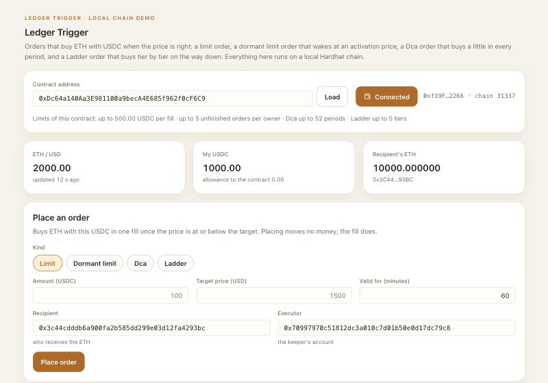
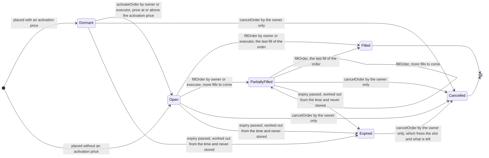

# Ledger Trigger: project specification

**Ledger Trigger: orders on the chain that buy ETH with USDC when the price is right, in four kinds, with a receipt for every fill.** A course project: two Solidity contracts, a small program that watches the price, and a web page, all running on a local Hardhat chain.

- Repository: [https://github.com/Zhen131/ZHENNs_Ledger_Trigger](https://github.com/Zhen131/ZHENNs_Ledger_Trigger)
- Author: Zhen Zhu

This document is for someone who meets the project for the first time. Each part first says why, then what. The full technical description is [contract-spec.md](contract-spec.md); which test covers which scenario is in [test-matrix.md](test-matrix.md); the live demonstration is [demo-script.md](demo-script.md).

## 0. Problem and design

**The problem.** A user wants to buy ETH automatically when the price is right, and have the ETH sent straight to a cold wallet. Until each purchase happens, the money should stay in the user's own wallet. "Buy once the price falls to this level" is not the only rule the user wants: also "start waiting for a fall only after the price has first risen to some level", "buy a set amount at regular intervals", and "buy in several steps as the price falls". And each purchase should leave a record that the user holds.

**The idea.** Orders of four kinds. A plain limit order: "when ETH costs this much or less, spend this much USDC on it and send the ETH to this address". A dormant limit order: the same, but it sleeps until the price first rises to an activation price and is woken up. A `Dca` order (dollar-cost averaging): from a start time, buy a set amount once in every period, for a number of periods, each time at no more than a price cap; a period that passes without a purchase is skipped. A `Ladder` order: a few tiers, each a price and an amount, at falling prices, bought one tier at a time and in order. Placing an order moves no money. Each fill takes only its own share from the owner's wallet: all of a limit order, one period of a `Dca` order, the next tier of a `Ladder` order. Each fill also gives the owner a receipt.

**The design.** Three parts work together:

- **Two contracts, with no admin.** `LedgerTrigger` holds the orders and has seven functions that change state: four that place an order (`createOrder`, `createDormantOrder`, `createDcaOrder`, `createLadderOrder`), `activateOrder`, `fillOrder` and `cancelOrder`. `FillReceipt` issues a receipt for each fill: an ERC-721 token, which is unique, records the fill and can never be transferred. Only `LedgerTrigger` can issue receipts, and the two are bound to each other when they are deployed.
- **The keeper**, an off-chain program on the user's computer, that only presses the buttons. Each round it looks at the orders that name its account as executor: it wakes up each dormant one that the contract says can be activated now (`canActivate`), then fills each open or partly filled one as often as the contract says it can be filled now (`canFill`), up to a limit per round. The contracts do not trust the keeper and check everything themselves.
- **A price feed and a swap venue.** `LedgerTrigger` reads the ETH / USD price from a price feed with the same interface as a Chainlink price feed, and swaps USDC for ETH at a swap venue. Both are fixed when the contract is deployed. On the local chain, `MockPriceFeed`, `MockSwapVenue` and the test token `MockUSDC` stand in for them.

**What the system guarantees.**

1. Seven functions change state: four that place an order, one that activates a dormant order, one that fills and one that cancels. Placing and activating move no money; only a fill takes USDC from the owner's wallet, swaps it for ETH and sends the ETH to the recipient, and each fill takes only this fill's share: all of a limit order, one period of a `Dca` order, the next tier of a `Ladder` order. The owner can cancel an order that is not finished at any time, dormant, open or partly filled, expired or not; what it has already bought is not given back.
2. Three roles: owner, executor and recipient. There is no admin. Only the owner and the executor named in an order can activate or fill it; only the owner can cancel it. The receipt contract has no admin either. Nobody can pause either contract, upgrade it, change its settings or take money out of it.
3. Every fill gives two hard guarantees: the price paid is never above this fill's price cap (the target price of a limit order, the cap of every period of a `Dca` order, the price of the tier being bought of a `Ladder` order), and the ETH received is never less than the price feed's price gives, minus the allowed slippage. Both minimums are whole numbers rounded down, so each can fall short of the exact value by less than one wei.
4. An order is stored as `Dormant`, `Open`, `PartiallyFilled`, `Filled` or `Cancelled`. `Expired` is never stored; it is worked out from the time. `Filled` and `Cancelled` are final.
5. The contracts keep no money: the USDC and ETH balances of both contracts are the same before and after every fill. This is a promise about fills only; part 4, group 6, says what happens to USDC sent straight to a contract. Each receipt stands for exactly one fill, is issued to the owner of the order that was filled, and can never be transferred; nobody can be approved to transfer it either.

**Why it is built this way.**

1. _Why the contract never holds funds between fills._ Placing and activating an order move nothing; the USDC leaves the owner's wallet only inside a fill, and only this fill's share, so a compromised contract or keeper finds nothing to take beyond what the current fill moves.
2. _Why there is no admin._ Neither contract has an owner, a pause or an upgrade, so nobody, the author included, can change the rules, freeze an order, redirect funds or move a receipt; the rules a user reads are the rules that run.
3. _Why the keeper cannot cheat._ The keeper only chooses when to call `activateOrder` and `fillOrder`. The contract itself checks the caller, the feed price (against the activation price, or against this fill's price cap), the expiry, the period of a `Dca` order or the next tier of a `Ladder` order, and the USDC; and it sends the ETH only to the recipient named when the order was placed, never to the caller. So a hostile keeper can at most do nothing, or act at a moment the order's own rules allow.

The web page in `web/` shows the contracts at work on a local chain: the price, the balances and the contract's limits; an order form for all four kinds; the orders, with their kind, their progress (`fills n of N`), the schedule of a `Dca` order or the tiers of a `Ladder` order, and an Activate button on a dormant order; and the events.



## 1. Roles and permissions

Who may do what is decided order by order: the owner names an executor and a recipient in each order, and there is no admin. A second contract issues the receipts, and it listens to one order contract only.

| Role                    | Who                                                                               | Can                                                                                                                                                                                                                                          | Cannot                                                                                                                            |
| ----------------------- | --------------------------------------------------------------------------------- | -------------------------------------------------------------------------------------------------------------------------------------------------------------------------------------------------------------------------------------------- | --------------------------------------------------------------------------------------------------------------------------------- |
| Owner (`owner`)         | The account that places an order with one of the four functions that place orders | Place orders; activate and fill its own orders; cancel them, expired or not; receive one receipt for each fill of its orders                                                                                                                 | Touch anyone else's orders; transfer a receipt, or approve anyone to                                                              |
| Executor (`executor`)   | An address the owner names in each order, usually the keeper's account            | Activate and fill that one order                                                                                                                                                                                                             | Cancel it; touch orders that do not name it; change any setting                                                                   |
| Recipient (`recipient`) | An address the owner names in each order, usually a cold wallet                   | Receive the ETH of every fill of that order                                                                                                                                                                                                  | Call anything because it is the recipient: the role gives no rights                                                               |
| Anyone                  | Any account                                                                       | Read an order, its status, whether it can be filled or activated now, the schedule of a `Dca` order, the tiers of a `Ladder` order, an owner's open-order count and total, and the receipts; place orders of its own, and so become an owner | Change anything about an order it does not own or execute; send ETH to `LedgerTrigger` (only the swap venue can); issue a receipt |
| Receipt issuer          | `LedgerTrigger`, the one address `FillReceipt` is bound to at deployment          | Issue receipts, one in every fill                                                                                                                                                                                                            | Move or take back a receipt once it is issued                                                                                     |
| Deployer                | Whoever deploys the contracts                                                     | Choose the ten deployment parameters of `LedgerTrigger`, once                                                                                                                                                                                | Change them later, pause a contract, upgrade it or take money out of it: there is no admin, so nobody can, deployer included      |

The executor is not an admin: each owner names it in each order, and it has rights over that order only. An owner may name itself as executor, and may name itself as recipient. In the code, `onlyOrderOwner` guards `cancelOrder`, `onlyOrderOwnerOrExecutor` guards `activateOrder` and `fillOrder`, and in `FillReceipt` `onlyTrigger` guards `mint` (part 3, "Modifiers").

## 2. Functions

`LedgerTrigger` has seven functions that change an order, eight read functions, a `receive` function for the ETH a swap pays, and twelve values that anyone can read. `FillReceipt` has one function that issues a receipt, its own read function `receiptOf`, and OpenZeppelin's ERC-721 functions, of which those that would move a receipt or approve someone to are always refused.

| Function                                                                                                                                                                                           | Who can call                           | What it does                                                                                                                                                                                                                                                                                                                                                                                                                                                                          | Event                                                                   |
| -------------------------------------------------------------------------------------------------------------------------------------------------------------------------------------------------- | -------------------------------------- | ------------------------------------------------------------------------------------------------------------------------------------------------------------------------------------------------------------------------------------------------------------------------------------------------------------------------------------------------------------------------------------------------------------------------------------------------------------------------------------- | ----------------------------------------------------------------------- |
| `createOrder(usdcAmount, targetPrice, recipient, executor, expiry)`, returns `orderId`                                                                                                             | Anyone; the caller becomes the owner   | Checks the input and stores an `Open` limit order (kind `Limit`), filled once for its whole amount. Moves no money and needs no USDC allowance yet. IDs start at 1 and go up by one across all kinds                                                                                                                                                                                                                                                                                  | `OrderCreated`                                                          |
| `createDormantOrder(usdcAmount, targetPrice, activationPrice, recipient, executor, expiry)`, returns `orderId`                                                                                     | Anyone; the caller becomes the owner   | Stores a `Dormant` limit order; `activationPrice` must be above `targetPrice`. Once activated it is like an order placed with `createOrder`                                                                                                                                                                                                                                                                                                                                           | `OrderCreated`                                                          |
| `createDcaOrder(p)`, returns `orderId`                                                                                                                                                             | Anyone; the caller becomes the owner   | Stores a `Dca` order from a `DcaOrderParams`: from `startAt` on (0 for the block that places it), `usdcPerPeriod` once in each period of `periodLength` seconds, for `periodCount` periods, each time at no more than `targetPrice`; a missed period is skipped for good. Its budget is the amount per period times the number of periods; its expiry, worked out by the contract, is the last second of its last period. With an `activationPrice` above zero it is placed `Dormant` | `OrderCreated`, then `OrderScheduled`                                   |
| `createLadderOrder(p)`, returns `orderId`                                                                                                                                                          | Anyone; the caller becomes the owner   | Stores a `Ladder` order from a `LadderOrderParams`: one tier or more, up to `maxTiersPerOrder`, at strictly falling prices, filled one tier at a time and in order. Its budget is the tiers' amounts added up; its target price is the price of tier 0. With an `activationPrice` above zero, which must then be above the price of tier 0, it is placed `Dormant`                                                                                                                    | `OrderCreated`, then `OrderTiered`                                      |
| `activateOrder(orderId)`                                                                                                                                                                           | Only the order's owner or its executor | Turns a `Dormant` order into an `Open` one once the feed's price is at or above its activation price. Moves no money                                                                                                                                                                                                                                                                                                                                                                  | `OrderActivated`                                                        |
| `fillOrder(orderId)`                                                                                                                                                                               | Only the order's owner or its executor | Runs the checks, records the fill, then takes this fill's USDC from the owner, swaps it for ETH, sends all of that ETH to the recipient and has `FillReceipt` issue the owner a receipt. It takes no address and no instruction from the caller                                                                                                                                                                                                                                       | `OrderFilled` (and, from `FillReceipt`, `Transfer` and `ReceiptIssued`) |
| `cancelOrder(orderId)`                                                                                                                                                                             | Only the order's owner                 | Turns a `Dormant`, `Open` or `PartiallyFilled` order, expired or not, into `Cancelled`, frees its slot and takes what it had left off the owner's open total. Reads nothing outside the contract, so it works whatever the price feed, the swap venue or the keeper does                                                                                                                                                                                                              | `OrderCancelled`                                                        |
| `getOrder(orderId)`                                                                                                                                                                                | Anyone, read only                      | Returns every field of the order, with the stored status: an expired order still shows its stored status here                                                                                                                                                                                                                                                                                                                                                                         | -                                                                       |
| `getSchedule(orderId)`, `getTiers(orderId)`                                                                                                                                                        | Anyone, read only                      | The schedule of a `Dca` order; the tiers of a `Ladder` order, as given. Whatever the order's status                                                                                                                                                                                                                                                                                                                                                                                   | -                                                                       |
| `statusOf(orderId)`                                                                                                                                                                                | Anyone, read only                      | Returns the status now: `Expired` for an order stored as `Dormant`, `Open` or `PartiallyFilled` whose expiry has passed                                                                                                                                                                                                                                                                                                                                                               | -                                                                       |
| `canFill(orderId)`, returns `fillable` and `reason`                                                                                                                                                | Anyone, read only                      | Says whether the order can be filled now and, if not, the first reason why (a `FillBlocker`). Runs the same checks as `fillOrder`, apart from who the caller is, and does not try the swap or the receipt. The keeper asks it first                                                                                                                                                                                                                                                   | -                                                                       |
| `canActivate(orderId)`, returns `activatable` and `reason`                                                                                                                                         | Anyone, read only                      | Says whether the order can be activated now and, if not, the first reason why (an `ActivationBlocker`). Runs the same checks as `activateOrder`, apart from who the caller is. The keeper asks it first                                                                                                                                                                                                                                                                               | -                                                                       |
| `openOrderCount(owner)`, `openOrderTotal(owner)`                                                                                                                                                   | Anyone, read only                      | How many orders of an address are `Dormant`, `Open` or `PartiallyFilled`, expired ones included, and what they have left to spend, added up. The total is the allowance the owner needs to give the contract                                                                                                                                                                                                                                                                          | -                                                                       |
| `receive()`                                                                                                                                                                                        | Only the swap venue gets through       | Accepts the ETH a swap pays during a fill. ETH from anyone else is rejected, so nobody can lose ETH by sending it here by mistake                                                                                                                                                                                                                                                                                                                                                     | -                                                                       |
| `usdc`, `priceFeed`, `swapVenue`, `maxOrderAmount`, `maxOpenOrdersPerOwner`, `maxPriceAge`, `maxSlippageBps`, `maxPeriodsPerOrder`, `maxTiersPerOrder`, `receipt`, `usdcDecimals`, `priceDecimals` | Anyone, read only; never reverts       | The ten deployment parameters, and the decimals of the token and of the price feed read at deployment                                                                                                                                                                                                                                                                                                                                                                                 | -                                                                       |
| `constructor(usdc, priceFeed, swapVenue, maxOrderAmount, maxOpenOrdersPerOwner, maxPriceAge, maxSlippageBps, maxPeriodsPerOrder, maxTiersPerOrder, receipt)`                                       | Whoever deploys the contract           | Checks and stores the ten parameters, checks that the receipt contract is bound to this contract, and reads the two decimals. Nothing can change them later                                                                                                                                                                                                                                                                                                                           | -                                                                       |
| `FillReceipt`: `constructor(trigger)`                                                                                                                                                              | Whoever deploys it                     | Stores, for good, the order contract that alone may issue receipts                                                                                                                                                                                                                                                                                                                                                                                                                    | -                                                                       |
| `FillReceipt`: `mint(to, data)`, returns the receipt's ID                                                                                                                                          | Only `LedgerTrigger`                   | Issues the next receipt (IDs from 1, across all orders) to `to`, recording `data`, a `Receipt`                                                                                                                                                                                                                                                                                                                                                                                        | `Transfer` from the zero address, then `ReceiptIssued`                  |
| `FillReceipt`: `receiptOf(tokenId)`, `trigger()`                                                                                                                                                   | Anyone, read only                      | What a receipt records; the order contract it is bound to                                                                                                                                                                                                                                                                                                                                                                                                                             | -                                                                       |
| `FillReceipt`: `transferFrom`, both `safeTransferFrom`, `approve`, `setApprovalForAll`                                                                                                             | Anyone may call; always refused        | Nothing: a receipt never moves, and nobody can be approved to move it                                                                                                                                                                                                                                                                                                                                                                                                                 | -                                                                       |
| `FillReceipt`: `balanceOf`, `ownerOf`, `getApproved`, `isApprovedForAll`, `tokenURI`, `name`, `symbol`, `supportsInterface`                                                                        | Anyone, read only                      | OpenZeppelin's own ERC-721 read functions; `getApproved` always gives the zero address and `isApprovedForAll` false                                                                                                                                                                                                                                                                                                                                                                   | -                                                                       |

The inputs of `createOrder` and `createDormantOrder`: `usdcAmount` is the USDC to spend, in its smallest unit (6 decimals, so 100 USDC is `100000000`); `targetPrice` is the highest ETH price in USD the owner accepts, with the price feed's decimals (8 for an ETH / USD feed, so 1500 USD is `150000000000`); `activationPrice` is the price, written the same way, at or above which a dormant order can be woken up; `recipient` receives the ETH; `executor` may activate and fill the order besides the owner; `expiry` is the last second, in Unix time, at which the order is valid. The inputs of `createDcaOrder` and `createLadderOrder` are listed with their structs in part 3. `orderId` is the order's number.

### When each function rejects

Every check the contracts themselves make rejects with a named error, listed here in the order the function checks. An error raised by the price feed, the USDC token, the swap venue or the receipt contract is passed on as it is, so it may have another name or none (see "Errors" in part 3). A rejected call changes nothing.

| Function                                         | Rejects with, in this order                                                                                                                                                                                                                                                                                                                                                                                                                                                                                                                                                                                                                                                                                                                                                                                                                                                                                                                                                                                                                                                                                                                                                                                                                                                                                                                                                                                                                                                                      |
| ------------------------------------------------ | ------------------------------------------------------------------------------------------------------------------------------------------------------------------------------------------------------------------------------------------------------------------------------------------------------------------------------------------------------------------------------------------------------------------------------------------------------------------------------------------------------------------------------------------------------------------------------------------------------------------------------------------------------------------------------------------------------------------------------------------------------------------------------------------------------------------------------------------------------------------------------------------------------------------------------------------------------------------------------------------------------------------------------------------------------------------------------------------------------------------------------------------------------------------------------------------------------------------------------------------------------------------------------------------------------------------------------------------------------------------------------------------------------------------------------------------------------------------------------------------------ |
| `createOrder`                                    | `ZeroAmount`; `AmountAboveMax(amount, max)`; `ZeroTargetPrice`; `ZeroRecipient`; `ZeroExecutor`; `ExpiryNotInFuture(expiry, currentTime)` when the expiry is not after the current block's time; `TooManyOpenOrders(owner, max)` when the caller already has `maxOpenOrdersPerOwner` orders that are `Dormant`, `Open` or `PartiallyFilled`, expired ones included                                                                                                                                                                                                                                                                                                                                                                                                                                                                                                                                                                                                                                                                                                                                                                                                                                                                                                                                                                                                                                                                                                                               |
| `createDormantOrder`                             | `ZeroAmount`; `AmountAboveMax(amount, max)`; `ZeroTargetPrice`; `ActivationNotAboveTarget(activationPrice, targetPrice)` when the activation price is not above the target price; `ZeroRecipient`; `ZeroExecutor`; `ExpiryNotInFuture(expiry, currentTime)`; `TooManyOpenOrders(owner, max)`                                                                                                                                                                                                                                                                                                                                                                                                                                                                                                                                                                                                                                                                                                                                                                                                                                                                                                                                                                                                                                                                                                                                                                                                     |
| `createDcaOrder`                                 | `ZeroAmount` and `AmountAboveMax(amount, max)` for the amount per period (the budget may be above `maxOrderAmount`); `ZeroTargetPrice` for the price cap; `ZeroPeriodLength`; `ZeroPeriodCount`; `TooManyPeriods(periodCount, maxPeriods)`; `StartInPast(startAt, currentTime)` when the start is not zero and is before the current block's time; `ZeroRecipient`; `ZeroExecutor`; `ExpiryNotInFuture(expiry, currentTime)` for the expiry worked out from the schedule, which only a single period of one second starting in the current block can cause; `TooManyOpenOrders(owner, max)`. Inputs whose product does not fit in 256 bits (the number of periods times their length, or times the amount per period) make the call revert with a panic                                                                                                                                                                                                                                                                                                                                                                                                                                                                                                                                                                                                                                                                                                                                          |
| `createLadderOrder`                              | `NoTiers`; `TooManyTiers(tierCount, maxTiers)`; then tier by tier from tier 0, each tier checked in full before the next: `ZeroAmount`, `AmountAboveMax(amount, max)`, `ZeroTargetPrice` for a zero tier price and, from tier 1 on, `TiersNotDescending(tierIndex)` for a price not strictly below the tier before; then `ActivationNotAboveTarget(activationPrice, targetPrice)` when an activation price above zero is not above the price of tier 0; `ZeroRecipient`; `ZeroExecutor`; `ExpiryNotInFuture(expiry, currentTime)`; `TooManyOpenOrders(owner, max)`                                                                                                                                                                                                                                                                                                                                                                                                                                                                                                                                                                                                                                                                                                                                                                                                                                                                                                                               |
| `activateOrder`                                  | `OrderNotFound(orderId)`; `NotOrderOwnerOrExecutor(orderId, caller)`; `OrderNotDormant(orderId, status)` when the stored status is not `Dormant`; `OrderExpired(orderId, expiry)`; `InvalidPrice(price)` when the feed's price is zero or below or its update time is after the current block's time; `StalePrice(updatedAt, maxPriceAge)`; `PriceBelowActivation(price, activationPrice)`. An error raised by the price feed itself rejects it too                                                                                                                                                                                                                                                                                                                                                                                                                                                                                                                                                                                                                                                                                                                                                                                                                                                                                                                                                                                                                                              |
| `fillOrder`                                      | `ReentrancyGuardReentrantCall` for a call made while a fill is running; `OrderNotFound(orderId)`; `NotOrderOwnerOrExecutor(orderId, caller)`; `OrderNotOpen(orderId, status)` when the stored status is not `Open` or `PartiallyFilled`, which names `Dormant` for an order not activated yet; `OrderExpired(orderId, expiry)`; for a `Dca` order, `NotStarted(orderId, startAt)` before its period 0 begins and `PeriodAlreadyFilled(orderId, periodIndex)` when its current period has been bought; `InvalidPrice(price)`; `StalePrice(updatedAt, maxPriceAge)`; `PriceAboveTarget(price, targetPrice)`, where `targetPrice` is this fill's price cap; `InsufficientAllowance(allowance, needed)` and `InsufficientBalance(balance, needed)`, where `needed` is this fill's amount. Then, while the money moves: `SafeERC20FailedOperation(token)`, raised by OpenZeppelin's code in the contract, when a USDC transfer returns something other than true, such as false, instead of reverting, or an approval of the swap venue returns false when tried again (steps 7 to 9 of a fill in [contract-spec.md](contract-spec.md), Appendix A; see "Errors" in part 3); `SwapUsdcMismatch(expectedBalance, actualBalance)` when the swap venue did not take exactly this fill's amount; `InsufficientEthOut(received, minEthOut)`; `EthTransferFailed(recipient, amount)`. An error raised by the price feed, the USDC token, the swap venue or the receipt contract itself rejects the fill too |
| `cancelOrder`                                    | `OrderNotFound(orderId)`; `NotOrderOwner(orderId, caller)`; `OrderNotOpen(orderId, status)` when the order is already `Filled` or `Cancelled`                                                                                                                                                                                                                                                                                                                                                                                                                                                                                                                                                                                                                                                                                                                                                                                                                                                                                                                                                                                                                                                                                                                                                                                                                                                                                                                                                    |
| `getSchedule`                                    | `OrderNotFound(orderId)`, ID 0 included; `NotADcaOrder(orderId)` for an order of another kind                                                                                                                                                                                                                                                                                                                                                                                                                                                                                                                                                                                                                                                                                                                                                                                                                                                                                                                                                                                                                                                                                                                                                                                                                                                                                                                                                                                                    |
| `getTiers`                                       | `OrderNotFound(orderId)`, ID 0 included; `NotALadderOrder(orderId)` for an order of another kind                                                                                                                                                                                                                                                                                                                                                                                                                                                                                                                                                                                                                                                                                                                                                                                                                                                                                                                                                                                                                                                                                                                                                                                                                                                                                                                                                                                                 |
| `getOrder`, `statusOf`, `canFill`, `canActivate` | `OrderNotFound(orderId)` for an ID that no order has, ID 0 included. `canFill` also reverts when the price feed or the USDC token reverts as it reads them, and `canActivate` when the price feed does                                                                                                                                                                                                                                                                                                                                                                                                                                                                                                                                                                                                                                                                                                                                                                                                                                                                                                                                                                                                                                                                                                                                                                                                                                                                                           |
| `openOrderCount`, `openOrderTotal`, getters      | Never; an address with no orders gets zero                                                                                                                                                                                                                                                                                                                                                                                                                                                                                                                                                                                                                                                                                                                                                                                                                                                                                                                                                                                                                                                                                                                                                                                                                                                                                                                                                                                                                                                       |
| `receive`                                        | `UnexpectedEthSender(sender)` for ETH from anyone but the swap venue                                                                                                                                                                                                                                                                                                                                                                                                                                                                                                                                                                                                                                                                                                                                                                                                                                                                                                                                                                                                                                                                                                                                                                                                                                                                                                                                                                                                                             |
| `constructor` of `LedgerTrigger`                 | `ZeroUsdc`; `ZeroPriceFeed`; `ZeroSwapVenue`; `ZeroMaxOrderAmount`; `ZeroMaxOpenOrdersPerOwner`; `ZeroMaxPriceAge`; `SlippageTooHigh(maxSlippageBps)` when the slippage is 100 % or more; `ZeroMaxPeriodsPerOrder`; `ZeroMaxTiersPerOrder`; `ZeroReceipt`; `ReceiptNotBound(receipt, boundTo)` when the receipt contract's `trigger` is not this contract. A receipt address with no code, or a contract with no `trigger` function, makes it revert with no error data. It also reverts when the token or the price feed does not report its decimals                                                                                                                                                                                                                                                                                                                                                                                                                                                                                                                                                                                                                                                                                                                                                                                                                                                                                                                                           |
| `constructor` of `FillReceipt`                   | `ZeroTrigger` for the zero address                                                                                                                                                                                                                                                                                                                                                                                                                                                                                                                                                                                                                                                                                                                                                                                                                                                                                                                                                                                                                                                                                                                                                                                                                                                                                                                                                                                                                                                               |
| `mint`                                           | `NotTrigger(caller)` for any caller but `trigger`                                                                                                                                                                                                                                                                                                                                                                                                                                                                                                                                                                                                                                                                                                                                                                                                                                                                                                                                                                                                                                                                                                                                                                                                                                                                                                                                                                                                                                                |
| `receiptOf`                                      | `ERC721NonexistentToken(tokenId)`, from OpenZeppelin, for an ID that no receipt has, ID 0 included                                                                                                                                                                                                                                                                                                                                                                                                                                                                                                                                                                                                                                                                                                                                                                                                                                                                                                                                                                                                                                                                                                                                                                                                                                                                                                                                                                                               |
| `transferFrom`, both `safeTransferFrom`          | `ERC721InvalidReceiver(receiver)`, from OpenZeppelin, for a transfer to the zero address; then `ReceiptNotTransferable(tokenId)` for any receipt that exists; `ERC721NonexistentToken(tokenId)`, from OpenZeppelin, for an ID that no receipt has                                                                                                                                                                                                                                                                                                                                                                                                                                                                                                                                                                                                                                                                                                                                                                                                                                                                                                                                                                                                                                                                                                                                                                                                                                                |
| `approve`                                        | `ReceiptNotTransferable(tokenId)` for the receipt named, whatever the input, before any other check                                                                                                                                                                                                                                                                                                                                                                                                                                                                                                                                                                                                                                                                                                                                                                                                                                                                                                                                                                                                                                                                                                                                                                                                                                                                                                                                                                                              |
| `setApprovalForAll`                              | `ReceiptNotTransferable(0)` whatever the input, before any other check: it names no single receipt, and 0 is never a receipt                                                                                                                                                                                                                                                                                                                                                                                                                                                                                                                                                                                                                                                                                                                                                                                                                                                                                                                                                                                                                                                                                                                                                                                                                                                                                                                                                                     |
| The read functions of `FillReceipt`              | `balanceOf` rejects the zero address (`ERC721InvalidOwner`); `ownerOf`, `getApproved` and `tokenURI` reject an ID that no receipt has (`ERC721NonexistentToken`); `isApprovedForAll`, `name`, `symbol`, `supportsInterface` and `trigger` never revert                                                                                                                                                                                                                                                                                                                                                                                                                                                                                                                                                                                                                                                                                                                                                                                                                                                                                                                                                                                                                                                                                                                                                                                                                                           |

The interface of `FillReceipt` also lists five more OpenZeppelin errors that no call to it can reach, because transfers and approvals are refused before OpenZeppelin's own checks run: `ERC721IncorrectOwner`, `ERC721InsufficientApproval`, `ERC721InvalidApprover`, `ERC721InvalidOperator` and `ERC721InvalidSender`.

A price exactly `maxPriceAge` seconds old still counts, a price equal to this fill's price cap can fill, a price equal to the activation price can activate, and an order can still be filled or activated in the very second of its expiry.

## 3. Data structures

The contracts store only what the rules need. `LedgerTrigger` stores the orders, which are never deleted; for each owner, the count and USDC total of its unfinished orders; the schedule of each `Dca` order; the tiers of each `Ladder` order; a private counter of order IDs; and ten settings and two decimals that never change. OpenZeppelin's reentrancy guard keeps one flag besides. `FillReceipt` stores what each receipt records and a private counter of receipt IDs; OpenZeppelin's ERC-721 code keeps who holds each receipt, how many receipts each account holds, and the receipts' name and symbol, while its two tables of approvals stay empty, since every approval is refused.

### Deployment parameters

Ten values are given to `LedgerTrigger` at deployment and stored as immutables: nothing can change them afterwards. The contract has no defaults of its own; the last column shows what the deployment scripts in this repository use, and an environment variable can change each of the six limits.

| Name                    | Meaning                                                                                                                                                                                                               | With the deployment scripts                                                                                                |
| ----------------------- | --------------------------------------------------------------------------------------------------------------------------------------------------------------------------------------------------------------------- | -------------------------------------------------------------------------------------------------------------------------- |
| `usdc`                  | The USDC token that orders spend                                                                                                                                                                                      | Locally, a new `MockUSDC`; on the Sepolia test network, Circle's test USDC                                                 |
| `priceFeed`             | The price feed for ETH in USD                                                                                                                                                                                         | Locally, a new `MockPriceFeed`; on Sepolia, Chainlink's ETH / USD feed                                                     |
| `swapVenue`             | The swap venue that turns USDC into ETH                                                                                                                                                                               | Always a new `MockSwapVenue`                                                                                               |
| `maxOrderAmount`        | The largest amount of one fill: the whole amount of a limit order, the amount per period of a `Dca` order, the amount of each tier of a `Ladder` order. The whole budget of a `Dca` or `Ladder` order may be above it | 500 USDC                                                                                                                   |
| `maxOpenOrdersPerOwner` | How many unfinished orders (`Dormant`, `Open` or `PartiallyFilled`, expired or not) one owner may have at the same time                                                                                               | 5                                                                                                                          |
| `maxPriceAge`           | How old, in seconds, a price may be and still count                                                                                                                                                                   | 4500 seconds (75 minutes)                                                                                                  |
| `maxSlippageBps`        | The allowed slippage, in basis points (100 basis points = 1 %)                                                                                                                                                        | 100, that is 1 %                                                                                                           |
| `maxPeriodsPerOrder`    | The largest number of periods of one `Dca` order                                                                                                                                                                      | 52                                                                                                                         |
| `maxTiersPerOrder`      | The largest number of tiers of one `Ladder` order                                                                                                                                                                     | 5                                                                                                                          |
| `receipt`               | The receipt contract, which must be bound to this `LedgerTrigger`                                                                                                                                                     | Always a new `FillReceipt`, deployed right before `LedgerTrigger` and bound to the address `LedgerTrigger` is about to get |

At deployment the contract also reads the decimals of the token and of the price feed and stores them as `usdcDecimals` and `priceDecimals`, so no decimals are written into the code. One USDC is taken to be worth one US dollar.

### Structs

`Order`, one order:

| Field             | Meaning                                                                                                                                                                                                                                                                    |
| ----------------- | -------------------------------------------------------------------------------------------------------------------------------------------------------------------------------------------------------------------------------------------------------------------------- |
| `owner`           | The account that placed the order                                                                                                                                                                                                                                          |
| `executor`        | The one address besides the owner that may activate and fill it                                                                                                                                                                                                            |
| `recipient`       | Where the ETH of every fill goes                                                                                                                                                                                                                                           |
| `kind`            | `Limit`, `Dca` or `Ladder` (an `OrderKind`)                                                                                                                                                                                                                                |
| `status`          | The stored status (an `OrderStatus`), never `Expired`                                                                                                                                                                                                                      |
| `usdcAmount`      | The USDC budget of the whole order, in its smallest unit (6 decimals): the amount of a limit order, the amount per period times the number of periods, or the amounts of the tiers added up                                                                                |
| `usdcRemaining`   | The part of the budget not spent yet: the budget when placed, less the amount of each fill                                                                                                                                                                                 |
| `targetPrice`     | The highest ETH price in USD a fill may pay, written like the feed's price (8 decimals): the target price of a limit order, the cap of every period of a `Dca` order, the price of tier 0 of a `Ladder` order (each of its fills is held to the price of the tier it buys) |
| `activationPrice` | Zero for an order placed `Open`; otherwise the price at or above which the dormant order can be activated. It keeps its value after the activation                                                                                                                         |
| `fillsTotal`      | How many fills the order takes: 1, the number of periods, or the number of tiers                                                                                                                                                                                           |
| `fillsDone`       | How many fills it has had; for a `Ladder` order, also the index of the next tier                                                                                                                                                                                           |
| `createdAt`       | The time of the block that placed the order                                                                                                                                                                                                                                |
| `expiry`          | The last second, in Unix time, at which the order is valid; one second later it has expired. For a `Dca` order, the last second of its last period                                                                                                                         |

After an order is placed, only its `status`, `usdcRemaining` and `fillsDone` ever change; its owner, executor and recipient never do.

The other structs: `OpenOrders`, for one owner, the number of unfinished orders (`count`) and what they have left to spend, added up (`total`); `DcaSchedule`, the schedule of a `Dca` order (`startAt`, `periodLength`, `usdcPerPeriod`, and `filledThrough`, the first period that may still be bought, so a skipped period can never be bought later); `Tier`, a price and an amount; `DcaOrderParams` and `LadderOrderParams`, the inputs of `createDcaOrder` (`usdcPerPeriod`, `targetPrice`, `periodLength`, `periodCount`, `startAt`, `activationPrice`, `recipient`, `executor`) and of `createLadderOrder` (`tiers`, `activationPrice`, `recipient`, `executor`, `expiry`), passed as structs because so many separate inputs would run into Solidity's limit on local variables; `FillCheck` and `ActivationCheck`, used inside the contract only, so that `canFill` and `fillOrder`, and `canActivate` and `activateOrder`, run one and the same set of checks. `Receipt`, declared in the interface `IFillReceipt`, is what one receipt records: `orderId`, `fillNumber` (from 1), `usdcIn`, `ethOut`, `price` and `filledAt` (the fill's block time).

### Mappings and counters

- `orders`: order ID to `Order`. IDs start at 1 and go up by one across all kinds; an ID is never used twice, and an order is never deleted. Read it with `getOrder`. `lastOrderId`, private, is the ID of the newest order.
- `openOrdersOf`: owner address to `OpenOrders`. An order counts there while its stored status is `Dormant`, `Open` or `PartiallyFilled`, expired or not. Read it with `openOrderCount` and `openOrderTotal`.
- `schedules`: order ID to `DcaSchedule`, for `Dca` orders only. Read it with `getSchedule`.
- `tiersOf`: order ID to its `Tier` array, for `Ladder` orders only, never changed. Read it with `getTiers`.
- In `FillReceipt`: `receipts`, receipt ID to `Receipt`, read with `receiptOf`; and `lastTokenId`, private, the ID of the last receipt issued.

### Enums

The members of each enum, and their order, are fixed; in the contracts' interface each is a number counted from 0.

- `OrderKind`: `Limit` (one fill for the whole amount), `Dca` (once per period), `Ladder` (one tier at a time).
- `OrderStatus`: `None` (no order has this ID; never returned), `Dormant` (not activated yet; cannot be filled), `Open` (can be filled, no fill yet), `PartiallyFilled` (some fills done, more to come), `Filled` (final), `Cancelled` (final), `Expired` (never stored; `statusOf` returns it for an unfinished order whose expiry has passed).
- `FillBlocker`, why an order cannot be filled now, as `canFill` reports it; when several apply, the first in this list: `None`, `NotOpen` (filled or cancelled), `Dormant`, `Expired`, `NotStarted` (a `Dca` order before its start), `PeriodAlreadyFilled` (a `Dca` order whose current period is bought), `InvalidPrice` (zero or below, or updated in the future), `StalePrice` (older than `maxPriceAge`), `PriceAboveTarget` (above this fill's price cap), `InsufficientAllowance`, `InsufficientBalance` (each below this fill's amount).
- `ActivationBlocker`, why an order cannot be activated now, as `canActivate` reports it; when several apply, the first in this list: `None`, `NotDormant`, `Expired`, `InvalidPrice`, `StalePrice`, `PriceBelowActivation`.

### Events

One event for each change of state, kept on the chain for good.

| Event                             | Fields                                                                                                                                                                                                                              | Indexed                                                         |
| --------------------------------- | ----------------------------------------------------------------------------------------------------------------------------------------------------------------------------------------------------------------------------------- | --------------------------------------------------------------- |
| `OrderCreated`                    | `orderId`, `owner`, `executor`, `recipient`, `usdcAmount` (the whole budget), `targetPrice`, `expiry`, `kind`, `activationPrice`                                                                                                    | `orderId`, `owner`, `executor`                                  |
| `OrderScheduled`                  | `orderId`, `startAt` (as stored), `periodLength`, `periodCount`, `usdcPerPeriod`; right after the `OrderCreated` of a `Dca` order                                                                                                   | `orderId`, `startAt`, `periodLength`                            |
| `OrderTiered`                     | `orderId`, `tiers`; right after the `OrderCreated` of a `Ladder` order                                                                                                                                                              | `orderId` only, so that the tiers can be read back from the log |
| `OrderActivated`                  | `orderId`, `activatedBy` (the owner or the executor), `price` (the feed's price at the activation)                                                                                                                                  | all three                                                       |
| `OrderFilled`                     | `orderId`, `owner`, `filledBy` (the owner or the executor), `recipient`, `usdcAmount` (what this fill spent), `ethReceived` (the ETH the recipient got, in wei), `price` (the feed price used), `fillNumber` (from 1), `fillsTotal` | `orderId`, `owner`, `filledBy`                                  |
| `OrderCancelled`                  | `orderId`, `owner`, `afterExpiry` (whether the order had already expired)                                                                                                                                                           | all three                                                       |
| `ReceiptIssued`, in `FillReceipt` | `tokenId`, `orderId`, `owner`; right after OpenZeppelin's `Transfer` from the zero address, which marks the receipt's issue                                                                                                         | all three                                                       |

The contract keeps no list of the orders that name an executor: the keeper finds its orders by searching `OrderCreated` for its own address as executor.

### Modifiers

| Modifier                        | Rejects                                                                                                                           | Used by                                                                                                                  |
| ------------------------------- | --------------------------------------------------------------------------------------------------------------------------------- | ------------------------------------------------------------------------------------------------------------------------ |
| `orderExists`                   | An ID that no order has (`OrderNotFound`)                                                                                         | `activateOrder`, `fillOrder`, `cancelOrder`, `getOrder`, `getSchedule`, `getTiers`, `statusOf`, `canFill`, `canActivate` |
| `onlyOrderOwner`                | Any caller but the order's owner (`NotOrderOwner`)                                                                                | `cancelOrder`                                                                                                            |
| `onlyOrderOwnerOrExecutor`      | Any caller but the order's owner and its executor (`NotOrderOwnerOrExecutor`)                                                     | `activateOrder`, `fillOrder`                                                                                             |
| `onlyOpen`                      | An order whose stored status is not `Open` or `PartiallyFilled` (`OrderNotOpen`, naming `Dormant` for an order not activated yet) | `fillOrder`                                                                                                              |
| `onlyUnfinished`                | An order whose stored status is not `Dormant`, `Open` or `PartiallyFilled` (`OrderNotOpen`)                                       | `cancelOrder`                                                                                                            |
| `onlyDormant`                   | An order whose stored status is not `Dormant` (`OrderNotDormant`)                                                                 | `activateOrder`                                                                                                          |
| `onlyTrigger`, in `FillReceipt` | Any caller but `LedgerTrigger` (`NotTrigger`)                                                                                     | `mint`                                                                                                                   |

An expired order keeps its stored status, so it gets past these modifiers; a fill and an activation check the expiry right after. `fillOrder` also carries OpenZeppelin's reentrancy guard (`nonReentrant`), placed first.

### Errors

Every reason the contracts themselves have to reject a call has its own named error, never a sentence in a string, so the tests, the keeper, the scripts and the web page can tell the reasons apart. Many errors carry the values that caused them.

| Group                                   | Errors, with the values they carry                                                                                                                                                                                                                                                                                                                    |
| --------------------------------------- | ----------------------------------------------------------------------------------------------------------------------------------------------------------------------------------------------------------------------------------------------------------------------------------------------------------------------------------------------------- |
| Placing an order                        | `ZeroAmount()`, `AmountAboveMax(amount, max)`, `ZeroTargetPrice()`, `ActivationNotAboveTarget(activationPrice, targetPrice)`, `ZeroRecipient()`, `ZeroExecutor()`, `ExpiryNotInFuture(expiry, currentTime)`, `TooManyOpenOrders(owner, max)`                                                                                                          |
| Placing a `Dca` order                   | `ZeroPeriodLength()`, `ZeroPeriodCount()`, `TooManyPeriods(periodCount, maxPeriods)`, `StartInPast(startAt, currentTime)`                                                                                                                                                                                                                             |
| Placing a `Ladder` order                | `NoTiers()`, `TooManyTiers(tierCount, maxTiers)`, `TiersNotDescending(tierIndex)`                                                                                                                                                                                                                                                                     |
| Which order, which caller, which status | `OrderNotFound(orderId)`, `NotOrderOwner(orderId, caller)`, `NotOrderOwnerOrExecutor(orderId, caller)`, `OrderNotOpen(orderId, status)`, `OrderNotDormant(orderId, status)`                                                                                                                                                                           |
| The fill and activation checks          | `OrderExpired(orderId, expiry)`, `NotStarted(orderId, startAt)`, `PeriodAlreadyFilled(orderId, periodIndex)`, `InvalidPrice(price)`, `StalePrice(updatedAt, maxPriceAge)`, `PriceAboveTarget(price, targetPrice)`, `PriceBelowActivation(price, activationPrice)`, `InsufficientAllowance(allowance, needed)`, `InsufficientBalance(balance, needed)` |
| While the money moves                   | `SwapUsdcMismatch(expectedBalance, actualBalance)`, `InsufficientEthOut(received, minEthOut)`, `EthTransferFailed(recipient, amount)`                                                                                                                                                                                                                 |
| Reading a schedule or tiers             | `NotADcaOrder(orderId)`, `NotALadderOrder(orderId)`                                                                                                                                                                                                                                                                                                   |
| ETH sent to the contract                | `UnexpectedEthSender(sender)`                                                                                                                                                                                                                                                                                                                         |
| Deployment of `LedgerTrigger`           | `ZeroUsdc()`, `ZeroPriceFeed()`, `ZeroSwapVenue()`, `ZeroMaxOrderAmount()`, `ZeroMaxOpenOrdersPerOwner()`, `ZeroMaxPriceAge()`, `SlippageTooHigh(maxSlippageBps)`, `ZeroMaxPeriodsPerOrder()`, `ZeroMaxTiersPerOrder()`, `ZeroReceipt()`, `ReceiptNotBound(receipt, boundTo)`                                                                         |
| From OpenZeppelin, in `LedgerTrigger`   | `ReentrancyGuardReentrantCall()`, for a call to `fillOrder` made while a fill is running; `SafeERC20FailedOperation(token)`, when a USDC transfer returns something other than true, such as false, instead of reverting, or an approval of the swap venue returns false when tried again                                                             |
| `FillReceipt`                           | `ZeroTrigger()`, `NotTrigger(caller)`, `ReceiptNotTransferable(tokenId)`                                                                                                                                                                                                                                                                              |
| From OpenZeppelin, in `FillReceipt`     | `ERC721NonexistentToken(tokenId)`, `ERC721InvalidReceiver(receiver)`, `ERC721InvalidOwner(owner)`                                                                                                                                                                                                                                                     |

## 4. Security rules

The rules fall into six groups, the same as in [contract-spec.md](contract-spec.md), part 4.

**1. Access control**

- Only the owner can cancel an order. The executor cannot either.
- Only the owner or the order's executor can activate it or fill it.
- Only `LedgerTrigger` can issue receipts. Nobody can transfer a receipt, or approve anyone to.
- Neither contract has an admin, a pause, an upgrade or a function that changes a parameter. All deployment parameters are immutable.

**2. State transitions**

- Only a `Dormant` order can become `Open`, and only through `activateOrder`. An order that has had a fill can never be activated.
- An `Open` or `PartiallyFilled` order leaves its state only through a fill or a cancel. Only the fill that completes the order's fills makes it `Filled`; an earlier one makes it `PartiallyFilled`.
- `Filled` and `Cancelled` are final: an order never leaves them, and never goes from one to the other.
- An order whose expiry has passed can no longer be activated or filled. The only thing still possible is for its owner to cancel it.
- Order IDs are never reused, and a cancelled order never comes back.

**3. Payment safety**

- A fill always runs in this order: check; then record the fill (the fill count, what is left, the status, the owner's open-order count and total, the next period of a `Dca` order); and only then move money: take the USDC, swap it, send the ETH, issue the receipt. A reentrancy guard comes on top.
- A fill takes USDC only from the order's owner, and only this fill's share: all of a limit order, once; the amount per period of a `Dca` order, never twice in one period; the amount of the next tier of a `Ladder` order, in order.
- The swap venue's and the receipt contract's addresses are fixed at deployment. `fillOrder` takes no address and no instruction from its caller.
- If the swap brings in less ETH than the minimum output, the whole fill is rejected. The minimum is the larger of "not above this fill's price cap" and "within the allowed slippage of the feed price".
- After the swap, the swap venue's allowance is set back to zero.
- If the swap venue does not take exactly this fill's amount, the ETH cannot be sent to the recipient, or the receipt cannot be issued, the whole fill is rejected: the order keeps the status it had and the owner's USDC does not move.
- Placing, activating and cancelling move no money.

**4. Input validation**

- When an order is placed: the amount, which is the amount per period of a `Dca` order and the amount of each tier of a `Ladder` order, is above zero and not above `maxOrderAmount`; the target price, cap or tier price is above zero; the activation price of a dormant limit order is above its target price, and that of a dormant `Ladder` order above the price of tier 0; a `Dca` order has a period length above zero, between one and `maxPeriodsPerOrder` periods, and a start time that is zero or not before the current block's time; a `Ladder` order has between one and `maxTiersPerOrder` tiers at strictly falling prices; neither the recipient nor the executor is the zero address; the expiry is in the future; the caller has fewer unfinished orders than `maxOpenOrdersPerOwner`. Any check that fails rejects the order.
- At deployment: none of the three addresses of the parts is the zero address; `maxOrderAmount`, `maxOpenOrdersPerOwner`, `maxPriceAge`, `maxPeriodsPerOrder` and `maxTiersPerOrder` are above zero; `maxSlippageBps` is below 100 %, and may be zero; the receipt contract is not the zero address and is bound to this `LedgerTrigger`.

**5. Auditability**

- Orders are never deleted. At any time, any order can be looked up by its ID, with all its fields, its schedule or tiers, and how it ended.
- Placing, activating, filling and cancelling each emit an event. Each fill emits its own `OrderFilled`, with which fill it is, the feed price used and the ETH actually received, so anyone can check afterwards that the price paid was not above that fill's price cap.
- The cancel event records whether the order had already expired.
- Each fill issues one receipt, which records the same order, fill number, USDC, ETH and price as its `OrderFilled`, and the fill's block time.

**6. Consistent ownership**

- The contract always knows each order's owner, executor and recipient, and none of the three can change after the order is placed.
- For every address, the open-order count and total always equal the number of its orders stored as `Dormant`, `Open` or `PartiallyFilled` and what they have left to spend. For every order, what is left plus what its fills have spent equals its budget.
- Each receipt is held by the owner of the order whose fill it records, and each fill issues exactly one receipt.
- The contracts keep no money: the USDC and ETH balances of both contracts are the same before and after every fill. USDC sent straight to a contract cannot be refused, and stays there for good, untouched by any fill.

## 5. State machine

An order is placed `Dormant` or `Open`, and can end only as `Filled` or `Cancelled`. The diagram is the same as in [contract-spec.md](contract-spec.md), part 5.



`Filled` and `Cancelled` are the final states: an order can never be both filled and cancelled, and never leaves either. `Expired` is never stored: `statusOf` works the status out each time it is asked, from the expiry and the current block's time. In storage an expired order keeps the status it had, and the contract has no clock and cannot free a slot by itself when an order expires, so the order keeps one of its owner's open-order slots, and what it has left stays in the open total, until the owner cancels it; it can no longer be activated or filled. A plain limit order, and a dormant one once it is activated, takes one fill, which takes it straight from `Open` to `Filled`, never through `PartiallyFilled`. A `Dca` order whose schedule has run out with periods still unbought is `Expired`; cancelling it frees what it has left. When a fill and a cancel of the same order are sent at the same time, whichever the chain includes first takes effect: a cancel first rejects the fill; a fill first rejects the cancel when it was the order's last fill, and otherwise the cancel still goes through and frees what is left.

## 6. Test scenarios

Each of the 60 scenarios below has at least one test. Expected results are written in four forms: a status change (`Open -> Filled`), "transaction must revert", "second call must revert", and "explicit error". [test-matrix.md](test-matrix.md) names the tests for each scenario, and `npm run check` fails if a scenario has no test.

| ID  | Scenario                                                       | How                                                                                                                                                                                       | Expected result                                                                                                                                                                                                               |
| --- | -------------------------------------------------------------- | ----------------------------------------------------------------------------------------------------------------------------------------------------------------------------------------- | ----------------------------------------------------------------------------------------------------------------------------------------------------------------------------------------------------------------------------- |
| S01 | Normal fill                                                    | Place an order; the price falls to the target; the executor fills it                                                                                                                      | `Open -> Filled`; the ETH goes to the recipient, not to the caller                                                                                                                                                            |
| S02 | The owner fills                                                | As S01, but the owner fills it                                                                                                                                                            | `Open -> Filled`                                                                                                                                                                                                              |
| S03 | Cancel                                                         | Place an order; the owner cancels it                                                                                                                                                      | `Open -> Cancelled`                                                                                                                                                                                                           |
| S04 | A stranger fills                                               | An account that is neither the owner nor the executor fills                                                                                                                               | Transaction must revert                                                                                                                                                                                                       |
| S05 | Someone else cancels                                           | A stranger cancels; the executor cancels                                                                                                                                                  | Transaction must revert                                                                                                                                                                                                       |
| S06 | Price not reached                                              | Fill while the price is above the target                                                                                                                                                  | Transaction must revert; the order stays `Open`                                                                                                                                                                               |
| S07 | Filled twice                                                   | Fill the same order twice                                                                                                                                                                 | Second call must revert                                                                                                                                                                                                       |
| S08 | Fill after cancel                                              | Cancel an order, then fill it                                                                                                                                                             | Transaction must revert                                                                                                                                                                                                       |
| S09 | Cancel after fill                                              | Fill an order, then cancel it                                                                                                                                                             | Transaction must revert                                                                                                                                                                                                       |
| S10 | Fill after expiry                                              | Move the time past the expiry, then fill                                                                                                                                                  | Transaction must revert; `statusOf` returns `Expired`                                                                                                                                                                         |
| S11 | Expiry boundary                                                | Fill in the very second of the expiry; fill one second later                                                                                                                              | The first fills; the second must revert                                                                                                                                                                                       |
| S12 | Cancel after expiry                                            | The owner cancels an expired order                                                                                                                                                        | It becomes `Cancelled`; one open-order slot is freed                                                                                                                                                                          |
| S13 | Price too old                                                  | The feed's last update is older than `maxPriceAge`                                                                                                                                        | Transaction must revert                                                                                                                                                                                                       |
| S14 | Bad price                                                      | The feed reports zero or a negative price                                                                                                                                                 | Transaction must revert                                                                                                                                                                                                       |
| S15 | Allowance too small                                            | The owner's allowance is below the order amount                                                                                                                                           | Transaction must revert; the order stays `Open`; once the allowance is topped up, the order fills                                                                                                                             |
| S16 | Balance too small                                              | The owner holds less USDC than the order amount                                                                                                                                           | Transaction must revert; the order stays `Open`                                                                                                                                                                               |
| S17 | Balance larger than the order                                  | The owner holds more USDC than the order amount, and the order fills                                                                                                                      | Only the order amount is taken; the rest does not move                                                                                                                                                                        |
| S18 | A sixth order                                                  | Five orders are open; place one more                                                                                                                                                      | Transaction must revert; once one is cancelled, a new one can be placed                                                                                                                                                       |
| S19 | Two orders, allowance for one                                  | Two orders, and an allowance that covers one of them                                                                                                                                      | The first fills; the second is rejected (allowance too small); once topped up, it fills                                                                                                                                       |
| S20 | Bad input when placing                                         | Amount zero; amount above the single-order limit; target price zero; recipient the zero address; executor the zero address; expiry in the past                                            | Each one must revert                                                                                                                                                                                                          |
| S21 | Too little ETH from the swap                                   | The swap venue gives less than the minimum output                                                                                                                                         | Transaction must revert; the owner's USDC does not move                                                                                                                                                                       |
| S22 | Reentrancy                                                     | The recipient is a hostile contract that calls `fillOrder` again when it receives the ETH                                                                                                 | The same order is never filled twice                                                                                                                                                                                          |
| S23 | Recipient cannot take ETH                                      | The recipient is a contract that refuses ETH                                                                                                                                              | Transaction must revert; the order stays `Open`; the USDC does not move                                                                                                                                                       |
| S24 | Unknown order                                                  | Look up an ID that no order has                                                                                                                                                           | Explicit error (`OrderNotFound`)                                                                                                                                                                                              |
| S25 | The contract keeps no money                                    | Any fill                                                                                                                                                                                  | The contract's USDC and ETH balances after the fill equal those before it                                                                                                                                                     |
| S26 | ETH sent straight to the contract                              | Someone other than the swap venue sends ETH to the contract                                                                                                                               | Transaction must revert                                                                                                                                                                                                       |
| S27 | A dormant order is activated, then filled                      | Place a dormant order; the price rises to the activation price; the executor activates it; the price falls to the target; the executor fills it                                           | `Dormant -> Open -> Filled`; `OrderActivated` records the executor and the price; while dormant the order already takes an open-order slot and counts in the open total                                                       |
| S28 | The owner activates                                            | As S27, but the owner activates it                                                                                                                                                        | `Dormant -> Open`                                                                                                                                                                                                             |
| S29 | Fill while dormant                                             | The price is at the target, but the order has not been activated; fill it                                                                                                                 | Transaction must revert (`OrderNotOpen` with `Dormant`); `canFill` reports `Dormant`                                                                                                                                          |
| S30 | Activation price not reached                                   | Activate while the price is below the activation price; then at exactly the activation price                                                                                              | The first must revert (`PriceBelowActivation`), and `canActivate` reports the same reason; the second activates                                                                                                               |
| S31 | Activate an order that is not dormant                          | Activate an open, a filled and a cancelled order; activate the same order twice                                                                                                           | Each one must revert (`OrderNotDormant`); second call must revert                                                                                                                                                             |
| S32 | A stranger activates                                           | An account that is neither the owner nor the executor activates                                                                                                                           | Transaction must revert (`NotOrderOwnerOrExecutor`)                                                                                                                                                                           |
| S33 | A dormant order expires                                        | Move the time past the expiry of a dormant order; activate it, fill it, then the owner cancels it                                                                                         | Activation must revert (`OrderExpired`); the fill must revert (`OrderNotOpen` with `Dormant`); `canFill` reports `Dormant`; `statusOf` returns `Expired`; the cancel frees the slot and the amount                            |
| S34 | Cancel a dormant order                                         | The executor cancels a dormant order; the owner cancels it                                                                                                                                | The executor's cancel must revert; `Dormant -> Cancelled`                                                                                                                                                                     |
| S35 | Activation price not above the target                          | Place a dormant order with an activation price equal to the target price; below it                                                                                                        | Each one must revert (`ActivationNotAboveTarget`)                                                                                                                                                                             |
| S36 | Bad or old price at activation                                 | The feed reports zero; its last update is older than `maxPriceAge`                                                                                                                        | Each one must revert (`InvalidPrice`, `StalePrice`)                                                                                                                                                                           |
| S37 | First period of a Dca order                                    | The start has come and the price is not above the cap; the executor fills                                                                                                                 | `Open -> PartiallyFilled`; only one period's USDC is taken; `OrderFilled` records fill 1 of N; `usdcRemaining` and the open total each drop by one period; the ETH goes to the recipient                                      |
| S38 | Same period bought twice                                       | Fill the first period, then fill again without moving the time                                                                                                                            | Second call must revert (`PeriodAlreadyFilled`)                                                                                                                                                                               |
| S39 | Fill before the start                                          | The start time is in the future; fill                                                                                                                                                     | Transaction must revert (`NotStarted`)                                                                                                                                                                                        |
| S40 | Every period bought                                            | Move the time period by period and fill each one                                                                                                                                          | The last fill is `PartiallyFilled -> Filled`; the slot is freed; another fill must revert (`OrderNotOpen`)                                                                                                                    |
| S41 | A skipped period                                               | Buy period 0, then move the time straight to period 2 and fill                                                                                                                            | Period 2 fills; period 1 can never be bought; `filledThrough` matches                                                                                                                                                         |
| S42 | The schedule ends with periods unbought                        | Buy some of the periods, then move the time past the last period                                                                                                                          | `statusOf` returns `Expired`; the fill must revert (`OrderExpired`); cancelling frees what is left                                                                                                                            |
| S43 | Cancel a Dca order midway                                      | After two periods, the owner cancels                                                                                                                                                      | `PartiallyFilled -> Cancelled`; the open total drops by what is left; what was bought is not given back                                                                                                                       |
| S44 | Price cap of each period                                       | Fill while the price is above the cap                                                                                                                                                     | Transaction must revert (`PriceAboveTarget`); once the price is at the cap, the period fills                                                                                                                                  |
| S45 | Allowance for one period                                       | The allowance covers one period only                                                                                                                                                      | The first period fills; the second must revert (`InsufficientAllowance`); once topped up, it fills                                                                                                                            |
| S46 | Bad input for a Dca order                                      | Amount per period zero or above the single-fill limit; cap zero; period length zero; number of periods zero or above the limit; start in the past; recipient or executor the zero address | Each one must revert; a start equal to the current block's time is accepted                                                                                                                                                   |
| S47 | A dormant Dca order; a partly filled order cannot be activated | Dormant, then activated, then the current period is filled; activate the order again                                                                                                      | `Dormant -> Open -> PartiallyFilled`; the second activation must revert (`OrderNotDormant` with `PartiallyFilled`), and `canActivate` reports `NotDormant`                                                                    |
| S48 | The contract keeps no money over several fills                 | Each fill of a Dca order                                                                                                                                                                  | The contract's USDC and ETH balances are the same before and after; `usdcRemaining` plus what has been spent equals `usdcAmount`                                                                                              |
| S49 | Read the schedule                                              | Ask for the schedule of a Dca order, and of a plain order                                                                                                                                 | The first returns every field; the second is an explicit error (`NotADcaOrder`)                                                                                                                                               |
| S50 | Tiers filled one at a time                                     | Three tiers at 2000, 1900 and 1800; fill at 1950; move the price to 1850 and fill; fill again; move it to 1800 and fill                                                                   | The first fill is `Open -> PartiallyFilled` and takes the amount of tier 0; the second takes tier 1; the third must revert (`PriceAboveTarget`, with the price of tier 2); at 1800 the order goes `PartiallyFilled -> Filled` |
| S51 | A price that falls through several tiers                       | The price drops straight to 1700; fill three times                                                                                                                                        | Three fills, one tier each, in three transactions; each takes the amount of the next tier: no tier is skipped or joined with another                                                                                          |
| S52 | Bad input for a Ladder order                                   | No tiers; more tiers than the limit; prices equal or rising; a tier amount zero or above the single-fill limit; a tier price zero                                                         | Each one must revert                                                                                                                                                                                                          |
| S53 | Cancel a Ladder order midway                                   | After one tier, the owner cancels                                                                                                                                                         | `PartiallyFilled -> Cancelled`; the amounts of the tiers left leave the open total                                                                                                                                            |
| S54 | A dormant Ladder order                                         | Place one with an activation price not above the price of tier 0; place one with it above: dormant, then activated, then filled                                                           | The first must revert (`ActivationNotAboveTarget`); the second is `Dormant -> Open -> PartiallyFilled`                                                                                                                        |
| S55 | Read the tiers                                                 | Ask for the tiers of a Ladder order, and of a plain order                                                                                                                                 | The first returns every tier; the second is an explicit error (`NotALadderOrder`)                                                                                                                                             |
| S56 | One receipt for each fill                                      | Fill a plain order once; fill a Dca order for three periods                                                                                                                               | The owner gets 1 and then 3 more receipts; each records the order, which fill it was, the USDC, the ETH, the price and the time, as its `OrderFilled` does; one `ReceiptIssued` for each receipt                              |
| S57 | A receipt cannot be transferred                                | The owner tries `transferFrom` and `safeTransferFrom` to someone else, `approve` and `setApprovalForAll`                                                                                  | Each one must revert (`ReceiptNotTransferable`)                                                                                                                                                                               |
| S58 | No one else can issue receipts                                 | A stranger and the owner call the receipt contract's `mint` directly                                                                                                                      | Transaction must revert (`NotTrigger`)                                                                                                                                                                                        |
| S59 | Binding at deployment                                          | Deploy LedgerTrigger with a receipt contract bound to another address, and with a zero receipt address                                                                                    | The deployment must revert (`ReceiptNotBound`, `ZeroReceipt`)                                                                                                                                                                 |
| S60 | A fill that is undone leaves no receipt                        | The swap venue gives too little ETH, so the fill is undone at the swap                                                                                                                    | The number of receipts does not change; the owner gets no new receipt                                                                                                                                                         |

`npm run demo` plays thirteen of these on a fresh local chain: S01, S03, S27, S37, S50 and S56, which must succeed, and S04, S06, S07, S15, S29, S38 and S57, in which a call must be rejected. The live demonstration ([demo-script.md](demo-script.md)) shows S01, S06, S04, S29, S27, S50, S37, S38 and S03 on the web page and in a terminal, and S56 and S57 in the `npm run demo` of its closing scene; S09 and S20 are in its backup plans.

## 7. Where to look

Each point the course grades on, and where in the repository to find it. Test titles are written as in [test-matrix.md](test-matrix.md); scenes are those of [demo-script.md](demo-script.md).

| Grading point                                                              | Files                                                                                                                                                                                                                                                                                                                                                                                                                                                                                                                                                                                                                                                                                           | Tests                                                                                                                                                                                                                                                                                                                                                                                                                                                                                                                                                                                                                                                                                                                                                    | Demo                                                                                                 |
| -------------------------------------------------------------------------- | ----------------------------------------------------------------------------------------------------------------------------------------------------------------------------------------------------------------------------------------------------------------------------------------------------------------------------------------------------------------------------------------------------------------------------------------------------------------------------------------------------------------------------------------------------------------------------------------------------------------------------------------------------------------------------------------------- | -------------------------------------------------------------------------------------------------------------------------------------------------------------------------------------------------------------------------------------------------------------------------------------------------------------------------------------------------------------------------------------------------------------------------------------------------------------------------------------------------------------------------------------------------------------------------------------------------------------------------------------------------------------------------------------------------------------------------------------------------------- | ---------------------------------------------------------------------------------------------------- |
| **Correctness of the contract logic**                                      | `contracts/LedgerTrigger.sol` and `contracts/FillReceipt.sol`; [contract-spec.md](contract-spec.md), Appendix A (steps 0 to 12 of a fill, the steps of an activation, and the minimum output)                                                                                                                                                                                                                                                                                                                                                                                                                                                                                                   | S01, S02, S03, S17, S19, S25 in `test/LedgerTriggerFill.ts` and `test/LedgerTriggerOrders.ts`; S27 in `test/LedgerTriggerDormant.ts`; S37 and S40 in `test/LedgerTriggerDcaFills.ts`; S50 in `test/LedgerTriggerLadderFills.ts`; S56 in `test/LedgerTriggerReceipts.ts`; the tests that show `canFill` and `fillOrder` agree, such as `None: canFill reports the order fillable and the owner's fill goes through` in `test/LedgerTriggerCanFill.ts`, `None: canFill reports the Dca order fillable and the executor's fill goes through` in `test/LedgerTriggerDcaCanFill.ts` and `None: canFill reports the Ladder order fillable, before tier 0 and again before tier 1, and the executor's fills go through` in `test/LedgerTriggerLadderCanFill.ts` | Scenes 2 and 6 (S01), scene 7 (S27), scene 8 (S50), scene 9 (S37), scene 10 (S03); the closing (S56) |
| **Use of Solidity concepts (structs, mappings, enums, modifiers, events)** | `contracts/LedgerTrigger.sol`: structs `Order`, `OpenOrders`, `DcaSchedule`, `Tier`, `DcaOrderParams`, `LadderOrderParams`, `FillCheck`, `ActivationCheck`; mappings `orders`, `openOrdersOf`, `schedules`, `tiersOf`; enums `OrderKind`, `OrderStatus`, `FillBlocker`, `ActivationBlocker`; six modifiers, among them `onlyUnfinished` and `onlyDormant`; six events, among them `OrderActivated`, `OrderScheduled` and `OrderTiered`. `contracts/FillReceipt.sol`, which inherits OpenZeppelin's `ERC721`: the struct `Receipt` (declared in `contracts/interfaces/IFillReceipt.sol`), the mapping `receipts`, the modifier `onlyTrigger`, the event `ReceiptIssued`. Part 3 of this document | `S01 OrderFilled names the order, its owner, ${label} as the one who filled it, the recipient, the USDC, the ETH the recipient got and the feed price`; `S03 emits OrderCancelled with the order, its owner and not-after-expiry, and nothing else`; `indexes orderId, owner and executor in OrderCreated, so one executor's orders can be looked up`; `${enumName} has exactly the fixed members, in the fixed order` in `test/LedgerTriggerEnums.ts`; `logs OpenZeppelin's three ERC-721 events and ReceiptIssued, with all three of its parameters indexed` in `test/FillReceipt.ts`                                                                                                                                                                  | The event list in scenes 2 and 5 to 10                                                               |
| **Security and access control**                                            | `contracts/LedgerTrigger.sol` (the modifiers and `receive`); `contracts/FillReceipt.sol` (`onlyTrigger`, and the refused transfers and approvals); `contracts/hostile/`, all five hostile contracts; part 4 of this document                                                                                                                                                                                                                                                                                                                                                                                                                                                                    | S04, S05, S21, S22, S23, S26 in `test/LedgerTriggerFill.ts`, `test/LedgerTriggerOrders.ts`, `test/LedgerTriggerFillGuards.ts` and `test/LedgerTriggerHostile.ts`; S32 and S34 in `test/LedgerTriggerDormant.ts`; S57 in `test/LedgerTriggerReceiptTransfers.ts`; S58 and S59 in `test/LedgerTriggerReceiptBinding.ts`                                                                                                                                                                                                                                                                                                                                                                                                                                    | Scene 4 (S04); the closing (S57)                                                                     |
| **Edge cases and invalid state transitions**                               | Part 5 of this document; [contract-spec.md](contract-spec.md), part 5                                                                                                                                                                                                                                                                                                                                                                                                                                                                                                                                                                                                                           | S07, S08, S09, S10, S11, S12, S13, S14, S16, S18, S20, S24; S29, S31 and S33 in `test/LedgerTriggerDormant.ts`; S38, S39, S42 and S47 in `test/LedgerTriggerDcaFills.ts`; S52 in `test/LedgerTriggerLadderOrders.ts`; S60 in `test/LedgerTriggerReceiptFailures.ts`                                                                                                                                                                                                                                                                                                                                                                                                                                                                                      | Scene 3 (S06), scene 6 (S29), scene 9 (S38); the backup plans (S09, S20)                             |
| **Testing and demonstration**                                              | `test/`; [test-matrix.md](test-matrix.md); `scripts/demo.ts`; `scripts/scenarios.ts`; `web/`; [demo-script.md](demo-script.md)                                                                                                                                                                                                                                                                                                                                                                                                                                                                                                                                                                  | All 60 scenarios; in `test/demo.ts`, `plays the listed scenarios in order, and every one passes`, for the thirteen scenarios of the demo                                                                                                                                                                                                                                                                                                                                                                                                                                                                                                                                                                                                                 | The whole script; the closing scene runs `npm run demo`                                              |
| **Clarity for another student**                                            | This document; [contract-spec.md](contract-spec.md); `README.md`; the documentation comments in `contracts/LedgerTrigger.sol` and `contracts/FillReceipt.sol`                                                                                                                                                                                                                                                                                                                                                                                                                                                                                                                                   | `npm run check`, step `lint`: every contract, function, event and public value must have its documentation comment; step `scenarios`: every scenario has a test, and [test-matrix.md](test-matrix.md) names each one                                                                                                                                                                                                                                                                                                                                                                                                                                                                                                                                     | Scene 1: a few sentences on what the contracts guarantee                                             |

## 8. How to run it

```sh
npm ci
npm run check
npm run demo
```

`npm ci` installs the exact package versions; `npm run check` runs every check, the tests included; `npm run demo` plays thirteen scenarios on a fresh local chain. [README.md](../README.md) gives the details: requirements, the local node, the keeper and the web page.
